# Art (W8)

Sources and authoring scripts for the game's art: the Rookie (base soldier), its parts and clips, and map kits. Runtime exports go to `apps/web/public/assets/` (docs/15 §3, W8). Conventions every asset follows are in [docs/04 §9](../docs/04-characters-and-customization.md).

| Milestone (docs/15 §4) | Status |
|---|---|
| Phase 0 art-style test | done (concept → 3D → rigged glTF, viewer, asset check) |
| A: clips + dye masks | #3: 30 clips incl. aim poses for 3 weapon families, jetpack as its own part, dye masks |
| B: starter cosmetics + 5 weapons | weapons: 11 models (#5); cosmetics: 11 items + 3 default parts (#8) |
| Done: Street Market kit | #10: 24-piece kit + compiled 128 × 62 m map (120 m of play between edge walls), collision from the kit's extras, 6 ad surfaces |
| Hero cosmetics from Higgsfield | 5 of the 11 starter items rebuilt from generated models |
| The female soldier | #203: a second base body on the Rookie's skeleton, her fits of the shared items, body regions |
| **Her hairstyles** | **this branch**: Field Bun, Cornrow Braids, Short Crop, each replacing her own hair |

## The female soldier (`rookie_female`, 22 Oct 2026)

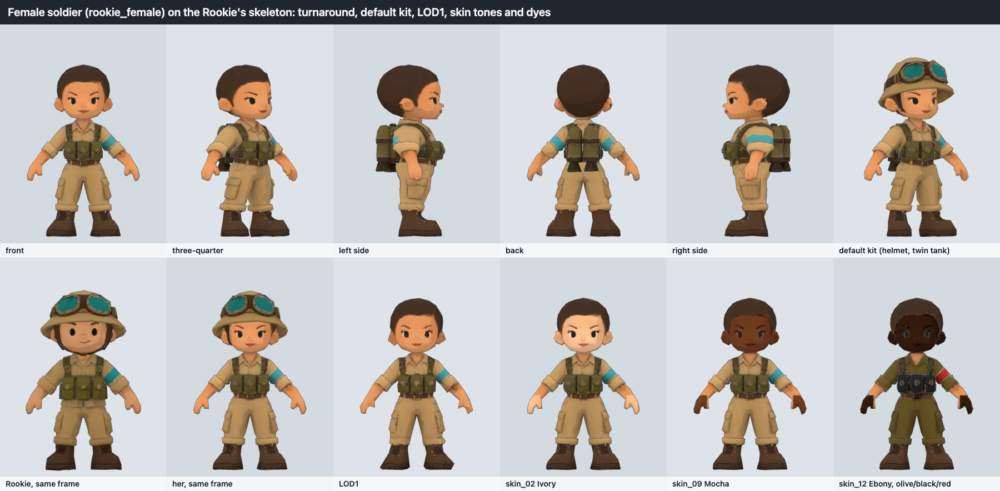
*Her turnaround with the Rookie at the same scale, her default kit, LOD1, three skin tones and a dye change.*

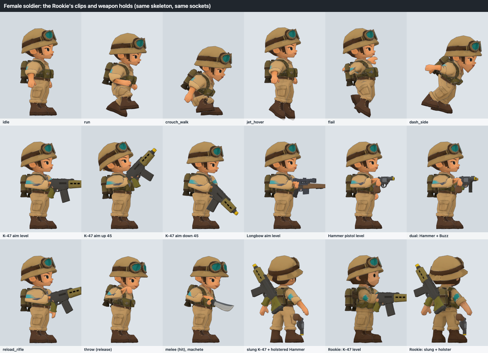
*The Rookie's clips and weapon holds on her: locomotion, jet, flail, dash, rifle aims at −45° / level / +45°, Longbow, pistol, dual, reload, throw, melee, and a slung rifle with a holstered pistol.*

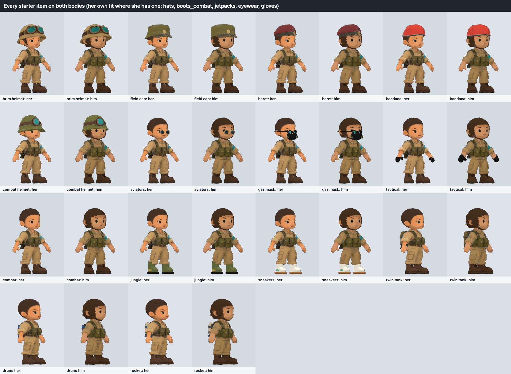
*Every starter item on her and on him. Her own fits: the five hats, the combat boots, the three jetpacks, both eyewear pieces and the gloves.*

The owner's 22 Oct ask: a female soldier players can pick, feminine but clearly a soldier, never sexualised, in the Rookie's style. She is a second base body on **the Rookie's exact skeleton**:
- the same bones, rest pose and sockets, so the same hitbox and every clip and weapon hold;
- her manifest, `characters/rookie_female/rookie_female.json`, shares his clips (it has no `anims`);
- content's `body_female`; the creator's assembler (`BODY_MANIFESTS.female` in `apps/web/src/character/assembler.ts`, #175) loads her manifest.

**Concept** (GPT Image 2.5 high 2k, 16:9; the Rookie's sheet A as the style reference):
- three variants of the prompt below: jobs `58a20fb0…`, `1fd29637…`, `24b131bc…`. All read as a boy with lashes.
- One edit of the third: job `66d25aef…`, [concepts/rookie_female_sheet.jpg](character/rookie_female/source/concepts/rookie_female_sheet.jpg). It gave her a softer face, longer lashes, lips, a slimmer neck and a belted waist, in the same modest uniform.

<details><summary>Prompts (exact text)</summary>

Sheet: "Character turnaround reference sheet for a 3D game model: a companion to the soldier in the reference image, in exactly the same art style (stylised 3D render, soft vinyl designer-toy look, light toon-shaded ramp, subtle hand-painted texture detail), the same chibi proportions, the same head size and height, the same A-pose and the same field uniform. This one is an original FEMALE soldier: clearly a capable, serious soldier, feminine but never glamorous or sexualised. A modest, loose-fitting uniform on a natural chibi body with slightly narrower shoulders and a belted waist; no curves emphasised. Big round face with a soft rounded jaw, simple dark dot eyes with short upper lashes, gentle determined eyebrows, a small calm confident smile, a small button nose, warm apricot skin exactly like the reference. Hair: short natural black hair cropped close to the scalp, neat and tight to the head, with a clean hairline; no bun, no ponytail, no braids, nothing sticking out from the head. BARE HEAD: no helmet, no hat, no goggles. Sand-khaki fatigues with the sleeves rolled above the elbow, a dark brown belt, olive chest webbing with three chunky pouches, a bright teal armband on the left upper arm, sand cargo trousers with the cuffs rolled once, dark brown lace-up boots. NO jetpack and NO backpack: her back shows only the shirt and the webbing straps. Palette: sand, olive, warm brown, with teal as the only saturated accent (the armband).

Layout: the SAME character shown three times side by side at identical scale and height, with wide empty gaps between them: front view, left side view (profile), back view. Orthographic, full body, neutral A-pose with arms angled about 30 degrees down and away from the body, feet shoulder-width apart, empty hands (no weapon, holding nothing). Chibi proportions like the reference: the head is about one third of the total height; short stubby limbs; chunky mitten hands with a separate thumb; big boots. Bold, simple, instantly readable silhouette. Clean flat light-grey background, soft even studio lighting, no cast shadows, no text, no labels, no logos, no watermarks, no insignia or national flags."

Edit (the third sheet as the reference): "Edit this character turnaround sheet. Keep EVERYTHING the same (the three views, their positions, scale and spacing, the A-pose, the vinyl toy style and texture, the sand uniform with rolled sleeves, the olive chest webbing with three pouches, the teal armband on the left upper arm, the brown belt, the rolled cargo trousers, the brown boots, the plain light-grey background, no jetpack, no helmet) but make the soldier read clearly as a young WOMAN, a capable serious soldier, never glamorous or sexualised: a softer, rounder, more feminine face with fuller cheeks and a slightly smaller chin, longer dark upper eyelashes on the dot eyes, gently arched eyebrows that still look determined, small soft rose-brown lips with a calm confident smile, a slightly slimmer neck, slightly narrower shoulders and a gently defined waist above the belt with a slightly fuller hip line, the uniform still loose and modest. Her hair stays short natural black hair close to the head, but with a soft rounded feminine shape and a neat curved hairline at the temples. Warm apricot skin as before. No text, no labels, no logos."

</details>

**3D:** `tripo_h3_1_multiview_to_3d` from the split views (`face_limit 30000`, texture on, PBR off), job `14f3e390…`. The output is [character/source/rookie_female_tripo_raw.glb](character/source/rookie_female_tripo_raw.glb), 28,546 tris.

### On the Rookie's skeleton (`build_character.py --skeleton`)

```bash
blender -b --factory-startup --python art/pipeline/build_character.py -- \
  art/character/source/rookie_female_tripo_raw.glb art/character/rookie_female --name rookie_female --body female --parts boots \
  --skeleton art/character/source/rookie.blend --height 1.44 --depth 1.14 --back-depth 1.6 --head-depth 1.2 \
  --runtime apps/web/public/assets
```

1. **Register her onto the Rookie** before rigging, so his skeleton fits her and she keeps her own build. Both arm axes are measured the same way on both raw meshes.
   - The hips line up front to back (2.0 cm).
   - Each arm turns and stretches about where it joins the torso onto his arm axis (11.9°, 0.277 → 0.283 m; girth kept), so her hands meet his grip sockets.
   - Her head scales (×0.958) to fit inside his hair cap with its crown at his.
   - The 1.5 % under the tightest fit keeps her nape hair clear of the long guns' stocks in the −45° holds.
   - **Her side silhouette fills the shared hitbox like his** (docs/04 §1.2, "no tiny skins"; the orchestrator's call, 23 Oct). On the same hitbox her first build covered 54–60% of it, against his 61–68% and the 60% floor. She was as tall as him, but flatter in the back and shallower in the head. Three depth-only steps fix that, leaving height and the front view as they were:
     - `--depth 1.14`: the whole body, front to back, from the knees to the neck. The arms keep theirs (thickened, her coarse hands fold at the wrist, and the gloves are built from them), and below the knees it fades out (the shared boots' shafts).
     - `--back-depth 1.6`: the upper back behind the spine, from the waist up (a push from the seat up made the hips bulge).
     - `--head-depth 1.2`: the head, backwards: the face stays where the guns' holds pass it, and the back of the head stays inside his (0.1 cm spare).
2. **Bind to his armature**, loaded from `rookie.blend` without its clips. Her landmarks give the skinning its girth; the joints are his.
3. **The rest is the Rookie's path:**
   - her generated boots split off as `boots_combat`'s female fit;
   - LOD0 / LOD1 at 2,349 / 999 tris with 512² / 256² bakes;
   - his dye rules (sand / olive / teal + the armband's team glow) and the skin weight in the dye albedo's alpha;
   - the strict envelope.
4. **Clips:** `clips.build_all` on his armature comes out key for key the same as `rookie_anims.glb` (all 34 bones' rest TRS and 444 tracks). The build fails if not. Her manifest has no `anims`, so the creator's assembler shares his clip library: one download for both bodies.
5. **Body regions** (6b, every body): a `_REGION` vertex attribute.
   - Hair (1) is the dark head texels above the brows or behind the ears. Top (2) and legs (3) are cloth that mostly follows the torso and arm bones, or the pelvis and leg bones. Skin stays 0.
   - Hairstyles, tops and trousers replace these (`hidesBody`); the manifest lists the codes.
   - Hers: 479 / 673 / 400 triangles at LOD0, 129 / 259 / 167 at LOD1.

**Coverage of the shared hitbox** (`check.py`'s side silhouette, the 60% floor; LOD0 / LOD1):

| Outfit | Rookie | Her first build | Her now |
|---|---|---|---|
| default kit (Brim Helmet, Combat Boots, Twin Tank) | 67 / 68 | 60 / 60 | 66 / 67 |
| Combat Helmet, Gas Mask, gloves, Jungle Boots, Rocket Pack | 66 / 65 | 58 / 57 | 66 / 64 |
| Bandana, Sneakers, Drum Pack | 66 / 65 | 58 / 57 | 66 / 64 |
| bare head, Combat Boots, Twin Tank | 64 / 64 | 56 / 56 | 63 / 63 |
| bare head, Sneakers, Rocket Pack | 62 / 61 | 55 / 54 | 62 / 61 |
| bare head, Sneakers, Drum Pack | 62 / 62 | 55 / 54 | 62 / 61 |

### Her fits of the shared items (`build_cosmetics.py --body female`)

```bash
blender -b --factory-startup --python art/pipeline/build_cosmetics.py -- \
  art/character/source/rookie.blend art/cosmetics --body female \
  --body-blend art/character/rookie_female/source/rookie_female.blend --runtime apps/web/public/assets
```

Each item is built exactly as for the Rookie, then fitted to her. The fits ship as `<id>_female[_lod1].glb` and the item manifest's `bodies.female`, and a Rookie rebuild keeps `bodies`.

| Item | Her fit | How |
|---|---|---|
| Combat Boots (default) | her own generated boots | split off her model |
| Twin Tank (default), Drum Pack, Rocket Pack | set on her back | where a pack sits closest to his back, it stands off hers by the same gap: −1.6 cm (twin tank), +0.5 cm (drum), −1.3 cm (rocket); the nozzles move with it |
| Aviators, Gas Mask | narrowed and flattened with her head about its centre (straps and arms meet a smaller head), then set on her face the same way | lenses +1.7 cm, mask plate +1.8 cm |
| Tactical Gloves | rebuilt from her hands, at each LOD | inflated along the normal, or straight out from the hand bone where her generated hand's faces are flipped; each shell's faces then turned outward. Over the pose sweep her skin stays inside: 4.8 mm worst at LOD0, 0 at LOD1 (6 mm allowed) |
| Brim Helmet (default), Field Cap, Beret, Bandana, Combat Helmet | narrowed with her head | scaled with her head box about its centre (×0.882 wide; front to back only as far as her envelope needs, never past the head ratio: ×1.000 now that her head is as deep as his; the crown stays at both crowns), squeezed into her envelope, then pushed out wherever her own hair comes through, at a vertex or through a face. On his head they overhung her first build's envelope by 3–4 cm front and back |
| Jungle Boots, Sneakers | none needed | the feet are shared |

### Checks
- **Web tests** (`apps/web/test/character/assembler.test.ts`):
  - every base body's manifest files exist;
  - her joints, their order and every bone's rest TRS equal the Rookie's (1e-4), and her manifest shares his clips (no `anims`);
  - every `bodies.<body>` fit names its files and sits on the same skeleton.
- **Head clearance:** `python3 tools/asset-check/head_clearance.py --body art/character/rookie_female/rookie_female_body.glb` passes 19/19 scanned weapons, like the Rookie.
- **Gloves (`poke_sweep`):** a skin vertex now counts as poking through only if a ray-parity test agrees it is outside the glove. The nearest glove face alone misread her LOD1 wrist: in the reload and idle poses the nearest face there is a folded or overlapping one, which read the skin as up to 10.7 mm outside, while rays from it cross the glove an odd number of times (inside). A real poke still fails the build; the parity test only drops these false readings, so the Rookie's gloves pass as before.
- **Asset check:** [her checks](character/rookie_female/checks/).


## Her hairstyles (22 Oct 2026)

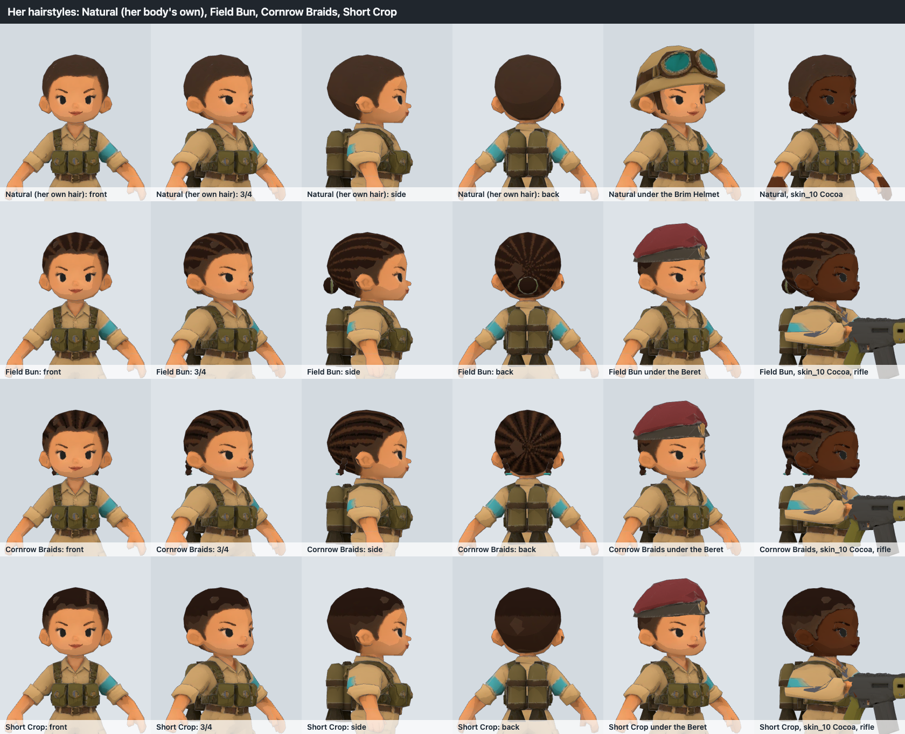
*Natural (her own hair), Field Bun, Cornrow Braids and Short Crop: four views each, under a Beret, and with another skin tone and a rifle held.*

Each style replaces her own hair. She wears a short natural afro, part of her mesh; that is `hair_body`, "Natural".
- **Hiding:** the style's manifest says `hidesBody: ["hair"]`, and the assembler drops the body triangles whose vertices all carry the `_REGION` hair code (479 / 129 at LOD0 / LOD1).
- **Under headgear:** a hat with `hidesHair` (the Brim Helmet, the Combat Helmet) hides the style instead, and her own hair shows under it. The Field Cap, Beret and Bandana sit over a style.
- **No hat:** content adds `headgear_none` "None" (wire 46, starter), so a style can be seen in full.

**Concept:** one sheet (GPT Image 2.5 high 2k, 4:3, her concept as the reference): job `a39c2d25…`, [concepts/hair_styles.jpg](cosmetics/source/concepts/hair_styles.jpg).

<details><summary>Prompt (exact text)</summary>

"Hairstyle reference sheet for a 3D game character: the same female soldier as in the reference image (same vinyl designer-toy style, same chibi head and face, same warm apricot skin, same sand uniform collar), shown as head-and-shoulders busts on a plain flat light-grey background. Three rows, one hairstyle per row, and in each row three views of the same head side by side with clear gaps: front, left side profile, back. Row 1, FIELD BUN: her black natural hair pulled back smooth and neat over the head into one round, compact bun low at the nape, held by a thin olive-green band; a neat practical military look. Row 2, CORNROW BRAIDS: neat straight cornrows running from the hairline straight back over the head, about seven raised rows, ending in two short thick braids that hang just to the nape, each tied with a small teal band. Row 3, SHORT CROP: a short tapered natural crop, about two centimetres of soft tight curls on top with a little more height at the front, the sides and back faded very short, with one clean shaved side part line. All three are original, practical, tidy hairstyles for a capable soldier; feminine but never glamorous. Hair is dark brown-black with soft toy-like sculpted volume, chunky readable shapes, no fine strands. No text, no labels, no logos, no extra people."

</details>

**Built in Blender** (`build_cosmetics.py --body female`, `hair_lod`), each LOD from that body LOD's own hair faces:
1. **Deflated toward the skull:** 1.8 cm, easing in over 3.5 cm from the hairline, where it stays exactly on the body's vertices. It meets her forehead, ears and nape with no seam.
2. **Styled:**
   - **Field Bun:** sleek, a few raised strands, one compact bun low at the nape with an olive band round it (secondary dye). The bun is placed from her own head, out as far as the strict envelope allows (7 cm), so the envelope never has to flatten it.
   - **Cornrow Braids:** eight rows straight back from the hairline, partings baked from a 3×-subdivided copy, and two short three-plait braids from behind the ears to the nape in teal bands (accent dye). At LOD1 each braid is one tapered plait with no band.
   - **Short Crop:** a soft top with a little height at the front, the sides and back faded short, one shaved side-part line.
3. **Decimated** to the hair it hides plus 50 / 40 triangles (`check.py` `REPLACES`). Only the scalp is decimated: the hairline stays on the body's vertices, and the bun and braids stay whole (a first build crushed the small closed bun to a sliver). Rigid to `head` like a hat.
   - LOD0 / LOD1 triangles: Field Bun 488 / 146, Cornrow Braids 450 / 163, Short Crop 494 / 129 (budgets 529 / 169).

Hair is painted, not dyed: a primary dye would recolour it with the uniform.

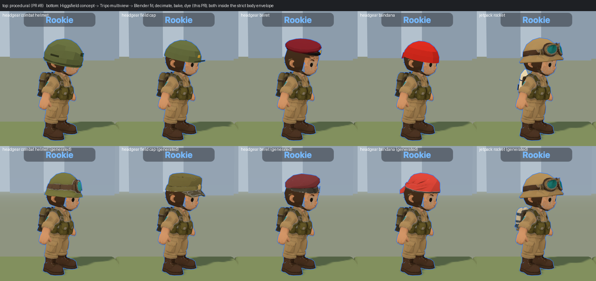
*Top: the procedural items from #8. Bottom: the same item ids rebuilt from Higgsfield-generated models, in the Rookie's painted vinyl style.*

The procedural starter items read cleaner and flatter than the painted Rookie (#8, gaps). Five of the most visible ones now come from generated models instead: **Combat Helmet, Field Cap, Beret, Bandana, Rocket Pack**. Ids, slots, budgets and manifests are unchanged, so the Locker and W2's renderer don't change.

**Pipeline** (sources in [cosmetics/source/](cosmetics/source/): the raw Tripo GLBs are the build inputs; the concept sheets are kept as 1600 px JPEGs for the record. The full-res sheets are on Higgsfield under the job ids below, and `split_sheet.py` regenerates the views):
1. **Concept turnaround** (GPT Image 2.5, high, 2k): front / left / back of the item alone, with concept A (the Rookie sheet) as the style reference. All are original designs: no insignia, logos or real brands.
2. **Split** with `split_sheet.py`. It now merges a pair's two pieces per view (boots).
3. **3D:** `tripo_h3_1_multiview_to_3d`, about 29k tris with a 2048² texture → `source/<id>_tripo_raw.glb`.
4. **`build_cosmetics.py`** uses a generated source whenever `source/<id>_tripo_raw.glb` exists (`--procedural` ignores them, `--only id,...` rebuilds a few):
   - **Fit:** the procedural item is still built first, and the generated model is scaled into its bounding box. Hats sit on the brim line; the beret's line is lowered onto the brow. Jetpacks go into the default jetpack's box.
   - **Strict envelope (docs/04 §1.2):** then the same `fit_envelope` as the procedural items runs. Overhangs are squeezed in: Field Cap front 4.3 / top 2.4 cm, Beret top 6.1, Bandana top 5.7 / back 0.2, Combat Helmet top 0.8. Jetpacks would be scaled about their backplate; the Rocket Pack already fits inside the (fitted) default jetpack's box.
   - **Head clearance:** after the envelope fit, crown vertices that dip into the hair cap are pushed back out, so a squeezed crown never sinks into the hair. The hat's underside stays: it is hidden inside the head, and a closed mesh decimates cleanly. Pinholes are filled.
   - **LODs:** LOD0 decimates the source to the slot budget (450 headgear / 550 jetpack). LOD1 decimates LOD0 (200 / 250), is clamped to LOD0's bounds, and falls back to a voxel remesh when the generator's non-manifold fins stall collapse decimation (the beret).
   - **Bake:** fresh UVs, then the generated albedo is baked with metallic zeroed (badges and lenses), like the Rookie's body. LOD1 bakes from LOD0.
   - **Dye masks:** per-item colour rules (`rules_*`). Texels the bake didn't reach are never dyed. The Combat Helmet came out sand-coloured like the default Brim Helmet, so its default primary dye is overridden to olive drab and its albedo repainted to match.

| Item | LOD0 / LOD1 tris | Default dyes (primary / secondary / accent) |
|---|---|---|
| Combat Helmet | 449 / 199 | olive drab / brown strap / teal lens |
| Field Cap | 450 / 200 | olive / dark peak / gold badge |
| Beret | 448 / 200 | maroon / dark band / gold badge |
| Bandana | 448 / 200 | red / dark hem |
| Rocket Pack | 550 / 250 | cream / navy / brass |

Every item passes `--kind part` at both LODs (slot budget, skin, strict envelope, dye round trip), and so do the worst-case outfits ([checks](cosmetics/checks/)). Measured against the bare body, all 28 parts are inside.

**Not built yet: Drum Pack, Jungle Boots, Sneakers.** Their concept sheets are done and paid for (in `source/concepts/`), but this session's permission check blocked the Tripo step as a purchase. Each needs one more `tripo_h3_1_multiview_to_3d` run (9 credits, 27 in total), and then `build_cosmetics.py --only ...` picks them up with no code changes. Until then they stay procedural. Eyewear and gloves stay procedural on purpose: at 150 tris there's nothing a generated model would add.

**Spend: 69.75 credits.** That's 9 concept images × 2.75 (8 items plus a re-roll of the sneakers, whose first side view showed the two shoes pointing opposite ways) and 5 Tripo models × 9. The Higgsfield balance went from 786.28 to 716.53. Job ids:
- concepts: helmet `e6008b0f…`, cap `5a172851…`, beret `ac3fa9be…`, bandana `8591f551…`, rocket `fa5a003f…`, drum `9873d27e…`, jungle `71c181ad…`, sneakers `b60a2a0c…` (first try `a9bc5f67…`);
- 3D: helmet `e8020e60…`, cap `625d8296…`, beret `e2ccc5a6…`, bandana `3bfac805…`, rocket `b49a88ec…`.

## Street Market: map kit + map (docs/01 §7, map 4)

A generic market street (no real place: invented, region-neutral signage, a plain two-tone minibus), built for the same collision workflow as the movement-test map. The gameplay layout is docs/01 §7's map 4: dense rooftops, minibuses, stalls, awnings.

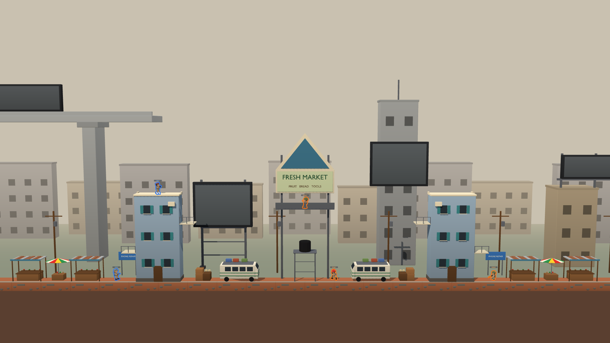
*The centre ~83 m at 7× (the widest zoom): stalls and minibuses on the ground, balconies and 12 m roofs, the tank tower and the billboard catwalk in the middle; behind, the ad Screens and Hoardings (mid layer) and the far blocks.*

| | |
|---|---|
| 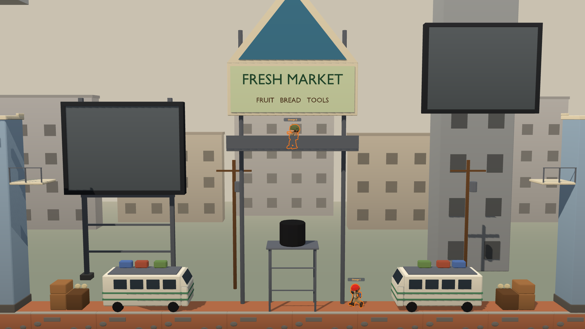 *1×, centre: minibuses, tank tower (deck 4 m, tank top 5.4 m), catwalk at 10 m under the solid billboard panel (2 m headroom)* | 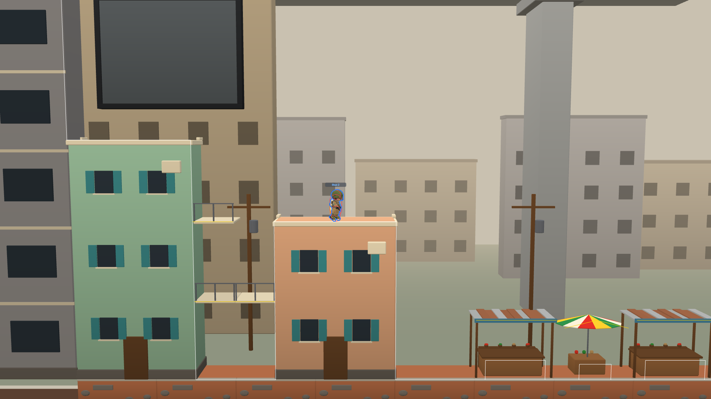 *1×, west side with `hitboxes=1`: terrain skyline and edge wall (white), one-ways (yellow), solids* |

**Render = collision (docs/11 §2).** Each kit piece carries its gameplay collision in glTF extras, in piece-local metres. `art/pipeline/compile_map.py` places the pieces from a layout and writes a `packages/content` **MapDef** (`types.ts` shape) and the map's **AdSlot list** (docs/14 §4.2), so the sim, the renderer and the ad system read the same numbers:

| Extra | Meaning | In the MapDef |
|---|---|---|
| `terrain: [[x0, x1, h]]` | a rectangle standing on y = 0 (ground blocks, houses, edge blocks) | merged with the ground into **one terrain polygon** whose top is the skyline, like `movementTest` (no internal edges to snag on) |
| `solids: [[x, y, …]]` | free-standing CCW polygons (stall counters, minibus bodies, tank, billboard panel) | one solid each |
| `oneWays: [[ax, ay, bx, by]]` | drop-through ledges (awnings, balconies, tower deck, catwalk, the umbrella's two 15° slopes) | `oneWays` |
| `blocksBullets` | the piece's one-ways stop bullets (every piece's do since the 23 Oct QA) | `blocksBullets` on its one-ways |
| `bulletOnly: [[x, y, …]]` | thin parts that stop bullets but not bodies: stall posts, the umbrella pole, tank tower legs and braces, billboard masts and the catwalk's front plate, balcony handrails (`bulletOnlyMaterial` when not the piece's material) | `bulletOnly` polygons |
| `layer` | `gameplay` / `mid` / `far` (docs/11 §2) | only `gameplay` pieces collide; `mid`/`far` go in the layout's `decor` |
| `material` | sim material id (0 concrete, 1 metal, 2 wood, 3 dirt) | solid `material` |
| `noFlip` | the piece has lettering | the layout may not mirror it |
| `adSlot` | on Screen / Hoarding bezels: `kind`, `format`, `size`, `frames`, `centre` of the creative | one AdSlot per bezel placed with a `slotId` |

**Kit** (`art/pipeline/build_market_kit.py` → [kits/street_market/kit_street_market.glb](kits/street_market/)): one node per piece, one shared vertex-colour material, single-sided (`doubleSided: false`). Within 0.35 m of the gameplay plane (the capsule radius) nothing is drawn outside the collision: produce and sacks sit behind the plane, the minibus carries nothing on its roof rack, balconies have a front handrail instead of end plates across the walkway, parapet lips are at the back.

| Piece | Layer | Tris | Collision |
|---|---|---|---|
| `sm_ground_4m` | gameplay | 336 | terrain 4 m at y 0 |
| `sm_stall_4m` | gameplay | 1,544 | counter solid 1.0 m, awning one-way 3.05 m (blocks bullets) |
| `sm_umbrella_stall` | gameplay | 360 | counter solid 0.8 m, canopy one-ways 2.65 → 3.05 → 2.65 m (it follows the cone) |
| `sm_minibus` | gameplay | 752 | body solid from the ground (the 0.35 m under it let bullets and rolling grenades through: 23 Oct QA) with the sloped front drawn to match, roof 2.3 m; the rack lies flush on it (the luggage that stood 0.5 m above the walkable roof is gone: environments review L15) |
| `sm_crates` | gameplay | 260 | one stepped solid, 1.0 / 1.6 m |
| `sm_tank_tower` | gameplay | 332 | deck one-ways at 4 m either side of the tank solid (top 5.4 m) |
| `sm_billboard` | gameplay | 550 | catwalk one-way at 10 m; panel solid 12–15.2 m with a 51° gable to 20.2 m (too steep to stand on). House-only (never sold) |
| `sm_house_2f` / `_3f` / `_3f_blue` | gameplay | 976 / 1,356 / 1,356 | terrain roof 8 / 12 m, balcony one-ways at 4 / 8 m |
| `sm_edge_block` | gameplay | 872 | terrain 54 m: the map's side walls, up to the ceiling |
| `sm_screen_8x6`, `sm_hoarding_18x3`, `sm_hoarding_21x3_5` | mid | 232 each | none; `adSlot` (docs/14 §2.1: Screen 4:3 × 6 frames, Hoarding 6:1) |
| `sm_junction_block`, `sm_screen_tower`, `sm_screen_mast`, `sm_flyover`, `sm_east_block` | mid | 324 / 220 / 212 / 264 / 588 | none: the structures the bezels hang on |
| `sm_signboard` (noFlip), `sm_power_pole` | mid | 215 / 156 | none |
| `sm_far_block_a` / `_b` | far | 216 / 168 | none |

**Map** ([maps/street_market/layout.json](maps/street_market/layout.json) → [street_market.map.json](maps/street_market/street_market.map.json) + [street_market.adslots.json](maps/street_market/street_market.adslots.json)): id `street-market`, bounds 128 × 62 m: 120 m of play between the edge walls, and the top 2 m of the bounds is a ceiling slab. Mirrored halves: houses at the edges, then stalls, the blue 3-storey, crates and minibuses toward the middle, with the tank tower and billboard in the centre. 50 gameplay pieces + 31 decor (81 placements, 35,612 tris; 30 piece/flip pairs, so 30 instanced draws), 14 spawns, walkable heights 0 → 12 m. Palette: sky `#c9c1b0`, fog `#cbbfa8`.

**Ad surfaces** (docs/14 §2.3 placements, z per the table there): S1 junction Screen (x −57, z −6), H1 flyover Hoarding 21 × 3.5 (x −47, z −8), S3 mast Screen over the west minibus (x −12, z −5), S2 tower Screen (x 14, z −7), H2 rooftop Hoarding across two buildings (x 47, z −6) and S4 gantry Screen next to it (x 58, z −6). Positions were searched against compile_map's view lints, below; screens get phase offsets 0–3.

```bash
B=/Applications/Blender.app/Contents/MacOS/Blender
$B -b --factory-startup --python-exit-code 1 --python art/pipeline/build_market_kit.py -- \
   art/kits/street_market/kit_street_market.glb --runtime apps/web/public/assets/kits/street_market/kit_street_market.glb
python3 art/pipeline/compile_map.py art/maps/street_market/layout.json
$B -b --factory-startup --python-exit-code 1 --python tools/asset-check/check.py -- art/kits/street_market/kit_street_market.glb --kind kit
```

Checks:
- **asset-check `--kind kit`:** 83 pass, 0 warn, 0 fail on the source and the runtime GLB ([report](kits/street_market/kit_street_market.check.txt)). New rows: **render = collision on the gameplay plane** (samples every triangle within 0.35 m of the plane and fails on any region ≥ 0.15 m drawn more than 0.1 m outside the piece's collision; thin, shallow poles are allowed), **team-colour contrast** (gameplay vertex colours ≥ 25 ΔE from team blue `#2f7dff` and orange `#ff7a1a`; the old orange billboard measured 16) and **ad surface off the gameplay plane**. The previous version of this kit fails 10 of these rows (luggage, produce, sacks, umbrella canopy, billboard, balcony end plates, the orange panel); this kit passes all. The yard kit passes 13/13; selftest 30/30 (3 new kit cases).
- **`compile_map.py`** fails the build on:
  - unknown pieces, non-gameplay pieces in `pieces`, gaps in the ground;
  - a play space open at either edge (the skyline must reach the ceiling);
  - overlapping solids, solids sunk into terrain or reaching the ceiling, one-ways inside solids;
  - spawns not standing on a walkable edge (terrain top, a solid edge ≤ 50°, a one-way) or whose 0.32 × 1.5 m capsule overlaps terrain or a solid;
  - < 12 spawns, < 3 vertical layers;
  - any clear eye-to-eye line ≥ 60 m between standing spots (docs/01 §7: sightlines ≤ the Widow's range). This map: 0 of 195 spots;
  - a flipped `noFlip` piece;
  - AdSlot lints (docs/14 §2.6): z ∈ [−9, −4], no collision, not mirrored, unique `street-market/<slot>` ids (1); 2.5–8% of the screen at 1× and ≥ 1.5% at 4× (2); from every standing spot, with the camera clamped to the bounds, ≤ 2 surfaces in a 1× view and ≤ 4 / ≤ 8% at 7× (4; a surface counts when ≥ 50% of it is on screen, the IAB rule §4.6 measures with). This map: ≤ 2 at 1×, ≤ 4 and 3.9% at 7×.
- **In the sim** (W6's code on main, run locally, not committed): the review's fuzz harness, 8 players × 15 sim-minutes of random input: **0 deaths by falling out of the map** (61 per hour before the walls), 0 player-ticks out of bounds, 0 ticks with solid penetration. Every one-way lands and drops through; the umbrella slopes hold a standing player at 2.86 m.
- **Viewer:** `?map=street_market&zoom=1&cx=-46&cy=9&hitboxes=1` draws the kit from the layout with the collision on top. The map path is the reference for W1: one `InstancedMesh` per (piece, flip), mirrored pieces get their own geometry with the winding reversed (no DoubleSide).

In the game: `packages/content/src/maps/streetMarket.map.json` is a copy of `street_market.map.json` (content.test.ts checks they match; the kit marks the floor slabs, the balconies, the tank deck and the catwalk, `blocksBullets`, and compile_map.py writes it onto their one-ways), and the web build draws `kits/street_market/kit_street_market.glb` from the same layout (apps/web/src/render3d/environment). docs/01 §7 and docs/14 §2.3/§2.4 call the map the Street Market and its slots `street-market/S1`…`S4`, `H1`, `H2`.

Gaps:
- **Breakable awnings** (docs/01 §7) need a sim feature; the awning one-ways are separate segments, so they can be removed individually once there is one.
- The ad bezels show a grey placeholder where the creative goes; the house pool and the array-texture renderer are W1's (docs/14 §4.5). Lint 3 (facing) holds by construction (every slot faces the camera); lints 5–8 need the playtest heatmap and other systems.
- No props pass yet (bunting, generators, crowd cut-outs); the decor layer has room for them.

## Milestone A: clips, aim poses, jetpack part, dye masks

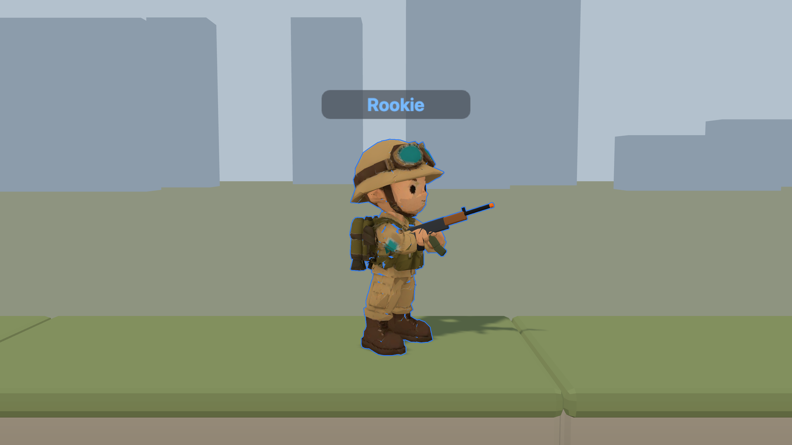

| | |
|---|---|
| 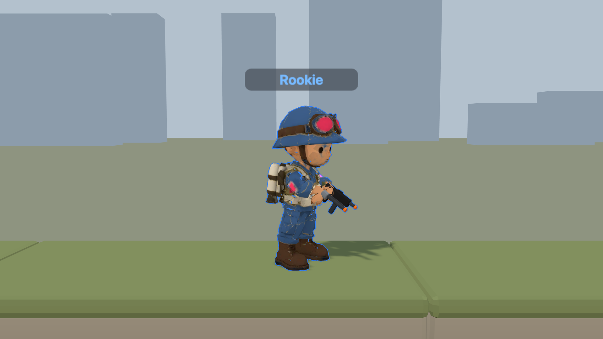 *Dual pistols aimed −30°, dyed navy / bone / red: the dye masks recolour uniform + helmet, gear + jetpack tanks, and goggles + armband* | 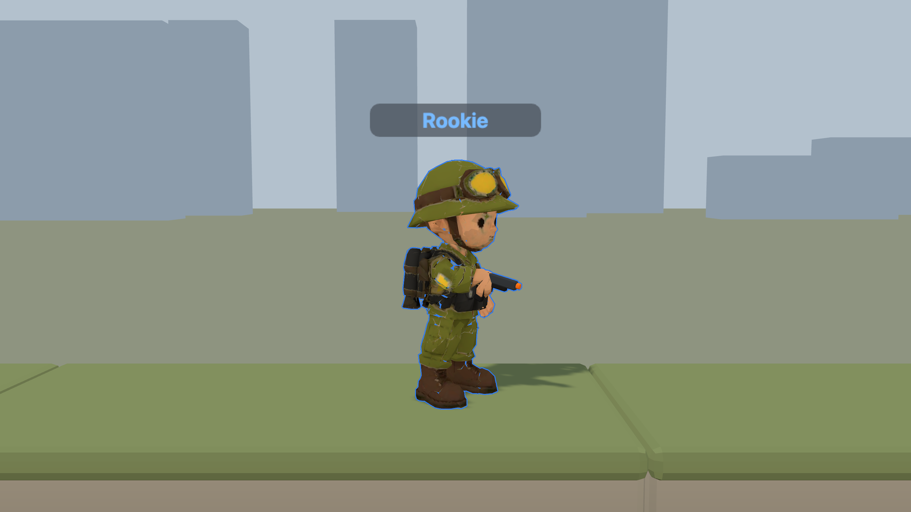 *Pistol aimed −10°, dyed olive / black / yellow* |

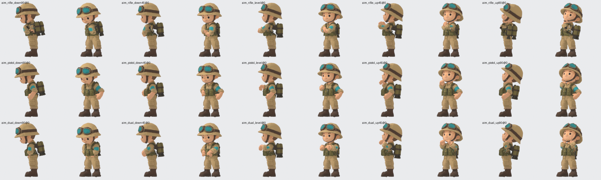
*Aim poses (profile + three-quarter): rifle, pistol and dual at down90 / down45 / level / up45 / up90. The renderer blends the two poses around the aim angle.*

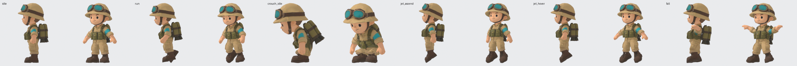
*idle, walk, run, crouch_idle, crouch_walk, jet_ascend, jet_hover, fall, land, reload_rifle, reload_pistol, swap, throw (wind-up, release), melee.*


*1× zoom at 1080p: every soldier is armed and aiming through the aim layer; flames on the jet clips.*

### What ships (`apps/web/public/assets/`)

```
characters/rookie/
  rookie.json              manifest: LODs, anims, dye textures + default dyes, clip list, upper-body bones, aim angles
  rookie_body.glb          LOD0 body: 3,300 tris, 512² albedo; no jetpack, no clips
  rookie_body_lod1.glb     LOD1 body: 1,450 tris, 256²
  rookie_anims.glb         shared skeleton + 39 clips (no mesh; 3 from motion capture, see "Motion capture")
  textures/                rookie_body[_lod1]_dye_mask.png, _dye_albedo.webp
cosmetics/jetpack/
  jetpack_twin_tank.json   slot jetpack, attachBone spine2, socket_jetpack
  jetpack_twin_tank[_lod1].glb   600 / 300 tris, 256² / 128²
  textures/
```

- **Compression:** GLBs use `EXT_meshopt_compression` and `EXT_texture_webp` (the loader needs `setMeshoptDecoder`). **KTX2 isn't done:** it needs KTX-Software's `toktx` installed on this machine (a user install), so textures ship as WebP/PNG until then.
- **Parts (docs/04 §9.3):** every part GLB is authored in character space and carries the shared skeleton; it is **not** parented to a socket. Rigid parts (the jetpack now; headgear and eyewear later) are weighted 100% to one bone (`attachBone`), so they bind to the body's skeleton or merge into one SkinnedMesh (docs/04 §5.3). The viewer's `assemble()` is the 10-line reference.
- **Dye masks (docs/04 §5.4):** R = primary (sand uniform + helmet), G = secondary (olive webbing, pouches, jetpack tanks), B = accent (teal goggles + armband), A = team glow (armband). `*_dye_albedo` has the dyeable texels neutralised so `albedo × lerp(1, dye, mask)` with the default dyes (in the mesh extras and `rookie.json`) gives back the painted look. The GLB's own albedo stays the undyed original. The asset check verifies that round trip on every part (review fix: the first WebP exports went through Blender's AgX view transform, so dyed areas came out ~40% darker). The viewer's `dyeMaterial()` is a 10-line reference shader.

### Clips (`rookie_anims.glb`, 30 fps, in place)

| Kind | Clips | Tracks |
|---|---|---|
| Locomotion (loops) | idle 2 s, walk 1 s, slide 0.4 s (held), jet_ascend 0.8 s, jet_hover 1.2 s, fall 0.67 s | the bones each clip keys |
| Locomotion with planted feet (loops) | crouch_idle 2 s, walk_slow 0.7 s (0.5 m/s), run 0.33 s (5 m/s), crouch_walk 0.4 s (2.2 m/s) | pelvis, legs, spine, arms |
| One-shots | land 0.3 s (dip; play over locomotion), land_hard 0.5 s (falls over ~10 m/s) | legs, pelvis, spine, head (land_hard: arms too) |
| Action poses | flail 0.6 s (blast-launch loop), dash_side, dash_up, dash_down, brake (single-frame poses) | full body |
| Aim poses | `aim_<pistol|dual|rifle>_<down90|down45|level|up45|up90>` | upper body only: spine1/2, neck, head, clavicle/upperarm/forearm/hand _L/_R |
| Upper-body actions | reload_rifle 1.6 s, reload_pistol 1.0 s, swap 0.5 s (swap the mesh at 50%), throw 0.6 s (release ≈55%), melee 0.47 s (hit ≈45%) | upper body only |

Aim poses exist for 3 of the 8 docs/04 §4.2 families. Until the others get their own, `rookie.json` `aimPoseFallback` maps shotgun, sniper, launcher and heavy to the rifle set, and melee and thrown to the pistol hold. Weapons also carry `aimPose` directly.

How to layer them (what the viewer does): when armed, play locomotion with its upper-body tracks removed; weight the two aim poses around the angle by (1 − t, t) × (1 − actionWeight); fade actions in over 0.08 s and out over 0.12 s; time-scale reloads to the weapon's reload time.

Aim poses and actions are **solved, not hand-keyed**: each key says where the grip goes and where the gun points, and two-bone IK places the arms. Chibi arms reach only ~0.32 m from shoulder to grip, so the holds centre on one point just in front of the chest pouches with both shoulders protracted. That has two consequences for other workstreams:
- **W5/W1:** a weapon's `offhand` node must sit **within 0.10 m of the grip** (docs/04 §9.4, enforced by the weapon check). The default `socket_offhand_IK` sits 0.07 m ahead.
  - The rifle aim poses are solved per angle (`clips.RIFLE_HOLD`) so the left hand can actually reach those targets. Chibi arms reach 0.27 m from the shoulder to the wrist.
  - `build_character.py` asserts the reach in every rifle pose and fails the build if it breaks. Worst margins today: 1.2 cm to `socket_offhand_IK`, and 2.7–3.4 cm to the offhand nodes of the K-47, Breacher, Widow, Thumper and Shredder.
  - The review measured the old poses 3.4–7.5 cm out of reach, with the left arm locked straight.
- **W1:** the guns sit at ~0.76 m (chest) while the sim's aim pivot is 1.08 m (docs/02 §6). Draw tracers from the weapon's `muzzle` node to the hit point.

### Motion capture (23 Oct 2026, the animation agent; docs/design/character-feel-research.md §5.2, §5.3)

The owner approved the free sources on 23 Oct: the CC0 sets, the CMU database and 100STYLE. Mixamo, the Rokoko form and anything paid are not approved.

- **The pipeline:** [pipeline/mocap.py](pipeline/mocap.py) and the recipes in [pipeline/mocap_clips.py](pipeline/mocap_clips.py). They're plain Python with numpy, not Blender.
  1. **Read:** BVH, ASF/AMC or glTF.
  2. **Retarget onto shared-v1:** each bone takes its source bone's direction and twist, matched as whole frames against the rig's rest, so a T-pose source lands right on the A-pose rig. The hips' height is scaled by leg length.
  3. **Plant the feet:** two-bone IK, either held where they come down or marching (a planted stance like `clips.gait`).
  4. **Stylize:** stand the spine and head up, and push arms and spine ×1.3 (§5.3).
  5. **Bake:** append LINEAR, sign-continuous 30 fps clips to `rookie_anims.glb`. Every other clip stays byte for byte; `test_mocap.py` checks that and the maths.
- **Run it after `build_character.py`:** `python3 -I art/pipeline/mocap_clips.py --data <dir>`. It replaces the clips it makes and rewrites the runtime copy and `rookie.json`'s clip list. Both bodies share this library: the female rig has the same skeleton, and her manifest has no `anims`.
- **Raw data never enters the repo.** Each pack is downloaded into its own directory outside it. The repo keeps the recipes, the clips they make, the provenance (`character/rookie_mocap.json`) and the licences below.

| Clip | What | Source | Licence |
|---|---|---|---|
| `walk` (replaces W8's unplanted walk) | 100STYLE's neutral walk, one straight cycle (frames 1168–1250): the hips, spine and arms, and its timing. The feet are planted: down 55% of a 0.4 s cycle, sliding back at 1.2 m/s, with 5 cm of lift. The toes stay out of the floor. | 100STYLE `Neutral/Neutral_FW.bvh` | CC BY 4.0: credit line in the game |
| `idle_shift` | weight shifting from foot to foot; 4 s loop, feet planted | CMU `140_07` (Idle), 0–4 s | CMU: free for all uses, not to be resold as data |
| `idle_look` | looking around; 4 s loop, feet planted | CMU `140_07` (Idle), 6–10 s | as above |

**Credits** (also served at `/licenses/motion-data.txt`):
- "100STYLE dataset by Ian Mason, Sebastian Starke and Taku Komura, licensed under CC BY 4.0 (https://www.ianxmason.com/100style/)."
- "The data used in this project was obtained from mocap.cs.cmu.edu. The database was created with funding from NSF EIA-0196217."

### Clips for the animation stream (18 Oct 2026, animation-clip-asks.md)

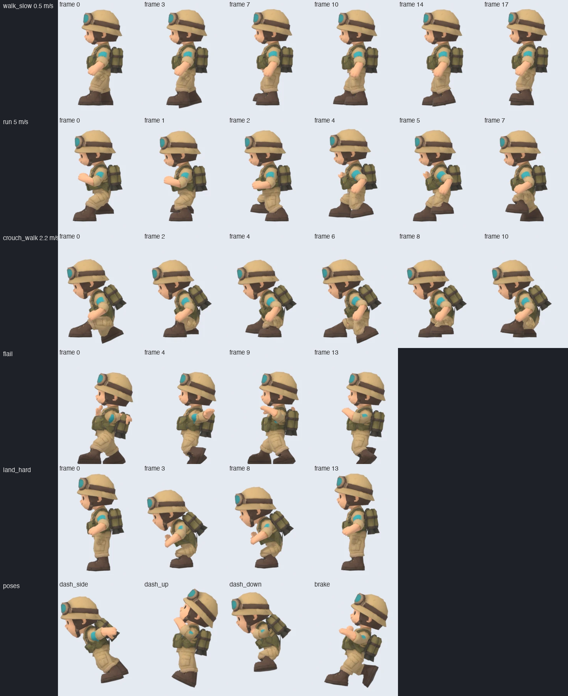

- **The wobble fix:** the old export wrote CUBICSPLINE samplers whose quaternion tangents were identity quaternions (1,789 of 1,874), so bones wobbled between keys; the idle's pelvis bowed ±11°.
  - `clips.bake_linear` now resamples every clip at each frame (Blender's own curves, quaternions renormalised) as LINEAR keys, and the exporter writes LINEAR samplers. All 444 samplers in the 37 clips are LINEAR, and the client's `clipRepair.ts` becomes a no-op.
  - Each clip still carries only the bones it keys, so upper-body clips keep layering. Constant channels keep two keys. The runtime file grows from 183 KB to 218 KB, mostly from the seven new clips.
  - Every pre-existing clip is unchanged at its key times, checked against a rebuild of the previous code. That includes all aim holds and actions, and the reach margins above.
- **`--kind clips` in the asset check** (review L7): it reads an animation GLB straight from the file and fails on EXT_meshopt_compression (its QUATERNION filter normalises zero CUBICSPLINE tangents and rewrites the signs: the original wobble), on any non-LINEAR sampler, and on any rotation track with consecutive keys of negative dot. The art and runtime `rookie_anims.glb` pass; the selftest adds a flipped key and a meshopt flag, which fail.
- **Sign continuity (M4 review):** the exporter derives each bone's quaternion from a matrix per key, so its sign came out arbitrary: 12 consecutive key pairs had a negative dot, in crouch_walk, flail, land_hard, melee and throw. `build_character.sign_continuous_rotations` negates those keys in the exported GLB, so no track turns the long way when an engine blends or lerps component-wise. Every key keeps the same rotation (all 431 tracks match up to sign). The clips are no longer meshopt-compressed, because meshopt made them larger (218 → 179 KB).
- **Planted feet** (`clips.gait`, leg IK in `clips.LegSolver`): `walk_slow`, `run` and `crouch_walk` are solved, not hand-keyed, and keyed at every frame.
  - `crouch_idle` (`clips.crouch_hold`) holds both feet flat at 0.12 m for the whole loop (measured: zero slide), with a slow weight shift from foot to foot and breathing in the back.
  - The phase starts with the left foot touching down.
  - During the stance the ankle stays at its rest height (0.12 m) and slides back at exactly the sim speed. In the swing it lifts and eases forward.
  - Toe-off rolls about the toe (review L6): pitching the heel up about the ankle used to sink the toe joint 5–7 cm into the floor for a frame per step (crouch_walk −0.037 m, walk_slow −0.019 m; flat is +0.030). The ankle now rises until the toe joint is back at its flat height. Lowest toe joint now: +0.030 m in crouch_walk, walk_slow and run (flat), with the stance ankle still at 0.120 m.
  - The pelvis drops so the short legs (hip 0.46 m, leg 0.35 m) reach the stride.

  | Clip | Speed | Cycle | Stance per foot | Planted slide (measured) | Stride |
  |---|---|---|---|---|---|
  | walk_slow | 0.5 m/s | 21 frames (1.43/s) | 60 % | 0.48–0.51 m/s, 13 frames at 0.120 m | 0.21 m |
  | run | 5 m/s | 10 frames (3/s) | 22 %, with a flight phase | 4.98–5.01 m/s | 0.36 m |
  | crouch_walk | 2.2 m/s | 12 frames (2.5/s) | 50 % | 2.19–2.22 m/s | 0.44 m (was ~5 cm) |

  At 5 m/s a chibi stance lasts only about 2 frames at 30 fps; the client's foot IK keeps it planted between samples.
- **Action poses:**
  - `flail`: arms windmilling out of phase, legs kicking;
  - `dash_side`: stretched along the dash, arms back;
  - `dash_up`: reaching forward and up (straight up hides behind the helmet);
  - `dash_down`: knees tucked, fists up for the slam;
  - `land_hard`: a deep squat;
  - `brake`: leaning back, front foot planted, arms out for balance.
- **Authoring order matters:** each finished clip goes onto an NLA track, and the IK-solved upper-body clips are solved against that stack. The new clips are authored after them, so every shipped hold stays identical. Moving them earlier changed the holds by up to 24°.

### Skin weight in the dye albedo (18 Oct 2026, animation-clip-asks.md §4)

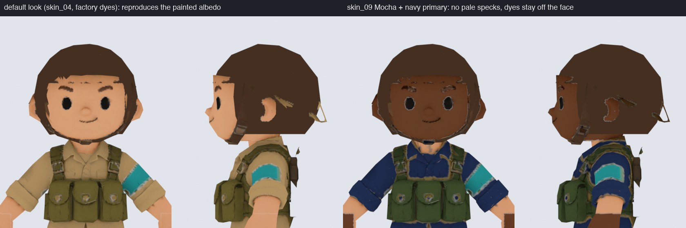

- **The face is out of the dye mask.** Nothing above the collar takes a dye any more.
  - Before, face texels (cheek highlights, around the mouth and eyes) shared the sand hue and landed in primary (R). They showed as pale specks under dark skin tones.
  - Skin texels that fell in a dye channel went from 7,869 to 348; the rest are soft borders at the cuffs.
- **Skin weight in `rookie_body*_dye_albedo` alpha** (`dye.rookie_body_skin`):
  - Which texels count: on the head, every warm light texel (skin, lips, and the sand the source baked along the hairline and ears); on the hands, only skin hues, so the sleeve cuffs stay cloth.
  - Skin texels store the painted colour divided by **2 × skin_04 `#da9f75`** (`skinHeadroom: 2`), per channel and in linear space. `dyeAlbedo × lerp(1, 2 × skinTone, alpha)` gives back the painted skin with skin_04, and any other tone keeps the lips' and cheeks' warmth. This is the animation stack's shader (`dyeMaterial.ts`, `SKIN_HEADROOM = 2`); with 1× it rendered skin 2× too bright (review H1). The headroom also keeps the highlights: a texel up to twice skin_04 in a channel fits the 8-bit texture, where 1× clipped 3.6 % (LOD0) and 6.0 % (LOD1) of skin texels.
  - The weight softens outward only, so a skin texel at partial weight can't keep a bright neutral colour and show as a pale outline. It also extends 3 texels into the atlas gutter, so UV seams don't fringe.
- **Alpha is floored at 1/255:** lossy WebP rewrites the colour under fully transparent texels. At the darkest tone the floor tints a non-skin texel by under 0.4 %. The runtime WebP keeps its alpha (minimum 1).
- **Flags:**
  - `rookie.json`: `dye.lod0/lod1.skin: "alpha"`, `skinNeutral: "#da9f75"` and `skinHeadroom: 2`;
  - glTF extras on the body: `dyeSkin: "alpha"`, `skinNeutral` and `skinHeadroom`.
  - The asset check's dye round trip counts the skin weight like a dye channel, through `lerp(1, skinHeadroom × skinNeutral, alpha)`; both LODs pass.
- **Defaults shift:** with the face gone, the primary's median moves slightly: `#b99664` → `#b29161` (LOD0).

### Budgets (assembled outfit: body + default jetpack)

| | Target (docs/04 §5) | LOD0 | LOD1 |
|---|---|---|---|
| Triangles | ≤ 4,000 / ≤ 1,800 | **3,900** | **1,750** |
| Draw calls | 1–3 | **2** (body, jetpack) | **2** |
| GPU textures (KTX2 estimate, albedo + dye masks) | ≤ 1.5 MB | **0.62 MB** | **0.16 MB** |
| Download (meshopt GLB + WebP + PNG masks) | — | body 461 KB, jetpack 67 KB, anims 176 KB, textures ≈ 0.6 MB | |

Reports: [rookie_outfit.check.txt](character/rookie_outfit.check.txt) (**40/40**), [rookie_outfit_lod1.check.txt](character/rookie_outfit_lod1.check.txt) (**40/40**), [jetpack_twin_tank.check.txt](cosmetics/checks/jetpack_twin_tank.check.txt) (**18/18**). The shipped runtime files pass the same check. `tools/asset-check/selftest.py`: **18/18**.

How the dye albedo is built (`dye.finish`):
- Dye defaults keep each channel's median hue at its 98th-percentile brightness, so the neutral grey (`lum / lum(default)`) stays ≤ 1 for all but the brightest 2% and highlights survive. A median default clipped them. On soft edges where the exact inverse would need a value above 1 (a bright colour next to a dark channel), the mask is capped so the default look is still reproduced exactly.
- In the mask core the dye albedo is that neutral grey.
- On the soft mask edges it is the exact inverse of the shader in linear space, `albedo / Π lerp(1, default, mask)`. A grey blend there rendered every island border 1.2–1.7× too bright.
- Undyed texels keep the albedo.
- With the default dyes, the round trip is now p95 0.005–0.007 linear luminance on dyed texels and exact on undyed ones.

`art/character/rookie.glb` and `rookie_lod1.glb` (the Phase 0 export) stay in place. W1 and W2 build against them until they switch to `characters/rookie/`, which will be a coordinated change later.

### Rebuild

```bash
blender -b --factory-startup --python art/pipeline/build_character.py -- \
  art/character/source/rookie_tripo_raw.glb art/character --name rookie --facing +x --runtime apps/web/public/assets
```

About 10 s on this machine. `blender` is `/Applications/Blender.app/Contents/MacOS/Blender` (5.2.1). Steps:
1. **Normalise:** face glTF +Z, 1.50 m tall, feet on y = 0.
2. **Landmarks → skeleton:** measure the full-res mesh and place the shared skeleton, the 7 sockets, and `sling_back` and `holster_thigh` for slung and holstered weapons ([rookie_rig.json](character/rookie_rig.json); docs/04 §9.3).
   - A weapon mounts on either with an identity transform, as on `socket_weapon_R`.
   - `sling_back` (spine2) holds a long gun on its side across the back: muzzle up over the left shoulder, right side against the back, between the jetpack and the slung shield.
   - `holster_thigh` (thigh_R) holds a pistol, SMG or the machete muzzle-down on the outer right thigh, slide forward.
   - At rest the slung rifles, shotguns, snipers, the Thumper and the Shredder clear the jetpack and body. The exceptions are a knob on the Longbow's right side, just above the grip, which touches the jetpack by 4 cm, and the Buzz on the thigh, which touches the hip by 2 cm.
   - Parts built before these sockets don't carry them. That's allowed: parts merge by their deform bones.
3. **Split the jetpack:** generated meshes are a soup of closed shells; a shell is jetpack when ≥ 80% of it sits behind the back and it ends below the neck.
4. **LODs:** per part, collapse-decimate, fresh UVs, then bake the original albedo (decimation wrecks generated UVs). Tripo marks the goggles metallic, so metallic is zeroed before baking.
5. **Skin:** the body gets distance-to-bone weights gated by body region (rigid head, boots); the jetpack goes rigidly to `spine2`.
6. **Clips:** [pipeline/clips.py](pipeline/clips.py).
7. **Dye masks:** [pipeline/dye.py](pipeline/dye.py) classifies the baked albedo by colour, plus position via a baked position map (sand is cloth on the legs but skin on the hands), then closes and softens the mask.
8. **Export:** art sources (plain GLB + `rookie_preview.glb` with everything for quick looks) and, with `--runtime`, the web build.

Every Blender script here imports `pipeline/guard.py` first, so a crash exits 1 even without `--python-exit-code 1` and can't leave stale outputs that look fresh.

The Blender authoring scripts moved from `tools/asset-pipeline/` to `art/pipeline/` (`build_character.py`, `clips.py`, `dye.py`, `build_kit.py`, `render_views.py`, `split_sheet.py`), so `tools/asset-pipeline/` is free for W1's export stage (gltf-transform/KTX2).

## Milestone B (part 2): starter cosmetics

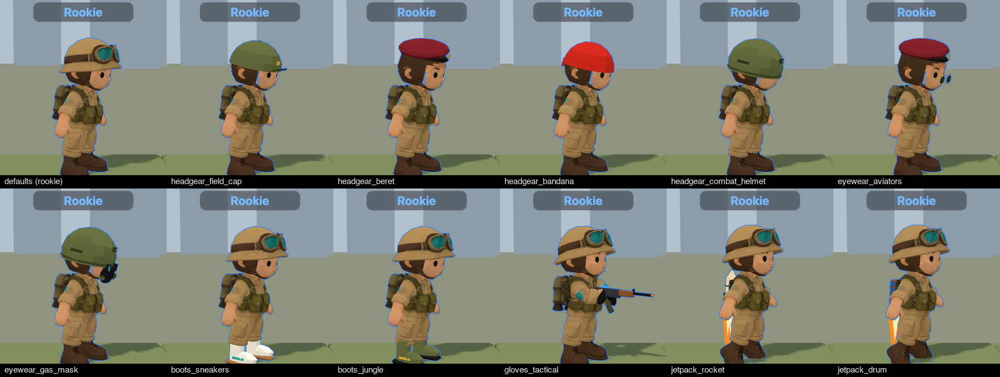
*Default Rookie, then each starter item on him: field cap, beret, bandana, combat helmet, aviators, gas mask, sneakers, jungle boots, tactical gloves, rocket pack, drum pack.*

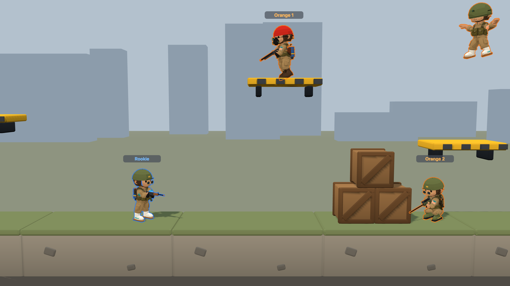

**The Rookie is now body + 3 default parts:** `headgear_brim_helmet`, `boots_combat` and `jetpack_twin_tank`, so every slot can be swapped. `build_character.py` splits them off the generated mesh:
- it tags faces by part before splitting, because face indices shift after each split;
- it welds the glTF seam-split vertices so the parts decimate;
- the generator never modelled a skull under the helmet, so the body gets a **short-hair cap** in its place.

**11 starter items** (`art/pipeline/build_cosmetics.py`) are original toy-style designs, built procedurally on the Rookie's landmarks:

| Slot | Items | Skinning |
|---|---|---|
| headgear | Field Cap, Beret, Bandana, Combat Helmet (+ default Brim Helmet) | rigid to `head` |
| eyewear | Aviators, Gas Mask | rigid to `head` |
| boots | Sneakers, Jungle Boots (+ default Combat Boots) | rigid per foot; shafts blend into the calves |
| gloves | Tactical Gloves (inflated copies of each body LOD's hands) | the skin's own hand/forearm weights |
| jetpack | Rocket Pack, Drum Pack (+ default Twin Tank) | rigid to `spine2` |

- **Same path as the body:** each item is authored with vertex colours `Col` and `Dye` (mask). Both are baked to textures on fresh UVs (256² LOD0, 128² LOD1), so W2's dye shader treats cosmetics and body parts identically. Default dyes live in each item's extras and manifest.
- **Slot budgets** (LOD0 / LOD1): body 2,350 / 1,000; headgear 450 / 200; eyewear 150 / 70; boots 300 / 130; gloves 150 / 70; jetpack 550 / 250. Any full outfit therefore stays within docs/04 §5.6.
- **Checks:** every item passes `--kind part` at both LODs ([checks](cosmetics/checks/)): slot budget, skin, skeleton, weights, dye round trip and the **strict cosmetic envelope** (docs/04 §1.2: the body alone ×1.10, from the floor up, for every slot including the default parts). The envelope check caught the first Drum Pack 1 cm too deep. Under the strict rule, `build_character.py` and `build_cosmetics.py` fit every part with [pipeline/envelope.py](pipeline/envelope.py): the Gas Mask was redesigned slimmer, and the rest are scaled or squeezed. `envelopeOk` in each item's extras is the measured result.

  How far each part stuck out past the strict envelope before the fit, and after (LOD0; LOD1 is within 0.5 cm of LOD0):

  | Part | Before | After | How |
  |---|---|---|---|
  | Brim Helmet (default) | front 7.0, top 1.3 cm | inside | brim and crown squeezed |
  | Twin Tank (default) | back 4.3 cm | inside | scaled about its backplate |
  | Combat Boots (default), Sneakers, Jungle Boots | inside (the envelope reaches the floor) | inside | none |
  | Gas Mask | front 8.4 cm | inside | **redesigned**: a flat mouth plate with twin cheek filters instead of one front canister |
  | Field Cap | front 9.9 cm | inside | visor squeezed shorter |
  | Bandana | back 0.2 cm | inside | knot squeezed |
  | Combat Helmet | front 0.1 cm | inside | squeezed |
  | Rocket Pack | back 6.5 cm | inside | scaled about its backplate |
  | Drum Pack | back 6.0 cm | inside | scaled about its backplate |
  | Beret, Aviators, Tactical Gloves | inside | inside | none |

| Outfit | Tris | Draw calls after merge | GPU textures |
|---|---|---|---|
| Default Rookie (LOD0) | 3,648 / 4,000 | 1 (4 before merging) | 0.88 MB |
| Fully dressed worst case: combat helmet + gas mask + gloves + jungle boots + rocket pack | 3,937 / 4,000 | 1 (6 before) | 1.17 MB / 1.5 |
| Same, LOD1 | 1,711 / 1,800 | 1 | 0.29 MB |

- **Ships to** `apps/web/public/assets/cosmetics/<slot>/<id>[_lod1].glb`, plus a manifest per item and `cosmetics/index.json`.
  - `index.json` is an **asset map** (id → manifest by slot). **`packages/content/src/cosmetics.ts` (W2) is the catalogue**: it owns display names, rarity and unlocks, and the asset check WARNs when an item id is missing from it.
  - The `name` in the manifests is a placeholder. The GLB extras carry only `cosmeticId`.
- **One schema** for default parts and starter items:
  - manifests: `id, slot, name, default, lods, dye, tris`, plus `attachBone`/`socket` on rigid parts and `nozzles` on jetpacks;
  - GLB extras: `slot, cosmeticId, hidesHair, bodyTypes, envelopeOk, dyeDefaults, dyeMask, dyeAlbedo`, plus the same rigid/jetpack keys.
- **Jetpack nozzles:** every jetpack part lists its nozzle exits (`nozzles`, glTF character space): the Twin Tank 2, the Rocket Pack 2, the Drum Pack 1. The viewer draws one flame per nozzle in `socket_jetpack`'s frame.
- **Boot tops:** the generated Rookie's boot leather was fused into the trouser shells, so it stayed on the body and poked through every non-default boot. `build_character.py` now moves the dark-brown faces below the trouser cuff (z < 0.255 m) into the default boots: 719 faces.
- **Gloves:**
  - Each glove vertex copies the skin weights of the hand vertex it was made from, and each LOD is built from that body LOD's own hands.
  - The build runs a pose sweep: rest plus 11 frames of idle, walk, run, rifle and pistol aims, reload, melee and throw. It fails if skin pokes more than 6 mm through the glove.
  - Today the worst is 5.5 mm at one wrist vertex while running (LOD0) and 0.0 mm at LOD1. The review measured 22–39 mm before.
- **Viewer:** Locker-style slot pickers for the hero, plus a different outfit on every other soldier. Each part keeps its own default dyes; the dye pickers recolour every part's channel once touched.

Gaps:
- **Tops** (shirts/jackets) aren't in this batch: the shirt is part of the body and there's no torso underneath. They need either a body-region hide mask or overlay shells; that's W2's call.
- The procedural items are **cleaner and flatter than the painted Rookie**. Five of them are now rebuilt from Higgsfield models (see "Hero cosmetics from Higgsfield" above).

## Weapon fire VFX: muzzle flashes, tracers, casings (Weapons Forge 2)

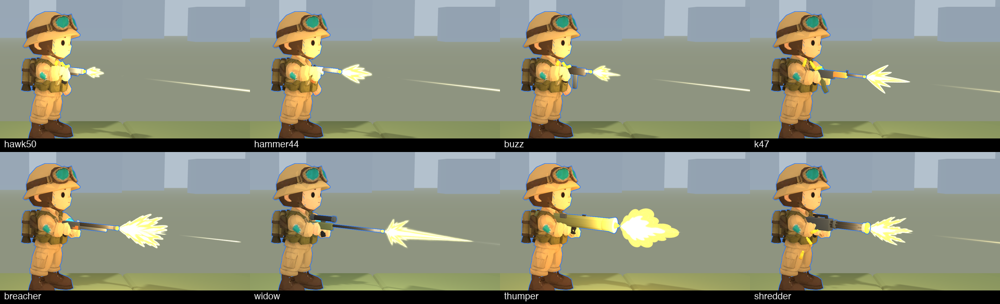
*Each weapon frozen mid-shot in the viewer (`?fire=1`): its flash style at `muzzle`, the light pop, the tracer, and casings in flight from `eject`.*

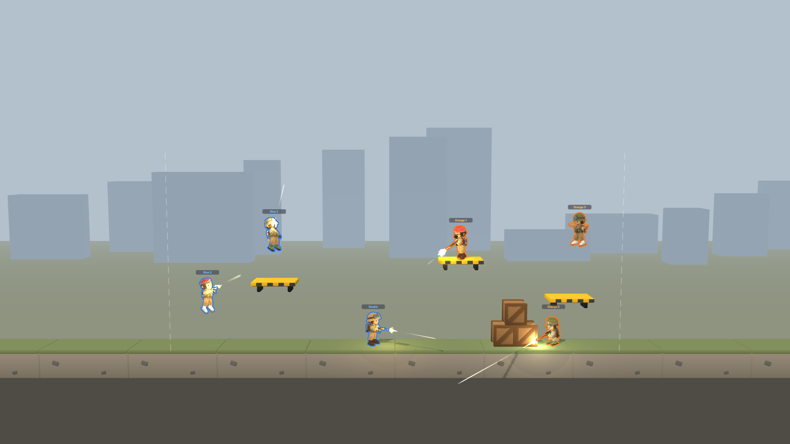
*The same at 1× (the gameplay zoom).*

Everything ships in `apps/web/public/assets/vfx/` and is described by **`weapons.vfx.json`**:

| | What | Built by |
|---|---|---|
| `flash_atlas.webp` | 1024², 28 frames in cells of 256 × 128. Each frame's muzzle point sits at the same spot in its cell, so one quad shape fits all. Additive, 188 KB | `art/pipeline/build_vfx.py` from the Higgsfield sheets in `art/vfx/source/` |
| flash styles | `pistol`, `smg`, `rifle`, `shotgun`, `sniper`, `launcher`, `heavy`: 4 frames each, a quad size in metres, a light pop (colour, intensity, range) and a duration. Per shot: a random frame, scale 0.85–1.15, roll ±6°, a vertical flip | `build_vfx.py` |
| `tracer.webp` + tracer styles | white streak, head at +U, tinted per style: width, length, on-screen speed, one per N shots, per-pellet (shotgun), a fading smoke trail (sniper) | `build_vfx.py` |
| `casings.glb` + casing types | `casing_pistol` / `_rifle` / `_shotgun` (72–144 tris, about 4× real so they read at 1×): ejection speed, cone, spin, lifetime; 32 live at most | `art/pipeline/build_casings.py` (Blender) |
| `weapons` | per weapon: flash style (+ scale), tracer style, casing type and when it ejects (`shot`, `reload` ×6 for the revolver, `pump` / `bolt` after a delay, every 2nd shot for the minigun) | `build_vfx.py`; it fails if a weapon in `sockets.json` has no entry or an entry needs a socket the weapon lacks |

Colours are white to lemon-yellow (the launcher bloom has a golden rim), so a flash never reads as a team colour. Tracer and flash colours are the hook for cosmetic tracer and flash tints later; those are store-safe cosmetics.

```bash
B=/Applications/Blender.app/Contents/MacOS/Blender
$B -b --factory-startup --python-exit-code 1 --python art/pipeline/build_casings.py -- art/vfx --runtime apps/web/public/assets
python3 art/pipeline/build_vfx.py --runtime apps/web/public/assets
```

**Flash sources (Higgsfield, GPT Image 2.5, medium, 1k, transparent background; 0.5 credits each):** one 2×2 sheet per style. The prompt pattern was "Sprite sheet for a side-view cartoon shooter game: four variations of a <STYLE> muzzle flash: <shape>. Arranged in a 2x2 grid … Each flash starts at one point at the left-middle of its quarter and blasts to the RIGHT: every flame petal fans forward to the right like a cone, none point back to the left. Hot white core fading to bright lemon yellow … Flat-shaded toon style … No gun, no smoke, no sparks, no text. Transparent background." Job ids:
- pistol `82b12661…`
- smg `3b78a8a3…`
- rifle `8785f752…` (a first rifle test `e83ddef1…` swept its petals backward and was not used)
- shotgun `dac431db…`
- sniper `72059270…`
- launcher `5617a462…`
- heavy `2b345da1…`

## Impact VFX and decals (Weapons Forge 3)

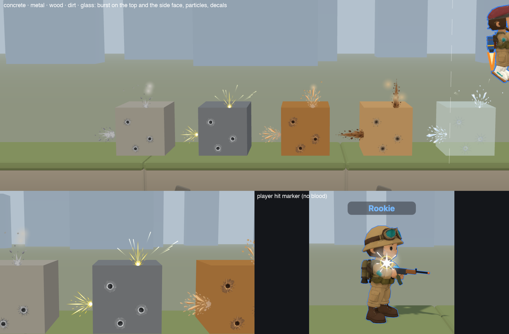
*Viewer `?impacts=1`: one block per sim surface, each with a burst on its top and its side face, frozen particles and bullet-hole decals; the non-gory hit marker on a character.*

`art/pipeline/build_impacts.py` ships to `apps/web/public/assets/vfx/`, described by **`impacts.vfx.json`**:
- **`impact_atlas.webp`** (1024 × 1536, 24 cells of 256²): `concrete`, `metal`, `wood`, `dirt`, `glass`, plus `player`, 4 variants each.
  - A surface burst's hit point sits at the bottom-middle of its cell, and +V is the surface normal. The renderer rotates the quad to the normal.
  - `player` is a centred comic pop: white star, pale yellow ring, no blood (age rating). Its soft glow is faded radially so it never ends in a square.
  - Keyed by the sim's `Material` ids (`packages/content` maps: 0 concrete, 1 metal, 2 wood, 3 dirt, 4 glass).
- **Per style:** quad size, life (pop in over the first 25 %, fade over the last 50 %), and **particles**.
  - Particle kinds are chips, dust or sparks, each with count, tint, size, speed, cone, gravity and life. Sparks are additive and stretch along their velocity.
  - The particle sprites are in `particles.webp` (256 × 64: spark, dust, chip; white, tinted per use).
- **Decals:** `decal_atlas.webp` (512 × 256, cells of 128²). Concrete chip, metal dent, wood hole, dirt pock, glass crack, plus `scorch` for explosions.
  - Each decal lives 8 s and fades over the last 1 s. At most 64 live (oldest first).
  - Decals go on map surfaces only, never on characters.

```bash
python3 art/pipeline/build_impacts.py --runtime apps/web/public/assets
```

**Sources (Higgsfield, GPT Image 2.5, medium, 1k, transparent; 0.5 credits each):**
- Six 2×2 impact sheets: "… four variations of a bullet impact on <SURFACE> … each burst starts at one point at the BOTTOM-middle of its quarter and sprays UPWARD … Flat-shaded toon style … No wall, no ground, no bullet, no text".
- The player sheet: "… a non-gory HIT MARKER … a white star-shaped pop with a thin pale yellow ring … No blood, no wound".
- One 3×2 decal sheet.

Job ids:
- concrete `f888893e…`
- metal `0cf3fd38…`
- wood `a92dc810…`
- dirt `9b09ad7f…`
- glass `fc9e21cd…`
- player `73499fc6…`
- decals `5a0efc56…`

## Explosion VFX for blast launches (Weapons Forge 4)

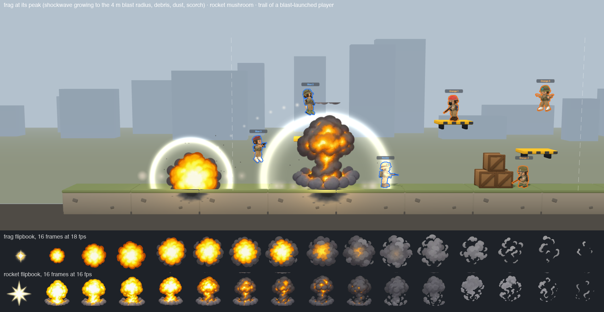
*Viewer `?boom=1`: a frag at its peak (shockwave growing to the 4 m blast radius, debris, dust, scorch), a rocket mushroom, and the puff trail of a blast-launched player; below, both flipbooks.*

Blasts now throw players up to 16 m (NOTES §17), so an explosion has to show its reach and make the flight read as a launch. `art/pipeline/build_explosions.py` ships **`explosions.vfx.json`** with:
- **Flipbooks** in `explosion_atlas.webp` (2048 × 1024, 16 frames of 256² each):
  - `frag` (flash → fireball → smoke, 18 fps): anchored on the fireball centre;
  - `rocket` (a mushroom with a base ring, 16 fps): anchored on the base, on the surface it hit.
  
  A flipbook keeps its frames' positions relative to each other (one crop and scale per sheet), so the anchor holds still through the animation.
- **Styles sized from `packages/content`:** `frag` reads the 4 m radius from `grenades.ts`. `rocket` (3.5 m) and `grenade_launcher` (3.0 m, frag flipbook) take docs/03 §5's splash radii and are marked `provisional` until their content entries exist; their fireballs scale with the radius. Each style has:
  - a **shockwave ring** (`shockwave.webp`) growing to the blast radius in 220 ms;
  - a light flash;
  - debris chips and ground dust (from `particles.webp`);
  - a `scorch` decal;
  - a **camera-shake suggestion** (amplitude, 14 Hz, 420 ms decay, full within the radius, zero at 3.5 × it).
- **`launchTrail`:** puffs behind a player while a blast throws them faster than `launchSpeedX` (12 m/s), so a 16 m flight reads as a launch, not a teleport.

```bash
python3 art/pipeline/build_explosions.py --runtime apps/web/public/assets
```

**Sources (Higgsfield, GPT Image 2.5, high, 2k, transparent; 2.75 credits each):**
- frag `a0ca5559…`: "a 16-frame animation of a GRENADE EXPLOSION laid out in a 4x4 grid … white-hot star flash … round puffy fireball … turning into dark grey smoke … faint wisps";
- rocket `984b39d4…`: "a big ROCKET EXPLOSION … a large mushrooming fireball … a ring of smoke puffs around its base".

The fireballs are yellow to amber and last under a second, so they don't compete with the team-orange outline the way a static prop would.

## Special-weapon VFX and projectiles (Weapons Forge 8c)

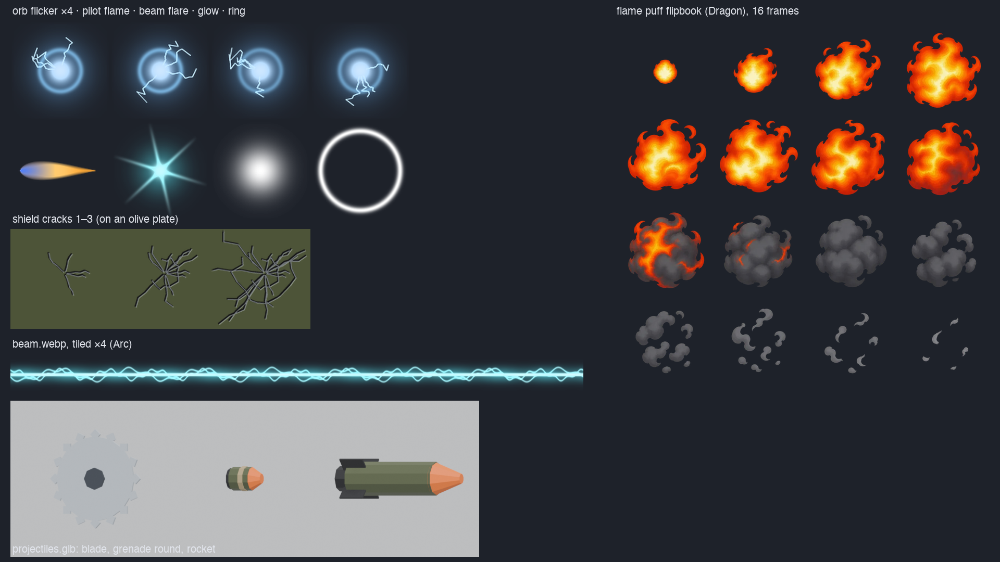

`art/pipeline/build_specials.py` ships **`specials.vfx.json`**: what the six non-bullet weapons fire, how it moves and what it leaves. `weapons.vfx.json` points to it with a per-weapon `special` key.

| Style | Kind | What it draws |
|---|---|---|
| `dragon` | flame | flame puffs from the muzzle every 0.15 s (3 per spawn, so the stream reads continuous). They play the flame flipbook over their 0.8 s life and grow 0.15 → 0.6 m like the sim. Also a pilot flame on `pilot`, a flickering light, a burn on the victim and a wall scorch |
| `arc` | beam | a camera-facing strip from the muzzle to the hit (`beam.webp`, tileable, scrolling), a glow at the muzzle, a spinning flare and sparks at the hit |
| `pulse` | orb | a charge glow and shrinking ring on `charge` (0.7 s), the orb flicker flipbook flying at 8 m/s through walls with a glow trail, and the EMP burst: a blue shockwave to R 2.5, a flash, a light, and crackle at a stunned jetpack |
| `ripper` | blade | charge sparks at the blade hub (0.4 s), the blade spinning at 14 turns/s with a faint trail, sparks on every bounce, and a half-size frag explosion after 5 s |
| `popper` | grenade | the grenade round with a dust trail, arcing under 1 g, then the `grenade_launcher` explosion (R 3.0) |
| `thumper` | rocket | the rocket with a flame flipbook at its nozzle and a smoke trail, then the `rocket` explosion (R 3.5) |
| `riot_shield` | shield | per stopped bullet: a spark star, a streak along the reflected ray, a spark fan, a scrape on the face and a light blip; three cumulative crack decals by HP; plate shards, rim bits and dust when it breaks (see Riot shield below) |

- **Textures:**
  - `flame_atlas.webp`: the Higgsfield flame puff, cropped once per sheet so it stays centred;
  - `specials_atlas.webp`: the orb flicker ×4, pilot flame, beam flare, glow, ring and shield cracks, drawn procedurally so they size and tile exactly;
  - `beam.webp`.
- **Projectiles** (`art/pipeline/build_projectiles.py` → `vfx/projectiles.glb` + `projectiles.json`): the rocket (148 tris), the grenade round (144) and the saw blade (280), in the muzzle frame, so a renderer spawns one at the weapon's `muzzle` with the weapon's rotation. Each has a trail point and a spin axis.
- **`vfx/manifest.json`:** the index of every VFX file, written by the last builder from the files actually present. It lists the builder, what each file holds, and texture sizes. The format note for the renderer is in the shared notes (forge-vfx-manifest.md).
- Speeds, ranges and timings are docs/03 §7's and marked `provisional` until packages/content has these weapons.
- **Armory preview** (`apps/web/src/armory/specials.ts`, [screenshot](screenshots/armory-specials.png)): Fire on these weapons plays the style.
  - While an effect runs, the view backs off and recentres to keep it on stage, then returns.
  - The stage is about 2 m across, so speeds run at 0.15× and reaches bigger than the stage (the 2.5 m EMP burst) at 0.3×. Things at the weapon keep their size.
  - What each Fire shows:
    - Dragon: flame puffs and the pilot flame;
    - Arc: the scrolling beam with its muzzle glow and end flare;
    - Pulse: charge, the orb in flight, then the burst;
    - Ripper: charge sparks, then the spinning blade;
    - Popper and Thumper: the flash plus the round and its trail;
    - Riot Shield: a ricochet and a scrape per Fire, cracks as its HP drops, and the break on the fifth hit.
  - Deep link `?weapon=pulse&fire&freeze=1.2` runs the effect to 1.2 s and holds it there, for screenshots.

```bash
blender -b --factory-startup --python-exit-code 1 --python art/pipeline/build_projectiles.py -- art/vfx --runtime apps/web/public/assets
python3 art/pipeline/build_specials.py --runtime apps/web/public/assets
```

**Source (Higgsfield, GPT Image 2.5, medium, 2k, transparent; 1.0 credit):** flame `b30b0079…`, prompt: "Sprite sheet for a side-view cartoon shooter game: a 16-frame animation of ONE FLAMETHROWER FIRE PUFF laid out in a 4x4 grid, read left to right, top to bottom. Frame 1 is a small, tight, bright ball of flame; it quickly swells into a big rolling, billowing cloud of fire with curling tongues of flame (frames 4 to 9), then breaks up and darkens into puffy dark grey smoke (frames 10 to 14) and fades to faint wisps (frames 15 and 16). Every frame is centred in its own cell with clear empty space around it, and no frame touches another. Flat-shaded toon style with crisp cel shading: hot white-yellow core, bright orange body, deep red-orange edges, then charcoal grey smoke. No gun, no sparks, no ground, no text, no numbers, no borders. Transparent background."

## Grenade readability (Weapons Forge 9)

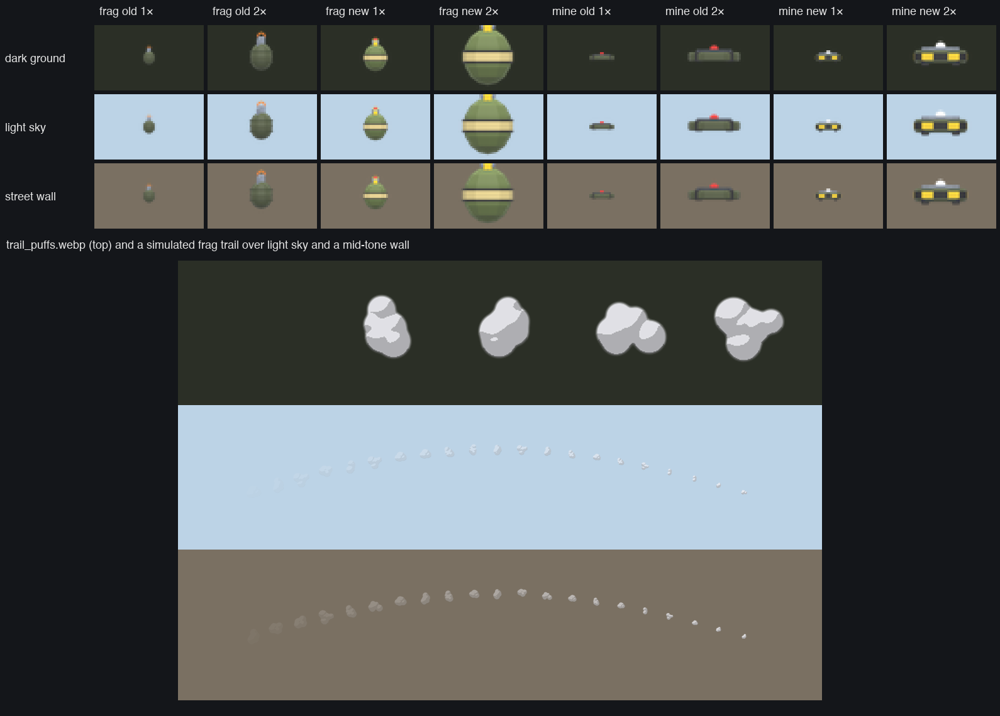
*Old vs new frag and mine at gameplay size (1× ≈ 70 px/m, 2×), shown enlarged on dark ground, light sky and a mid-tone wall. Below: the trail puffs and a simulated trail.*

Playtest feedback: frags were hard to see, and their throw trails were faint white lines.
- **The frag was under half its sim size.** It was 0.09 m across; `FRAG.radius` is 0.1 m. It's now 0.19 m.
  - Contrast: a lighter olive body, a sand band framed by dark rings, and a yellow lever and pin. The pin was team-adjacent orange.
  - A red fuse dome carries a **`light`** node, the name render3d's `throwableFromGltf` already blinks.
- **The mine** is 0.2 m across and nearly edge-on from the side view.
  - It's taller now, with a yellow/black hazard rim and a pale top.
  - Its `light` dome is near-white so the renderer can tint it by state (docs/02 §14: green flying, yellow arming, flashing red armed).
- **asset-check** for throwables now needs a `light` node and a body ≥ 80 % of the content sim radius. Throwables and the shield must keep every vertex colour ≥ 25 ΔE from both team colours. Selftest probes: the old-size frag and a team-orange frag fail.
- **Trails:** `art/pipeline/build_grenade_fx.py` → `vfx/trail_puffs.webp`, 8 cartoon puffs in neutral grey, lit from above with a dark lower lip, so a trail reads on light sky and dark ground. `vfx/grenades.vfx.json` gives each kind:
  - the trail: rate, size over life, life, tint and rise;
  - the fuse or state light: colours, a blink that speeds up as the fuse (`FRAG.fuse`, from content) runs out, and a reduced-motion cap of 3 Hz;
  - an outline suggestion (2 px, near-black), which keeps the olive frag readable on mid-tone walls.

```bash
python3 art/pipeline/build_grenade_fx.py --runtime apps/web/public/assets
```


### One model per grenade type (the owner, 18 Oct)

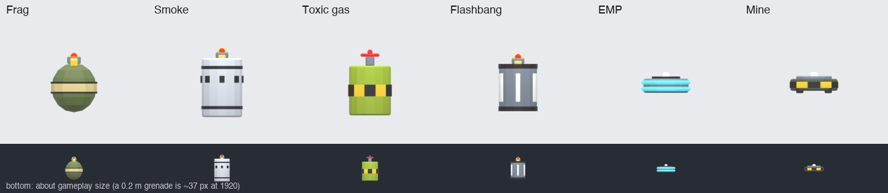
*The six throwables at one scale; below, on dark ground, at gameplay size (1×: a 0.2 m grenade is about 11 px) and at 4×.*

Each grenade reads by its shape, not only its colour. They're built by `build_weapons.py` (`--only smoke,gas,flash,emp` rebuilds just these and merges them into weapons.json and sockets.json):

| id (content) | Model | Tris | Nodes |
|---|---|---|---|
| `frag` | the ball with its sand band (unchanged) | 624 | grip, pin, light, ground |
| `smoke` | a tall pale canister (0.17 × 0.25 m) with a ring of dark vent holes and dark bands | 632 | grip, pin, light, ground |
| `gas` | a squat yellow-green canister (0.18 × 0.21 m) with a yellow/black hazard band and a valve with a red handwheel | 576 | grip, light, ground |
| `flash` | a spool (0.17 × 0.19 m): two wide dark end plates round a narrow mid-steel core with six bright slots, so its side view is an "I" beside the smoke's tall block (review: the two slotted cylinders read alike) | 704 | grip, pin, light, ground |
| `emp` | a disc (0.20 × 0.06 m) with two glowing pale-cyan coils round its rim (`_GLOW`) and an emitter on top | 616 | grip, light, ground |
| `mine` | the hazard-striped disc (unchanged) | 616 | grip, light, ground |

- **Rules:** all are sim-sized (half-width 0.086–0.105 m for a 0.10 m sim ball), at least 25 ΔE from both team colours (orange ≥ 33, blue 67), and pass asset-check 14/14.
- **Fuse lights:** the frag, smoke, gas and flashbang keep a red fuse dome on the `light` node the renderer blinks, and a `pin` where they have one. The EMP's `light` is its white emitter, like the mine's, so the renderer can tint it.
- **Which file reads them:** `render3d/grenades.ts` draws the frag (`frag.glb`). `render3d/clouds.ts` draws the other types today, as coloured balls (`GRENADE_COLORS` on `ballGeo`). It should load `smoke.glb`, `gas.glb`, `flash.glb` and `emp.glb` (in `assets/weapons/`, with their `ground` rest frame) in their place. The mine stays clouds.ts's puck, or `mine.glb`.

## Riot shield (Weapons Forge 10)

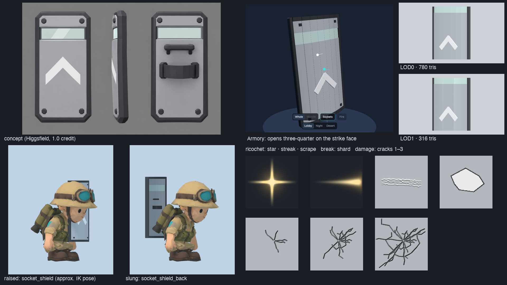
*The concept; the Armory's three-quarter view; the side views of LOD0 and LOD1; on the Rookie, raised and slung.*

Remodelled to the shield agent's spec (shared notes, shield-sockets.md; `apps/web/src/render3d/shield.ts`). The batch-2 version was in the weapon frame, at the wrong size.
- **Concept** ([weapons/concepts/riot_shield.jpg](weapons/concepts/riot_shield.jpg); Higgsfield GPT Image 2.5 medium 2k, job `21b4ad43…`, 1.0 credit). An invented toy design with no real-world markings. Prompt: "Concept sheet for a stylised toy-soldier video game: ONE chunky low-poly toy riot shield shown three times on a plain mid-grey background, evenly spaced, no text, no labels, no logos, no letters. Left: the front view; middle: the side view (it is slightly curved, about as thick as a thumb); right: the back view. The shield is tall and rectangular with rounded corners, a light pale steel-grey plate with flat toon shading, a thick dark charcoal rim all the way around, a pale glassy viewing window band near the top, a bold white chevron stencil pointing up in the lower middle of the front, and four dark bolts near the corners. The back shows a dark forearm strap at the centre and a short horizontal hand grip just above it. Bevelled boxy toy shapes, vertex-colour look. Do not use blue or orange anywhere."
- **Shield space:**
  - origin on the arm strap, **+Y up, +Z out of the strike face**;
  - **0.55 × 0.90 m**, which is the sim's blocking segment;
  - the plate is 4 cm thick, with its inner face at z 0.05 and the strike face at z 0.09, curving back toward the edges;
  - `build_weapons.py`'s modelling frame comes out of the glTF export axis for axis, so the shield is built in the same pipeline.
- **Nodes:**
  - `grip`: the hand bar above the strap, for the left hand's IK;
  - `face`: the strike-face centre, +Z, `halfSize` [0.275, 0.45], where the crack and scrape decals go;
  - `ground`: the bottom edge, local +Y up, for pickups standing on their edge.
- **Extras:** `frame: "shield"`, `attach: "socket_shield"` (forearm_L, raised) and `slungAttach: "socket_shield_back"` (spine2, slung). The offsets are the shield agent's: (0, 0.07, 0) on the forearm, and (0, 0.10, −0.40) rotated 180° about Y on the back. The placement renders above use exactly those. The raised one is an approximation of render3d's IK pose: hand forward at shoulder height, on the far arm.
- **Readable by role, no team colours:**
  - a light steel plate (reads on dark ground);
  - a dark charcoal rim (reads on light sky);
  - a pale window band;
  - a white chevron on the strike face, so you can tell front from back;
  - asset-check keeps every colour ≥ 25 ΔE from both team colours (blue 73, orange 83).
- **LOD0** 780 tris and **LOD1** 316 (`riot_shield_lod1.glb`: 3 curve strips, no bolts). Both pass asset-check.
- **VFX** (`specials.vfx.json` → `riot_shield`; new sprites in `specials_atlas.webp`):
  - **ricochet** (the sim's `ricochet` event): a 4-point spark star, a streak along the reflected ray (`ex, ey`), a spark fan, a bright scrape decal on the face along the incoming ray (up to 6, fading after 1.5 s), and a light blip;
  - **damage:** three cumulative crack decals at 66 / 33 / 12 % HP;
  - **break** at 0 HP: plate shards, dark rim bits, dust and a flash;
  - explosions, flames, saws and melee go round it, so they get no ricochet.
- **Armory:** models with `frame: "shield"` load upright, and open three-quarter on the strike face (from the side a shield is all edge).
- Known clash, from the shield agent's notes: slung, it covers the jetpack, and the jet flame comes out in front of its lower edge. A smaller back-carry would fix it if the sim's back strip moves with it. That's a call for the shield agent.

## Armory: the 3D weapon viewer (Weapons Forge 5)

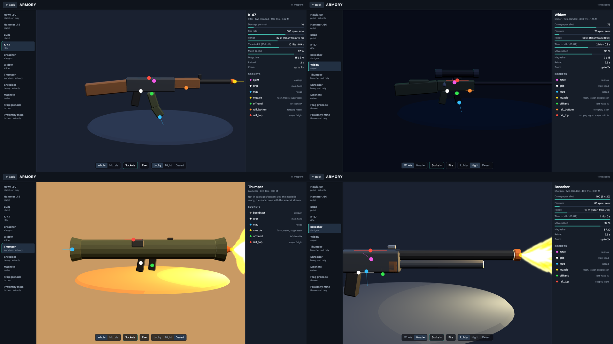
*`/armory.html`: K-47 with its sockets (Lobby); the Widow at Night (scope marked built-in); the Thumper firing in the Desert (art only, no stats yet); the Breacher zoomed to its muzzle, firing.*

`apps/web/src/armory/` (linked from the debug bar, next to the Locker) shows every model in `assets/weapons/`:
- **Turntable:** drag to rotate and tilt, scroll to zoom.
- **Focus:** Whole or Muzzle; click a socket in the list to zoom to it.
- **Sockets toggle:** gizmos in the sheet's colours, rails drawn along their usable length.
- **Fire:** pops the weapon's muzzle flash and light (`vfx/weapons.vfx.json`).
- **Lighting:** the Locker's Lobby / Night / Desert presets.
- **Stats card from `packages/content`:** damage (per pellet for the shotgun), fire rate, range and falloff, time to kill 100 HP, move speed, magazine, reload, zoom. Grenades show blast radius, launch, fuse and carry count. Models with no content entry yet say so.

It mounts like the Locker (`mountArmory(el)` / `mountArmoryRoute(el)` for W4's shell). The standalone page takes deep-link params: `?weapon=k47&focus=muzzle&light=night&fire&hold=<ms>`.

## Attachments: "things you can add" (Weapons Forge 6)

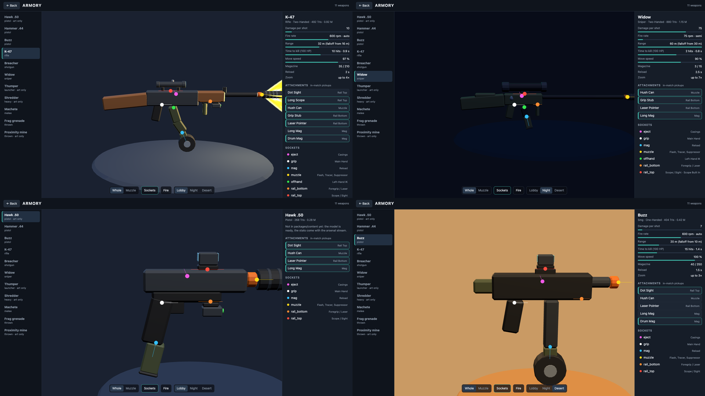
*Armory with attachments mounted:*
- *K-47: long scope, foregrip and laser sharing the bottom rail, suppressor (the flash leaves its tip), drum;*
- *Widow at night: suppressor, foregrip, long mag;*
- *Hawk: dot sight, suppressor, laser, long mag;*
- *Buzz in the desert: dot sight, drum.*

`art/pipeline/build_attachments.py` (Blender, the arsenal's toy style, 0 credits) builds 7 parts. They ship in `apps/web/public/assets/attachments/<id>.glb` and `attachments.json`:

| id (content) | Name | Mount | Tris | Fits |
|---|---|---|---|---|
| `sight_dot` | Dot Sight | rail_top | 112 | any unoccupied top rail: Hawk, Hammer, Buzz, K-47, Breacher, Thumper, Shredder |
| `sight_long` | Long Scope | rail_top | 572 | top rails ≥ 0.10 m: Hammer, K-47, Breacher, Thumper, Shredder (the Widow's scope is built in) |
| `suppressor` | Hush Can | muzzle | 316 | bores ≤ 0.02 m, not the launcher or heavy: Hawk, Hammer, Buzz, K-47, Breacher, Widow. Scaled to the bore; the flash moves to its tip at 0.4 × size |
| `foregrip` | Grip Stub | rail_bottom | 152 | two-handed with a bottom rail: K-47, Widow |
| `laser` | Laser Pointer | rail_bottom | 140 | any bottom rail: Hawk, Hammer, Buzz, K-47, Widow. A `beam` node; the beam is green, never a team colour |
| `mag_ext` | Long Mag | mag | 88 | box mags pointing down: Hawk, Buzz, K-47, Widow |
| `mag_drum` | Drum Mag | mag | 236 | K-47, Buzz |

- **Mounting:** each part is modelled in its mount frame, which is the weapon frame moved to the socket.
  - Rail parts sit above or below the rail centre. A foregrip and a laser share a bottom rail at −¼ / +¼ of its length.
  - Mag parts turn their −Z onto the mag socket's `dir`.
  - The fits are computed from `weapons/sockets.json`.
- **Data model:** `packages/content/src/attachments.ts` holds identity and fit only (id, name, kind, mount, sight level); the arsenal stream adds stats. The builder fails if its ids or mounts drift from content.
- **Fairness default** (pending the owner's confirmation): every attachment is `acquisition: 'pickup'`, `sellable: false`, an in-match pickup that is never sold, and a content test pins that. Cosmetic skins, charms and flash/tracer colours can be store items.
- **Armory:** the side panel lists the attachments that fit the selected weapon. Mount one per socket (the bottom rail takes two), see the whole kit framed, and Fire from the suppressor. Deep link: `?weapon=k47&attach=sight_long,foregrip,laser,suppressor,mag_drum`.

## Weapon camos (Weapons Forge 7)

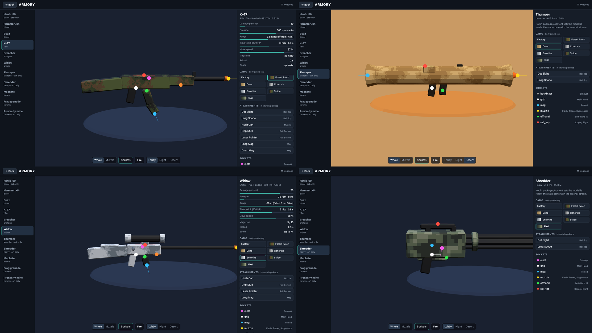
*Armory: K-47 in Forest Patch, Thumper in Dune, Widow in Snowline, Shredder in Pixel. Grips, barrels, the scope and the orange toy tips keep their colours.*

The weapons have no UVs (vertex colours on one material), so a camo works like the characters' dye mask, but in object space:
- **Mask:** `build_weapons.py` writes a `_CAMO` vertex attribute: 1 on body panels (gunmetal, olive polymer, wood, sand), 0 on grips, steel, the toy muzzle tip and blades. A camo therefore never hides a weapon's role, its silhouette or where it points.
- **Patterns:** `art/pipeline/build_camos.py` makes 6 tileable patterns as periodic noise, built in the frequency domain so they tile exactly. They are quantised into 3–4 levels and stored as indices in `weapons/camo_patterns.png` (1024 × 512, 31 KB).
- **`weapons/camos.json`:** a palette per camo, one tile per 0.30 m. The build fails if a palette colour is within 25 ΔE of a team colour.

| id | Name | Palette |
|---|---|---|
| `forest_patch` | Forest Patch | black, olive, brown, moss |
| `dune` | Dune | tan, sand, pale sand |
| `concrete` | Concrete | three greys |
| `snowline` | Snowline | grey-blue to white |
| `stripe` | Stripe | black, brown, olive: horizontal stripes |
| `pixel` | Pixel | four greens in 1.9 cm blocks |

- **Shader:** `apps/web/src/armory/camo.ts` is the reference. It projects the pattern triplanar in the weapon's frame, picks the dominant face for crisp edges, uses nearest sampling without mipmaps, and sets the palette colour on `_CAMO` panels; the toon lighting shades it.
- **Armory:** a camo picker (Factory plus the 6). The choice stays when you switch weapons. Deep link `?camo=forest_patch`.

Camos are cosmetic (no gameplay effect), so they are store-safe. W2's cosmetics catalogue can list them as weapon skins.

## Weapon finishes and fire colours (Weapons Forge 11)

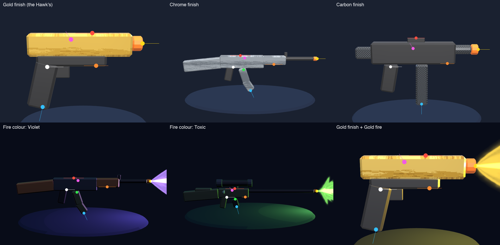

More store-safe cosmetics (no gameplay effect), on top of the camos:
- **Finishes** (in `weapons/camos.json` with `kind: "finish"`):
  - **Gold**: docs/03 §5's "gold skin for the Hawk with no stat change", so `weapons: ["hawk50"]`;
  - **Chrome**;
  - **Carbon**.
  - Each has a palette on a new pattern cell (`brushed` streaks along the barrel, or the `weave` checker), and a `metalness` and `roughness`.
  - `camo.ts` sets those on the camo panels only, in the shader; grips and steel keep their factory values. Finishes reflect an environment map (the Armory makes a soft room with `PMREMGenerator`); without one, metal renders near-black.
  - The Armory disables finishes made for another weapon, and switching away from the Hawk drops the gold finish back to factory.
- **Fire colours** (`weapons.vfx.json` → `fireTints`): Classic, Toxic, Violet, Ice, Gold and Rose.
  - A tinted shot draws the new `flash_atlas_mono.webp` (the same frames as luminance) times the tint, and the light pop takes the colour. Tracers multiply the white `tracer.webp` by the tint.
  - `build_vfx.py` fails if a tint is within 25 ΔE of either team colour, so a coloured shot never reads as a team.
- **Armory:** a Finish group under Camo, and a Fire colour picker on weapons that flash. Deep links: `?weapon=hawk50&camo=gold`, `?weapon=k47&tint=violet&fire&hold=60000`.


## Weapons from generated images (Weapons Forge 12)

### Batch 1: the core 6

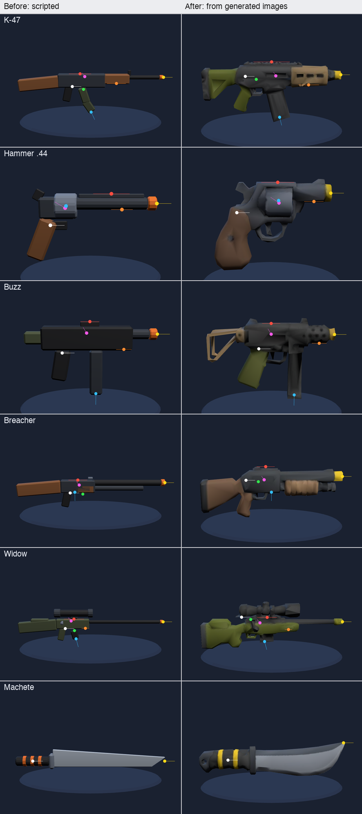
*Armory, Lobby light: scripted (left) and rebuilt from generated images (right), same camera. Top to bottom: K-47, Hammer .44, Buzz, Breacher, Widow, Machete.*

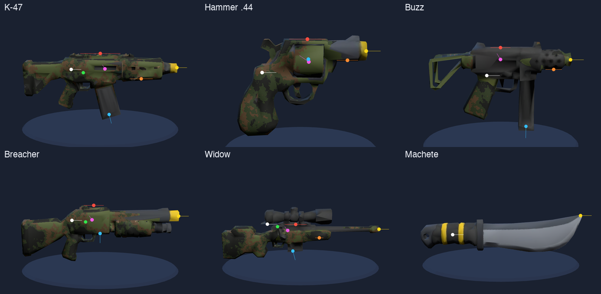
*The same six in Forest Patch: body panels take the camo; dark grips and mags, barrels, steel, the scope, the whole machete and the yellow toy tips keep their colours.*

The owner asked for guns made from generated images rather than scripted primitives. Batch 1 rebuilds the core 6 in place, with the same ids, socket names, frame and lengths, so holds, attachments, camos, finishes and the VFX hooks carry over. The owner judged this batch and approved the other 13 (18 Oct): batch 2 below (plan: the shared note `forge-gun-rebuild-plan.md`).

**Pipeline** (`art/pipeline/build_gun_scan.py`, Blender; inputs in `weapons/scan/source/<id>_tripo_raw.glb` and `weapons/scan_specs.json`):
1. **Concept:** GPT Image 2.5, medium, 2k (1 credit). One turnaround sheet per gun (right side, muzzle view, left side) with an invented silhouette; the prompts are below. `split_sheet.py` cuts the three views.
2. **Image → 3D:** Tripo H3.1 multiview (9 credits), face limit 3,000, textured, no PBR.
3. **Cleanup:**
   - orient by the spec's forward/up axes and scale to today's `lengthM`;
   - weld, then one symmetric collapse to the spec's budget (all ≤ 1,000 tris);
   - fresh UVs, and a Cycles bake of the Tripo texture at 512²;
   - flatten it for the toon look: k-means colour clusters, saturation × 1.4 (Tripo's textures come out greyer than the concepts), 35 % of the painted detail and the dark edge lines kept;
   - cap the team hues: texels in the team orange's hue band (12–40°) or the team blue's (195–235°) are capped at 0.44 saturation, and the warm ones darken by up to 15 %. The generated wood now reads brown, not orange (review M3: the Breacher's wood was 45 % orange-hued, ΔE76 27.5 from team orange at its nearest);
   - box-filter it to the 256² weapon budget (`weapons/scan/<id>_albedo.png` is the record copy). The asset check now caps a weapon's texture at 256²;
   - smooth by angle (35°): flat panels hide the triangulation, hard edges stay.
4. **Masks:** `_CAMO` per vertex from the colour clusters. Dark grips and mags, steel greys and the yellow tip never take a camo. The spec's `plain` boxes take it off barrels and blades that share the body's colour.
5. **Team colours:**
   - the build fails if any colour cluster is within 25 ΔE of either team colour;
   - it also measures the baked albedo itself: it fails if over 2 % of the covered texels sit in a team's hue band (saturation ≥ 0.45, value ≥ 0.35) or within ΔE76 40 of a team colour. All six are at 0–0.5 %;
   - the toy tip is yellow on the scanned guns (the scripted ones are team orange).
6. **Fit in the hand (review M4):** at the ±45° aims the Rookie's chin sits about 0.11 m above the hand, so the taller scans went through the head (the K-47's receiver 13 cm deep). Spec `drop` lowers each gun in the hand, with its sockets; the off hand keeps its place relative to the grip, so the reach margins don't change. Spec `squash` reshapes a part before the bake: the Widow's scope is 20 % shorter and 15 % lower. `tools/asset-check/head_clearance.py` checks it: it poses the rig's aim clips, mounts each gun at `socket_weapon_R`, and fails a scanned gun with any vertex over 2 cm inside the head at a level or ±45° aim. All six pass, with none inside; ±90° is reported only, since the scripted guns clipped there too.
7. **Moving parts (the owner's request, 18 Oct):** spec `parts` cuts a gun's moving piece off into its own child mesh: `part_slide`, `part_pump`, `part_bolt`, `part_cylinder` or `part_mag`. The faces whose centre falls in a side-view box move to the part, which keeps the UVs, the albedo and `_CAMO`, so camos and finishes cover it too.
   - The part's node sits at its centre (the pivot), with its motion in extras: a unit `axis` in the weapon frame, and a `travel` in metres or an `angle` in degrees.
   - `sockets.json` gets a `parts` block per weapon (`{name: {pos, axis, travel | angle}}`), and `weapons.json` a `parts` list. The renderer animates them when the gun fires or reloads.
   - Batch 1: the K-47's mag (75 tris), the Hammer's cylinder (200, 60° per shot), the Buzz's mag (53), the Breacher's pump (245, 0.06 m), and the Widow's bolt and mag (46 each). The tris are part of each gun's budget.
   - The asset check counts `part_*` meshes with the body (one material), and checks each: a known kind, triangles, a unit axis, a travel or angle, inside the gun.
8. **Sockets:** from the spec, in normalised side-view coordinates (u from the butt to the muzzle, v from the bottom to the top), written as GLB child nodes and merged into `sockets.json` in the same schema. The muzzle's `boreRadius` is measured from the mesh. The offhand keeps its old offset from the grip, so the rifle reach margins in `build_character.py` don't change.
9. `build_weapons.py` skips every id that has a scan source, so a full scripted rebuild keeps the scans.
10. **Casings** (`build_casings.py`): `casing_pistol`, `casing_rifle`, `casing_sniper` (brass) and `shell_shotgun` (a red hull on a brass base). They're six-sided lathes of 20–44 tris, at least 40 ΔE from both team colours, in `weapons/casings.glb` next to the guns (and still `vfx/casings.glb`). A gun's `eject` socket is where its casing leaves, along `dir`; `weapons.vfx.json` maps each gun to a type (the Widow and Longbow now `sniper`).

```
B=/Applications/Blender.app/Contents/MacOS/Blender
$B -b --factory-startup --python-exit-code 1 --python art/pipeline/build_gun_scan.py -- \
    k47 hammer44 buzz breacher widow machete --runtime apps/web/public/assets
$B -b --factory-startup --python-exit-code 1 --python art/pipeline/build_attachments.py -- art/attachments --runtime apps/web/public/assets
python3 tools/asset-check/head_clearance.py
```

The concept sheets stay on Higgsfield under the job ids below; they aren't kept in the repo. The raw Tripo models are, because they're the build inputs. All six pass the asset check ([checks](weapons/checks/)).

| id | Tris (scripted → scan) | Camo share (vertices) | Bore radius (m) | Concept job | 3D job |
|---|---|---|---|---|---|
| k47 (K-47) | 492 → 920 | 83% | 0.0276 | `ae7264dd-ac9f-4fe6-81c5-8d7fe95c68df` | `1f6070e3-b441-4879-92f1-f4912930b428` |
| hammer44 (Hammer .44) | 520 → 824 | 62% | 0.0266 | `827a7646-59c8-4fb9-bb20-1675c06bfa65` | `415f62fd-3762-4b4e-9029-d0106c7a2b2f` |
| buzz (Buzz) | 404 → 823 | 39% | 0.021 | `3e1cb8d8-bc09-4adb-9361-43973d72647a` | `054cc599-1042-42e4-b036-ab1f949fa178` |
| breacher (Breacher) | 496 → 921 | 78% | 0.0334 | `b10e86de-4d07-409e-bdc0-4d96fffde08a` | `dfa87ada-fc53-4a5b-9c6a-e4dfe1d4c2f3` |
| widow (Widow) | 880 → 950 | 33% | 0.0217 | `4ed23ce9-cec8-4b88-bd6c-314c5697d41e` | `9daf4604-a20d-40e3-aa51-0c4525ebc266` |
| machete (Machete) | 312 → 582 | 0% | — | `4bd92a47-8c05-4421-a89b-7c1f10e32826` | `012bab35-8c3d-4af5-82c8-565c325b0cf0` |

**What changed for other code:**
- **Texture, not vertex colours:** the scans carry their colour in a 256² albedo (`TEXCOORD_0` and `baseColorTexture`; no `COLOR_0`). Every scripted gun is vertex-coloured. Renderers keep each scanned gun's map and UVs (a textured toon material per gun) and keep reading `_CAMO`; these three ship on every scan.
- **The Armory frees textures:** `disposeTree` now disposes material maps (not the room's env map), so switching to a scanned gun no longer leaks one texture per switch (review M2; a textured case is in viewer.test.ts).
- **Bore radii** are now the toy tip's half-height (0.021–0.034 m; the scripted guns had 0.013–0.020). The flash and the suppressor scale with it. The suppressor's fit rule in `build_attachments.py` moved from ≤ 0.02 to ≤ 0.035 so it keeps fitting the same guns; every attachment fits the same weapons as before.
- **Rail lengths** follow the real rails: the K-47's top rail is 0.24 m (was 0.14) and its bottom rail 0.14 m (was 0.12). The others keep their old lengths. The Buzz stays at 0.06 m, so it still takes only the dot sight.
- **Muzzle heights:** after the drop, the muzzles sit 0.011 (K-47), 0.061 (Hammer), 0.049 (Buzz), 0.026 (Breacher) and −0.038 m (Widow) from the grip; the scripted guns had 0.055–0.068. The trade-off: the hand holds the K-47 and Breacher at the receiver's base, and the Widow near its scope mount, with the pistol grip below the fist. A lower hold at the ±45° aims (an animation-stream change) would let them sit naturally.

**Spend, batch 1: 60.00 credits.**
- 6 concept sheets × 1.0 = 6.00. The machete was resent after a rate-limit refusal, which wasn't charged.
- 6 Tripo multiview models × 9 = 54.00.
- The pilot's SAM 3 3D comparison failed and was refunded (0).
- The Higgsfield balance went from 649.44 to 570.19. The other 19.25 of that drop came from another session's images, not from this batch.

<details><summary>Concept prompts (GPT Image 2.5, medium, 2k, 16:9, opaque)</summary>

- **K-47:** "Orthographic turnaround sheet of ONE chunky toy assault rifle for a stylised cartoon video game, three views in a single row on a flat plain light grey background, each view separated by wide empty gaps, all at the same scale and the same height, perfectly aligned: (1) left: the right side of the gun, muzzle pointing to the right; (2) middle: the end view looking straight at the muzzle; (3) right: the left side of the gun, muzzle pointing to the left. Invented design, not based on any real-world firearm: a thick angular slab-sided receiver in dark gunmetal, a chunky sand-tan polymer handguard with three big vent slots, a solid olive-green stock with a rubber butt pad, a straight forward-raked box magazine, a pistol grip, a short thick barrel ending in a bright yellow toy safety tip, and a flat rail on top. Bevelled boxy toy shapes, clean flat colours with soft cel shading, no text, no logos, no letters, no hands, no background objects."
- **Hammer .44:** "Orthographic turnaround sheet of ONE chunky toy six-shot revolver for a stylised cartoon video game, three views in a single row on a flat plain light grey background, each view separated by wide empty gaps, all at the same scale and the same height, perfectly aligned: (1) left: the right side of the gun, muzzle pointing to the right; (2) middle: the end view looking straight at the muzzle; (3) right: the left side of the gun, muzzle pointing to the left. Invented design, not based on any real-world firearm: a squared-off dark gunmetal frame, a thick hexagonal steel cylinder, a short heavy barrel with a flat top strap and a bright yellow toy safety tip, a chunky warm-wood grip with a rounded butt, a big hammer spur and a round trigger guard. Bevelled boxy toy shapes, clean flat colours with soft cel shading, no text, no logos, no letters, no hands, no background objects."
- **Buzz:** "Orthographic turnaround sheet of ONE chunky toy compact submachine gun held in one hand, for a stylised cartoon video game, three views in a single row on a flat plain light grey background, each view separated by wide empty gaps, all at the same scale and the same height, perfectly aligned: (1) left: the right side of the gun, muzzle pointing to the right; (2) middle: the end view looking straight at the muzzle; (3) right: the left side of the gun, muzzle pointing to the left. Invented design, not based on any real-world firearm: a short boxy black receiver, a straight magazine in front of the trigger guard (not inside the grip), an olive-green pistol grip, a stubby barrel shroud with round holes, a small folded sand-tan wire stock at the back, a bright yellow toy safety tip on the muzzle. Bevelled boxy toy shapes, clean flat colours with soft cel shading, no text, no logos, no letters, no hands, no background objects."
- **Breacher:** "Orthographic turnaround sheet of ONE chunky toy pump-action shotgun for a stylised cartoon video game, three views in a single row on a flat plain light grey background, each view separated by wide empty gaps, all at the same scale and the same height, perfectly aligned: (1) left: the right side of the gun, muzzle pointing to the right; (2) middle: the end view looking straight at the muzzle; (3) right: the left side of the gun, muzzle pointing to the left. Invented design, not based on any real-world firearm: a fat dark gunmetal receiver, a thick ribbed sand-tan pump forend, a tube magazine under a wide barrel, a solid warm-wood stock with a black rubber butt pad, a pistol-style grip, a big bright yellow toy safety tip on the muzzle. Bevelled boxy toy shapes, clean flat colours with soft cel shading, no text, no logos, no letters, no hands, no background objects."
- **Widow:** "Orthographic turnaround sheet of ONE chunky toy bolt-action sniper rifle for a stylised cartoon video game, three views in a single row on a flat plain light grey background, each view separated by wide empty gaps, all at the same scale and the same height, perfectly aligned: (1) left: the right side of the gun, muzzle pointing to the right; (2) middle: the end view looking straight at the muzzle; (3) right: the left side of the gun, muzzle pointing to the left. Invented design, not based on any real-world firearm: a long olive-green polymer stock with a raised cheek rest, a dark gunmetal receiver with a round bolt knob on the right side, a big black scope with chunky end caps on top, a small box magazine, a long thin black barrel ending in a bright yellow toy safety tip. Bevelled boxy toy shapes, clean flat colours with soft cel shading, no text, no logos, no letters, no hands, no background objects."
- **Machete:** "Orthographic turnaround sheet of ONE chunky toy machete for a stylised cartoon video game, three views in a single row on a flat plain light grey background, each view separated by wide empty gaps, all at the same scale and the same height, perfectly aligned: (1) left: the right side, blade pointing to the right with the cutting edge at the bottom; (2) middle: the end view looking straight at the blade tip; (3) right: the left side, blade pointing to the left. Invented design: a broad, slightly curved light steel blade with a raked tip and a darker spine, a short square guard, a chunky black rubber handle with three bright yellow grip rings and a lanyard hole. Bevelled toy shapes, clean flat colours with soft cel shading, no text, no logos, no letters, no hands, no background objects."
</details>

### Batch 2: the other 8 originals

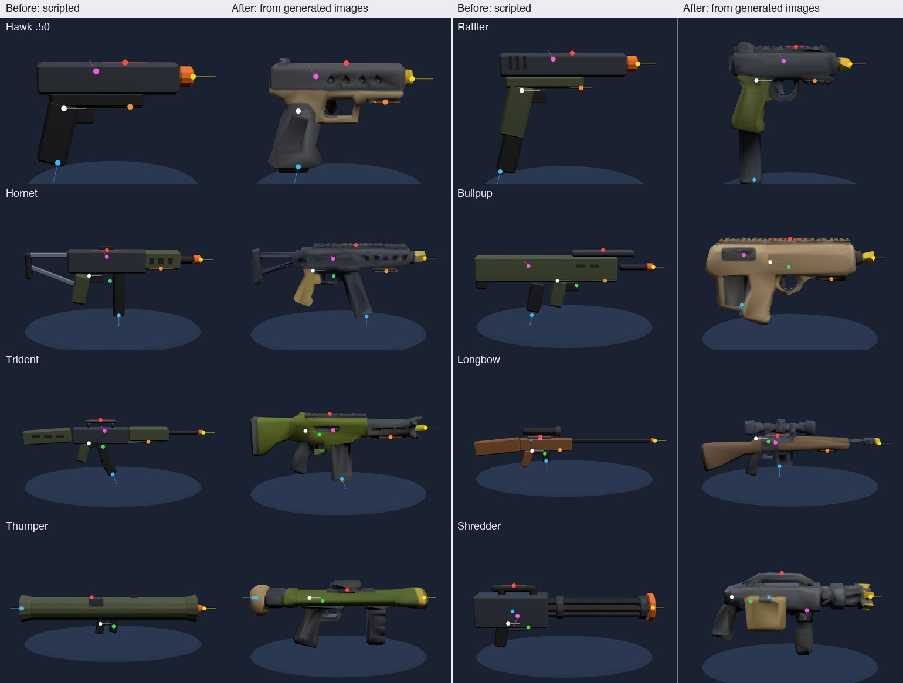
*Armory, Lobby light: scripted (left) and rebuilt from generated images (right), same camera.*

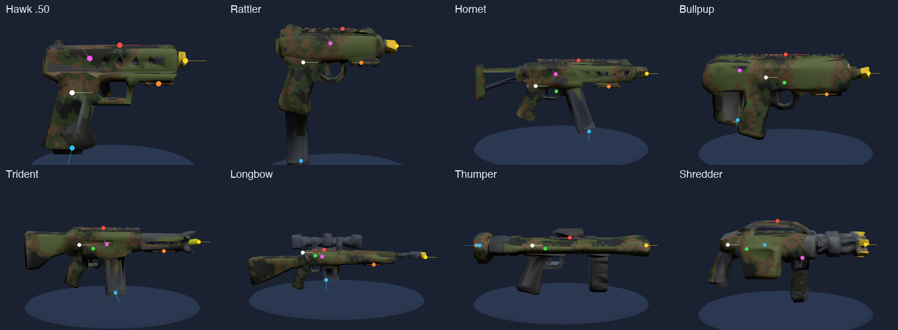
*Forest Patch on the eight: dark grips and mags, barrels, steel, scopes and the yellow tips keep their colours.*

The Hawk .50, Rattler, Hornet, Bullpup, Trident, Longbow, Thumper and Shredder go through the same pipeline, with the same ids, socket names and lengths. Socket directions and the rail lengths come from today's `sockets.json`, so the attachments fit as before; the one exception is the Thumper below.

| id | Tris (scripted → scan) | Camo share (vertices) | Bore radius (m) | Drop (m) | Concept job | 3D job |
|---|---|---|---|---|---|---|
| hawk50 (Hawk .50) | 268 → 776 | 73% | 0.025 | 0.02 | `22ad6829-8665-4d00-996c-26532e26dfe1` | `9ec7c637-ca41-4075-8fa9-7571b2dd912f` |
| rattler (Rattler) | 348 → 775 | 78% | 0.0178 | 0.055 | `bf11cae6-c51d-4cd2-80a4-a847fd66ef4e` | `0354627c-85d4-417e-8c74-2d81d25e01fa` |
| hornet (Hornet) | 616 → 872 | 68% | 0.0191 | 0.06 | `d071cde2-c0e2-47a7-a231-a1e837235a9c` | `ab67757e-c6c1-495d-95eb-1a8a2f905b38` |
| bullpup (Bullpup) | 472 → 872 | 89% | 0.0267 | 0.15 | `e2f979ba-5746-4d00-8db4-47b362a5cb13` | `da475499-9553-4882-94f3-f3c20de8ad28` |
| trident (Trident) | 704 → 920 | 50% | 0.0197 | 0.13 | `a099f248-3f36-4143-8644-36d697b65332` | `22d971a0-e6e3-43a0-968a-0d1455b23290` |
| longbow (Longbow) | 892 → 950 | 39% | 0.0144 | 0.13 | `b3e04c43-8ace-46db-ad67-ab3b4984e8f4` | `5b2152e8-7b0c-49d3-b6c2-c35d964c1f4f` |
| thumper (Thumper) | 616 → 872 | 34% | 0.0613 | 0.15 | `94fab403-9972-413a-837b-f070b1f6b5bc` | `53cb9645-e6b6-442d-a7e4-c268d2661bab` |
| shredder (Shredder) | 740 → 950 | 28% | 0.0584 | 0.065 | `44ce859b-8459-4001-85e5-b4f4fea1e240` | `00148ca5-0298-4455-a9a1-6dc1ece4ec60` |

- **The Thumper's sight is built in.** The generated launcher has a fixed box sight on its top rail, so `rail_top` is marked `occupied: "sight"` (the Armory shows "sight built in"). Add-on sights no longer fit it, the same rule as the Widow's and Longbow's scopes. Every other attachment fits the same weapons as before.
- **The Shredder's ammo box** (the `mag` socket) sits on the left side, so `build_gun_scan.py` now takes `side: "left"` as well as `"right"`.
- **Mags stay plain:** the mid-grey magazines of the Rattler, Hornet, Trident and Longbow would otherwise read as body panels, so each has a `plain` box (with the barrels and the Trident's fork).
- **Fit in the hand:** built with batch 1's review fixes from the start: team hues capped, and each gun lowered (`drop`) until `head_clearance.py` finds no vertex in the head at level and ±45°. The generated Thumper's tube was about 0.30 m across (the scripted one 0.13 m, firing a 0.06 m bore), and the Shredder's body and carry handle stood 0.34 m tall. Both are `squash`ed to 40 % and 50 % of their height above the grips, then dropped 0.15 and 0.065 m. `squash` now moves the sockets inside a squashed part with it.
- **Moving parts:** the Hawk's `part_slide` (271 tris, 0.03 m back), and `part_mag` on the Rattler (57), Hornet (83), Bullpup (58), Trident (56) and Longbow (32). Three are skipped: the Hawk's mag sits inside its grip, the Thumper has no matching mechanism, and the Shredder's ammo boxes are on both sides (and spinning barrels aren't one of the listed part kinds).
- **Side sockets** fall back to a ray cast onto the surface when the vertices within 2 cm sit on the far side; the Hawk's flat slide put its eject point inside the gun.
- **`split_sheet.py`** keeps views down to 2 % of the sheet's width (was 5 %), since a slim rifle's muzzle view is about 4 % wide.

**Spend, batch 2a: 80.00 credits:** 8 concept sheets × 1.0 and 8 Tripo multiview models × 9. Rate-limited submissions (429) weren't charged.

<details><summary>Concept prompts, batch 2a (GPT Image 2.5, medium, 2k, 16:9, opaque)</summary>

- **Hawk .50:** "Orthographic turnaround sheet of ONE chunky toy heavy semi-automatic hand-cannon pistol for a stylised cartoon video game, three views in a single row on a flat plain light grey background, each view separated by wide empty gaps, all at the same scale and the same height, perfectly aligned: (1) left: the right side of the gun, muzzle pointing to the right; (2) middle: the end view looking straight at the muzzle; (3) right: the left side of the gun, muzzle pointing to the left. Invented design, not based on any real-world firearm: a long rectangular dark gunmetal slide with a rounded top and a row of four round vent holes along each side, a thick sand-tan polymer frame with a squared trigger guard, a chunky dark-grey grip with a wide flared base and a short magazine base plate, a small square rear sight, a short flat accessory rail under the front of the frame, and a bright yellow toy safety tip on the muzzle. Bevelled boxy toy shapes, clean flat colours with soft cel shading, no text, no logos, no letters, no hands, no background objects."
- **Rattler:** "Orthographic turnaround sheet of ONE chunky toy compact machine pistol for a stylised cartoon video game, three views in a single row on a flat plain light grey background, each view separated by wide empty gaps, all at the same scale and the same height, perfectly aligned: (1) left: the right side of the gun, muzzle pointing to the right; (2) middle: the end view looking straight at the muzzle; (3) right: the left side of the gun, muzzle pointing to the left. Invented design, not based on any real-world firearm: a short fat dark gunmetal receiver with a ribbed top rail, an olive-green pistol grip with a long straight magazine sticking far out of its bottom, a short flat accessory rail under the barrel, a round trigger guard, a stubby barrel with a bright yellow toy safety tip. Bevelled boxy toy shapes, clean flat colours with soft cel shading, no text, no logos, no letters, no hands, no background objects."
- **Hornet:** "Orthographic turnaround sheet of ONE chunky toy rapid-fire submachine gun for a stylised cartoon video game, three views in a single row on a flat plain light grey background, each view separated by wide empty gaps, all at the same scale and the same height, perfectly aligned: (1) left: the right side of the gun, muzzle pointing to the right; (2) middle: the end view looking straight at the muzzle; (3) right: the left side of the gun, muzzle pointing to the left. Invented design, not based on any real-world firearm: a long slim dark gunmetal box receiver with a row of square cooling slots along the barrel shroud, a gently curved magazine in front of the trigger guard, a sand-tan pistol grip, a skeletal shoulder stock made of two thin parallel bars with a small butt plate, a flat rail on top, a short accessory rail under the shroud, a short barrel ending in a bright yellow toy safety tip. Bevelled boxy toy shapes, clean flat colours with soft cel shading, no text, no logos, no letters, no hands, no background objects."
- **Bullpup:** "Orthographic turnaround sheet of ONE chunky toy compact rifle with the magazine behind the pistol grip for a stylised cartoon video game, three views in a single row on a flat plain light grey background, each view separated by wide empty gaps, all at the same scale and the same height, perfectly aligned: (1) left: the right side of the gun, muzzle pointing to the right; (2) middle: the end view looking straight at the muzzle; (3) right: the left side of the gun, muzzle pointing to the left. Invented design, not based on any real-world firearm: a short one-piece sand-tan shell body with rounded corners, the box magazine set into the body BEHIND the pistol grip, a flat-topped rail along the whole top, a plain round trigger guard, a dark gunmetal ejection cover near the back, a short accessory rail under the front, a short dark barrel ending in a bright yellow toy safety tip; no carry handle and no built-in scope. Bevelled boxy toy shapes, clean flat colours with soft cel shading, no text, no logos, no letters, no hands, no background objects."
- **Trident:** "Orthographic turnaround sheet of ONE chunky toy burst-fire rifle for a stylised cartoon video game, three views in a single row on a flat plain light grey background, each view separated by wide empty gaps, all at the same scale and the same height, perfectly aligned: (1) left: the right side of the gun, muzzle pointing to the right; (2) middle: the end view looking straight at the muzzle; (3) right: the left side of the gun, muzzle pointing to the left. Invented design, not based on any real-world firearm: a long boxy olive-green receiver with a flat-topped rail, a three-pronged muzzle device around the barrel like a small fork, a straight box magazine, a dark pistol grip, a slim dark gunmetal handguard with an accessory rail underneath, a solid squared olive stock with a dark rubber pad, and a bright yellow toy safety tip on the barrel between the prongs. Bevelled boxy toy shapes, clean flat colours with soft cel shading, no text, no logos, no letters, no hands, no background objects."
- **Longbow:** "Orthographic turnaround sheet of ONE chunky toy marksman rifle with a fixed scope for a stylised cartoon video game, three views in a single row on a flat plain light grey background, each view separated by wide empty gaps, all at the same scale and the same height, perfectly aligned: (1) left: the right side of the gun, muzzle pointing to the right; (2) middle: the end view looking straight at the muzzle; (3) right: the left side of the gun, muzzle pointing to the left. Invented design, not based on any real-world firearm: a long slim warm-wood stock and forend made as one piece, a dark gunmetal receiver, a medium dark scope with square end caps fixed on top, a short straight box magazine, a dark pistol grip, a short accessory rail under the forend, a long dark barrel with a small square muzzle brake and a bright yellow toy safety tip. Bevelled boxy toy shapes, clean flat colours with soft cel shading, no text, no logos, no letters, no hands, no background objects."
- **Thumper:** "Orthographic turnaround sheet of ONE chunky toy shoulder-fired tube launcher for a stylised cartoon video game, three views in a single row on a flat plain light grey background, each view separated by wide empty gaps, all at the same scale and the same height, perfectly aligned: (1) left: the right side of the gun, muzzle pointing to the right; (2) middle: the end view looking straight at the muzzle; (3) right: the left side of the gun, muzzle pointing to the left. Invented design, not based on any real-world firearm: a fat round olive-green launch tube with flared ends, a dark gunmetal rear cap, two chunky dark grips under the tube (a pistol grip and a front grip), a small box sight on a short rail on top, a sand-tan shoulder pad, and a bright yellow toy safety band around the front opening. Bevelled boxy toy shapes, clean flat colours with soft cel shading, no text, no logos, no letters, no hands, no background objects."
- **Shredder:** "Orthographic turnaround sheet of ONE chunky toy heavy rotary-barrel gun for a stylised cartoon video game, three views in a single row on a flat plain light grey background, each view separated by wide empty gaps, all at the same scale and the same height, perfectly aligned: (1) left: the right side of the gun, muzzle pointing to the right; (2) middle: the end view looking straight at the muzzle; (3) right: the left side of the gun, muzzle pointing to the left. Invented design, not based on any real-world firearm: a big square dark gunmetal body with a curved carry handle on top, a cluster of six short barrels held by two round rings at the front, a sand-tan ammunition box hanging off the left side, a dark pistol grip and a front grip under the body, and bright yellow toy safety caps on the barrel ring. Bevelled boxy toy shapes, clean flat colours with soft cel shading, no text, no logos, no letters, no hands, no background objects."
</details>

### Batch 2b: the 5 specials

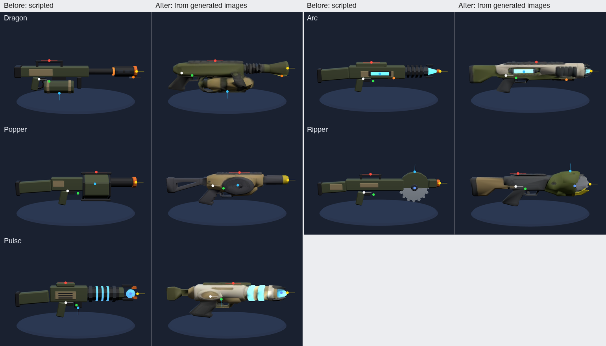
*Armory, Lobby light: scripted (left) and rebuilt from generated images (right), same camera.*

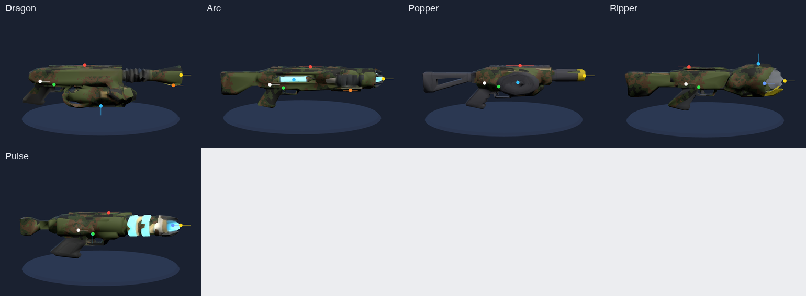
*Forest Patch on the five: grips, barrels, fins, prongs, the saw blade, the yellow tips and the glowing cells and coils keep their colours.*

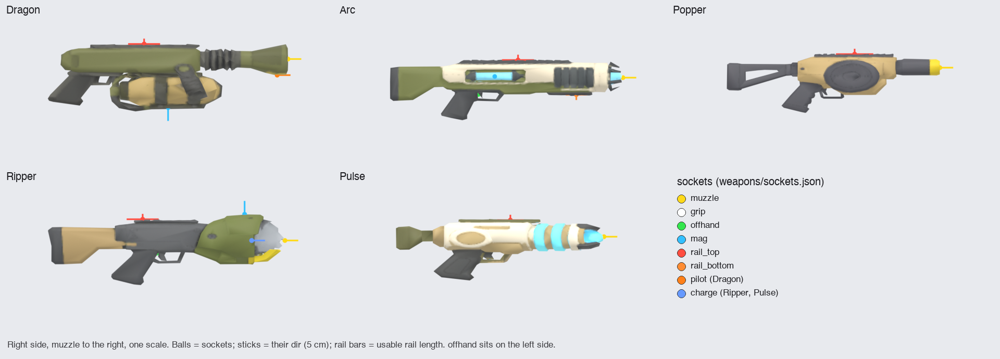
*The VFX hook-ups from Weapons Forge 8c stay: the Dragon's `pilot`, the Ripper's and Pulse's `charge`, every `muzzle`.*

The Dragon, Arc, Popper, Ripper and Pulse go through the same pipeline, with the same ids, socket names (including the `pilot` and `charge` hook-ups that `specials.vfx.json` uses) and lengths. Socket directions and rail lengths come from today's `sockets.json`.

| id | Tris (scripted → scan) | Camo share (vertices) | Glow share | Bore radius (m) | Squash (height and width) | Drop (m) | Concept job | 3D job |
|---|---|---|---|---|---|---|---|---|
| dragon (Dragon) | 968 → 950 | 62% | 1% | 0.0576 | 52 % | 0.07 | `7515ad04-d7c6-43d1-8933-c386f341e8e3` | `1863140b-536a-483c-9b54-99ac2fe30ea6` |
| arc (Arc) | 876 → 921 | 74% | 5% | 0.0368 | 57 % | 0.07 | `906706cd-0fe0-48f3-a9c0-4e17905ff0ca` | `812c1f5f-5e66-48ec-8b1e-7697597f46bc` |
| popper (Popper) | 756 → 920 | 32% | 0% | 0.0306 | 57 % | 0.07 | `321e5169-e50c-41c6-b613-73023d263ad2` | `27dd9315-f90f-4797-8e8a-de5178531b15` |
| ripper (Ripper) | 960 → 950 | 66% | 0% | 0.0226 | 55 % | 0.07 | `f93b8f8f-2418-4734-80ed-1d357f360146` | `000942ed-8194-47aa-8884-5a2f3992f26b` |
| pulse (Pulse) | 888 → 921 | 62% | 18% | 0.0343 | 45 % | 0.07 | `8225dde6-d016-4b8b-b83c-5494d98a8271` | `087d85d8-4b88-4d13-8370-2118fe159f1a` |

- **Fit in the hand:** the generated specials came out about twice as tall as the scripted ones (0.39–0.51 m against 0.22–0.25 m; 0.28–0.36 m above the grip), so no `drop` alone cleared the head: the hand would have ended up inside the body. Each is `squash`ed whole, in height and width about its bottom and centreline (`scale` takes an optional third, width, value now), to 45–57 %, which brings them back to 0.22–0.28 m tall, then dropped 0.07 m. `head_clearance.py`: all five have no vertex in the head at level and ±45°.
- **Team colours:** prompts asked for pale cyan and pale sky-blue glows and no orange. The nearest albedo texel to team blue is ΔE76 62.0 (the Pulse; the scripted Pulse's coils were 25.0, review N3) and to team orange 47.9 (the Popper). 0 % of texels are orange-hued; at most 0.2 % sit in the blue hue band, and none within ΔE 40.
- **Glow:** `glow` takes the Arc's cell and lens (`#84daf4`) and the Pulse's coils and orb (`#4bbee1`, `#7bf3fb`). The Dragon's yellow pilot tab is too small for a colour cluster of its own, so the new spec key `glow_boxes` marks it (12 vertices; the scripted Dragon glowed 3 %). Popper and Ripper don't glow, as before.
- **Clusters:** the squash changes the bake, so the Arc's cyan cell and the Ripper's tan stock merged into neighbouring clusters at the default 7. They use 8, and the Dragon 9 (spec `clusters`).
- **Camo:** `plain` boxes keep the grips, the Arc's fins and prongs, the Pulse's prongs and the Dragon's bellows plain. The Popper raises `dark` to 0.31, so its grey grip, stock, barrel and drum stay steel. `plain` boxes are now read in the unsquashed coordinates, like sockets; that changes nothing on the Shredder, the one squashed gun that had them.
- **Moving parts:** the Dragon's fuel tank as `part_mag` (361 tris, 0.08 m down) and the Arc's power cell (36 tris, `side: right`, 0.05 m out to the right). Three are skipped. The Popper's drum shows on both sides with the receiver between, so a side-view cut would take the receiver with it. The Ripper's blade sits inside its guard housing (and it's the round, not a mechanism). The Pulse has no separate mechanism, and its coils are rings.
- **Side sockets:** when no vertex lies within 2 cm (the middle of the Arc's long cell), `socket_points` now ray-casts onto the surface instead of using the bounding box, which the squash had made stale.
- **Attachments:** rebuilt; every fit is unchanged. Sights fit all five, and the foregrip and laser fit the Arc.

**Spend, batch 2b: 50.00 credits:** 5 concept sheets × 1.0 and 5 Tripo multiview models × 9. Rate-limited submissions (429) weren't charged. **Weapons Forge 12 total: 190.00** (batch 1 60, 2a 80, 2b 50). With Weapons Forge 2–10's 17.00, the Forge backlog stands at **207.00 of its 400 cap**.

<details><summary>Concept prompts, batch 2b (GPT Image 2.5, medium, 2k, 16:9, opaque)</summary>

- **Dragon:** "Orthographic turnaround sheet of ONE chunky toy flame projector for a stylised cartoon video game, three views in a single row on a flat plain light grey background, each view separated by wide empty gaps, all at the same scale and the same height, perfectly aligned: (1) left: the right side of the gun, muzzle pointing to the right; (2) middle: the end view looking straight at the muzzle; (3) right: the left side of the gun, muzzle pointing to the left. Invented design, not based on any real-world firearm: a wide flared nozzle with a small bright yellow pilot-light ring under its tip, a short dark barrel tube with cooling fins, a round sand-tan fuel tank with dark straps slung under the body on a bracket, a short looping dark hose, a dark olive boxy body with a flat rail on top, a dark pistol grip and a side handle. No orange, no red. Bevelled boxy toy shapes, clean flat colours with soft cel shading, no text, no logos, no letters, no hands, no background objects."
- **Arc:** "Orthographic turnaround sheet of ONE chunky toy sci-fi beam laser rifle for a stylised cartoon video game, three views in a single row on a flat plain light grey background, each view separated by wide empty gaps, all at the same scale and the same height, perfectly aligned: (1) left: the right side of the gun, muzzle pointing to the right; (2) middle: the end view looking straight at the muzzle; (3) right: the left side of the gun, muzzle pointing to the left. Invented design, not based on any real-world firearm: a long boxy off-white and olive body, a glowing pale cyan crystal lens at the front inside a ring of short dark prongs, a glowing pale cyan power cell visible in a window on the right side, dark cooling fins along the barrel, a dark pistol grip, a flat rail on top and a short accessory rail underneath, a solid olive stock. Bevelled boxy toy shapes, clean flat colours with soft cel shading, no text, no logos, no letters, no hands, no background objects."
- **Popper:** "Orthographic turnaround sheet of ONE chunky toy stubby grenade launcher for a stylised cartoon video game, three views in a single row on a flat plain light grey background, each view separated by wide empty gaps, all at the same scale and the same height, perfectly aligned: (1) left: the right side of the gun, muzzle pointing to the right; (2) middle: the end view looking straight at the muzzle; (3) right: the left side of the gun, muzzle pointing to the left. Invented design, not based on any real-world firearm: a short wide dark barrel with a bright yellow toy safety tip, a sand-tan boxy body, a closed round flat drum magazine like a big tin can mounted on the left side, a dark folding stock, a dark pistol grip, a flat rail on top. Bevelled boxy toy shapes, clean flat colours with soft cel shading, no text, no logos, no letters, no hands, no background objects."
- **Ripper:** "Orthographic turnaround sheet of ONE chunky toy saw-blade launcher for a stylised cartoon video game, three views in a single row on a flat plain light grey background, each view separated by wide empty gaps, all at the same scale and the same height, perfectly aligned: (1) left: the right side of the gun, muzzle pointing to the right; (2) middle: the end view looking straight at the muzzle; (3) right: the left side of the gun, muzzle pointing to the left. Invented design, not based on any real-world firearm: a big round light-steel toothed saw blade half-hidden inside a rounded olive-green guard housing at the front of the gun, a boxy dark gunmetal body, a sand-tan stock, a dark pistol grip, a flat rail on top, and a bright yellow toy safety lip on the front of the guard. Bevelled boxy toy shapes, clean flat colours with soft cel shading, no text, no logos, no letters, no hands, no background objects."
- **Pulse:** "Orthographic turnaround sheet of ONE chunky toy energy orb gun for a stylised cartoon video game, three views in a single row on a flat plain light grey background, each view separated by wide empty gaps, all at the same scale and the same height, perfectly aligned: (1) left: the right side of the gun, muzzle pointing to the right; (2) middle: the end view looking straight at the muzzle; (3) right: the left side of the gun, muzzle pointing to the left. Invented design, not based on any real-world firearm: three short dark claw prongs at the front holding a glowing pale sky-blue energy sphere, three glowing pale sky-blue ring coils around a thick barrel, an off-white and sand-tan bulky body, a dark pistol grip, a flat rail on top, a short olive stock. No dark blue. Bevelled boxy toy shapes, clean flat colours with soft cel shading, no text, no logos, no letters, no hands, no background objects."
</details>

### Part cuts that hold together in motion (review N1)

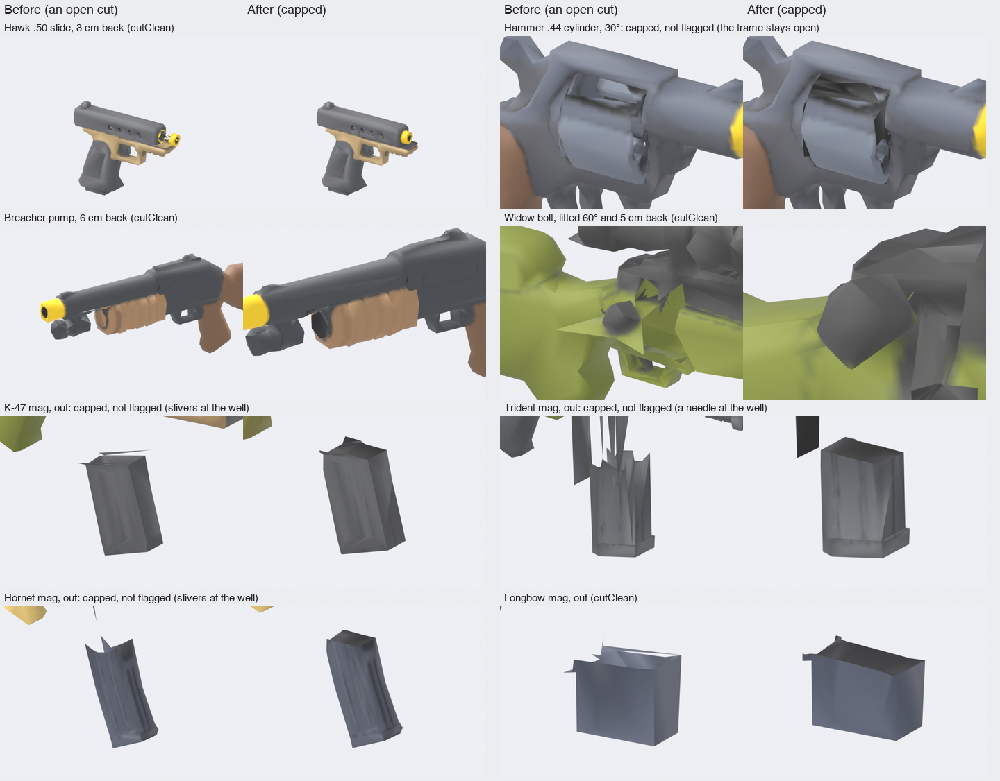
*Each part at full travel (`partsview`), before and after: the cut is capped dark on the part and on the body, so nothing tears open.*

render3d moves a `part_*` node only when it carries `cutClean: true` (gunParts.ts, render3d-b-gun-mechanisms.md). Until now every cut was an open seam in the fused generated shell: the Hammer's cylinder showed its hollow inside, the Hawk's slide left its tip behind, and the mags dragged shards and sheets of skin with them. `build_gun_scan.py` now cuts parts like this:

- **A straight cut:** the faces overlapping a part's box are first split along the box's planes (`bisect_plane`), so no face straddles the cut to leave a spike. Where that costs too many triangles (the Hammer's cylinder sits in a frame window; the Dragon's tank on a bracket), `bisect: false` keeps the shell's own edges.
- **Capped both sides:** every opening the cut leaves, on the part and on the body, is filled (`holes_fill`, then a fan for any loop it can't take), and every other opening on the part too, so the part is a closed shell. Caps sample the albedo's darkest texel and take no camo or glow. Vertices within 0.1 mm are welded first: the runtime file's quantised positions (meshopt) can part a pair the source has within a micron, and a cap built on the pair then leaves an opening there.
- **Tighter boxes:** the Hawk's slide box now takes the toy tip with it. The Widow's bolt takes only what stands out past the stock (`inset` 0.042 m), so it no longer carries a strip of skin, and it lifts about the bore line, not about its own middle. The Widow's, Buzz's and Longbow's mag boxes stop just below the receiver.
- **Within budget:** the cuts and caps add triangles, so a gun with parts is decimated further until all of it, caps included, fits the 1,000-tri budget (a dry run of the cut before the bake). Against each spec's `tris` target, the body before the cut is 25 % lower on the Breacher (950 → 709), 22 % on the Arc, 17 % on the Widow, 14 % on the K-47, 11 % on the Trident and Longbow and 9 % on the Dragon; the Hawk, Hammer, Buzz, Rattler and Hornet fit without it.
- **asset-check:** a part flagged `cutClean` must be a closed shell once its glTF splits are welded (at 0.1 mm, above the runtime's quantisation step), and the body must have no open edge within 1 cm of where the part sits (the opening it leaves, seen once it moves). Selftest case: a hole punched in the Hawk's slide fails. It counts open edges, not slivers: those the review saw at the K-47's, Hornet's and Trident's mag wells (the Trident's a ~10 cm needle) took those three mags' flags off.
- **The muzzle's bore** is measured on the whole gun before the parts are cut off: the Hawk's slide now carries the muzzle tip, and the bore measured on the body alone had dropped from 0.0233 to 0.0094 m (a suppressor about 0.4× as thick in the Armory). It is 0.025 m now; the attachments rebuild unchanged.

| Gun | Part | cutClean | Part caps / body caps (tris) | Gun tris (before → after) |
|---|---|---|---|---|
| Hawk .50 | `part_slide` | yes | 37 / 39 | 776 → 932 |
| Hammer .44 | `part_cylinder` | no: the cylinder is a closed shell, but the frame keeps 14 open edges around it (the scan fuses the cylinder into the frame's inside, with non-manifold seams there), so it stays still in game. A straight cut needed ~115-tri caps and left the body 344–458 tris. | 48 / 52 | 824 → 924 |
| Breacher | `part_pump` | yes | 56 / 56 | 921 → 993 |
| Widow | `part_bolt` | yes | 13 / 13 | 950 → 992 |
| Widow | `part_mag` | no: 4 open edges where a sliver of the scan folds onto the cut | 22 / 22 | |
| Buzz, Rattler, Longbow, Arc | `part_mag` | yes | 23–56 / 25–54 | within 1,000 |
| K-47, Hornet, Trident | `part_mag` | no: slivers at the mag well once the mag drops (review) | 26–37 / 26–37 | within 1,000 |
| Dragon | `part_mag` (tank) | no: 3 open edges, as the Widow's mag | 52 / 54 | 950 → 996 |
| Bullpup | none now | | | 872 |

- **The Bullpup's mag is no longer a part:** it is a panel set into the stock, so no side-view box frees it without the stock's skin. It's baked into the gun, which is how render3d drew it anyway.
- render3d animates the slide, pump, bolt and cylinder. Mags stay still for now, so the unflagged mags change nothing on screen. The Hammer's cylinder stays still too until it gets a clean cut: probably a modelled cylinder in the scan's colours, rather than a cut from the fused shell.

## Review lows (18 Oct 2026, review-art-stacks.md and the environments review)

- **L4, the shield's LOD1 node names:** `riot_shield_lod1.glb` named its nodes `face.001`, `grip.001` and `ground.001` (LOD0's still held the names in the build scene), which three.js reads as `grip001`. `build_weapons.py` now frees LOD0's names once it's written, and the LOD1 nodes are `face`, `grip` and `ground`. asset-check reads node names straight from the GLB and fails a Blender clash suffix (new selftest case).
- **L5, the shield grip:** the hand grip and its `grip` node sit 0.09 m above the arm strap (were 0.12): where the Rookie's fist closes with the strap on the forearm (forearm 0.108 m, strap at 0.07 m, `socket_weapon_L` 0.052 m past the wrist).
- **L11, Armory hitches:** a muzzle flash or special added and removed a PointLight, which changed the light count and recompiled the weapon's shaders on every Fire; switching weapons freed the old materials before the new ones drew, so their shared programs were deleted and compiled again. Now a fixed pool of three point lights stays in the scene (dark when free, `apps/web/src/armory/lights.ts`), the old weapon's and camo's materials are freed after the next frame, and each flash sheet keeps one material. Measured with a `linkProgram` counter in the browser, over two laps of Hawk / K-47 / Breacher / Widow and the specials: **3 programs per switch and 3 per Fire before, 0 after.**
- **L12, the Armory's shield panel:** the card reads the Riot Shield from `RIOT_SHIELD` in packages/content (HP 300, ±60°, raise 0.25 s, 75 % speed raised, bash 25, ricochet 60 %) instead of "not in content yet", and models without camo panels (the shield, the grenades) offer no camo or finish.

  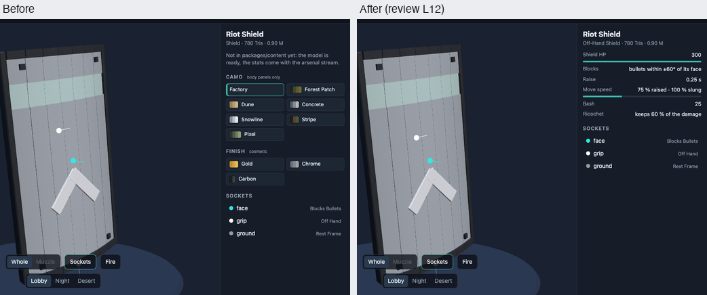
- **L13, skin in the art preview:** `tools/art-preview` applies the body albedo's skin weight (its alpha) as the game does, `× lerp(1, 2 × skin tone, alpha)` with the default skin_04, so faces and hands no longer render pale. Only the body layer carries skin; cosmetics are untouched.

  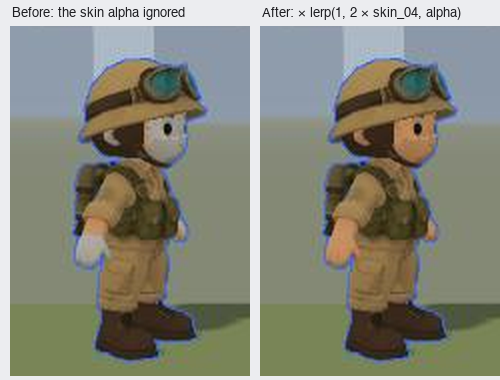
- **L14, docs/04 §9.4–9.5:** now documents the `pilot` and `charge` anchors, the `part_*` moving parts and `cutClean`, the `shield` family and shield space with its `grip`, `face` and `ground`, the shield's LOD1, exact node names, and the extras `casings`, `attach`, `slungAttach`, `frame` and `source`.
- **Environments L15, the minibus:** its luggage stood up to 2.8 m over the 2.3 m walkable roof with no collision, so it read as a step that isn't there; it's gone, and the rack lies flush on the roof. The map's collision is unchanged (street_market.map.json is byte-identical); kit asset-check 83/83. The tank-tower legs, the mast foot and the stall posts stay see-through: they are thin poles, which docs/11 §2 allows.

## Milestone B (part 1): the arsenal

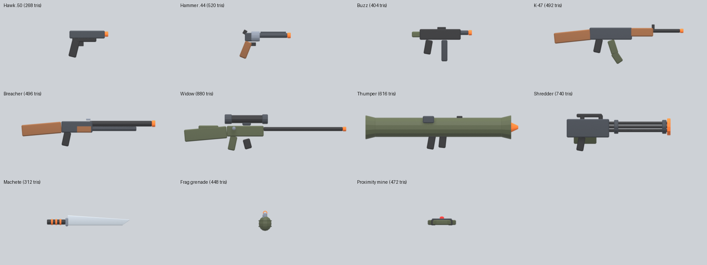
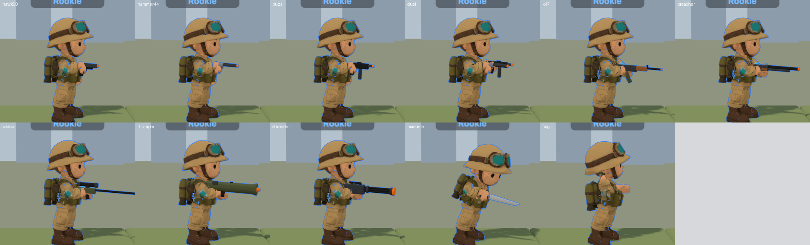
*Every weapon in the Rookie's hand through the aim layer (machete mid-swing, frag at the throw wind-up).*
*These two show the scripted versions. 14 guns now come from generated images (see Weapons from generated images); the socket sheet below is current.*

`art/pipeline/build_weapons.py` builds 22 original weapons (docs/03 §5 names) as chunky toy guns. They use vertex colours on one material, no textures, and an **orange toy muzzle tip** that reads at gameplay size. The 14 originals (everything but the five specials, the grenades and the shield) are now rebuilt from generated images by `build_gun_scan.py`, with a 256² texture and a yellow tip; see Weapons from generated images. The tris below are the scripted ones:

| id | Name | Family (docs/04 §4.2) | Aim pose | Hands | Tris | Length |
|---|---|---|---|---|---|---|
| hawk50 | Hawk .50 | pistol | pistol | 1 | 268 | 0.28 m |
| hammer44 | Hammer .44 | pistol | pistol | 1 | 520 | 0.36 m |
| buzz | Buzz | pistol | pistol | 1 | 404 | 0.42 m |
| k47 | K-47 | rifle | rifle | 2 | 492 | 0.92 m |
| breacher | Breacher | shotgun | rifle | 2 | 496 | 0.95 m |
| widow | Widow | sniper | rifle | 2 | 880 | 1.15 m |
| thumper | Thumper | launcher | rifle | 2 | 616 | 1.08 m |
| shredder | Shredder | heavy | rifle | 2 | 740 | 0.73 m |
| machete | Machete | melee | pistol | 1 | 312 | 0.58 m |
| frag | Frag grenade | thrown | pistol | 1 | 624 | 0.20 m |
| mine | Proximity mine | thrown | pistol | 1 | 616 | 0.21 m |
| rattler | Rattler | pistol | pistol | 1 | 348 | 0.31 m |
| hornet | Hornet | rifle | rifle | 2 | 616 | 0.58 m |
| trident | Trident | rifle | rifle | 2 | 704 | 0.91 m |
| bullpup | Bullpup | rifle | rifle | 2 | 472 | 0.63 m |
| longbow | Longbow | sniper | rifle | 2 | 892 | 1.04 m |
| dragon | Dragon | heavy | rifle | 2 | 968 | 0.90 m |
| arc | Arc | rifle | rifle | 2 | 876 | 0.87 m |
| popper | Popper | launcher | rifle | 2 | 756 | 0.80 m |
| ripper | Ripper | launcher | rifle | 2 | 960 | 0.89 m |
| pulse | Pulse | launcher | rifle | 2 | 888 | 0.78 m |
| riot_shield | Riot Shield | shield (off-hand) | pistol | 1 | 780 (LOD1 316) | 0.90 m tall |

- **Frame (docs/04 §9.4):** origin at the grip, +Y toward the muzzle, +Z up, +X to the weapon's right, so a weapon attaches to `socket_weapon_R` with an identity transform.
- **Sockets** (child nodes; all in [`weapons/sockets.json`](weapons/sockets.json), which the renderer reads). Each socket has `pos`, and a unit `dir` in the weapon frame (all but `offhand`):

  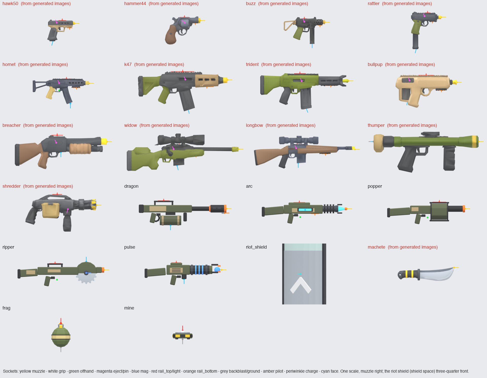

  | Socket | What it's for | dir | On |
  |---|---|---|---|
  | `grip` | the main hand (the origin) | +Y | every weapon |
  | `muzzle` | flash and tracer origin, suppressor mount; `boreRadius` sizes both | +Y | every firearm |
  | `offhand` | left-hand IK target, ≤ 0.10 m from the grip (chibi arms) | — | two-handed |
  | `eject` | casings leave here | right, up, a little back (Shredder: down-right) | every firearm but the Thumper (Hammer: spent cases on reload) |
  | `mag` | magazine / loading point for reload VFX | the way the mag drops or a round goes in | every firearm: the cylinder (Hammer), the loading port (Breacher), the breech (Thumper), the ammo box (Shredder) |
  | `rail_top` | scope / sight mount; `lengthM` of usable rail; `occupied: "scope"` on the Widow (built-in scope) | +Z | every firearm |
  | `rail_bottom` | foregrip / laser mount, `lengthM` | −Z | Hawk, Hammer, Buzz, K-47, Widow |
  | `backblast` | launcher exhaust | −Y | Thumper |
  | `part_*` (mesh nodes) | moving parts the renderer animates: `part_slide`, `part_pump`, `part_bolt`, `part_cylinder`, `part_mag`; extras `axis` with `travel` (m) or `angle` (°); `sockets.json` → `parts` | `axis` | scanned guns (see Weapons from generated images) |
  | `tip` / `pin` / `light` / `ground` | machete tip; frag pin ring; frag fuse light and mine state light (render3d blinks `light`); frag and mine rest frame in the world (`world = floorPoint × inverse(ground.local)`) | | machete / frag / mine |
  | `pilot` | the flamethrower's pilot light | +Y | Dragon |
  | `charge` | where a charge weapon's wind-up shows: the blade hub, the orb | +Y | Ripper, Pulse |
  | `face` | the shield's strike face centre (what it blocks); `halfSize` [w/2, h/2]. The shield is in shield space (see Riot shield) | +Z | Riot Shield |

- **Ships to** `apps/web/public/assets/weapons/<id>.glb` (meshopt), with `weapons.json` (name, family, aimPose, hands, tris, length, node positions) and `sockets.json`.
- **Weapon extras:** `casings: false` on weapons that throw no casing per shot (Dragon fuel, Arc cell, Popper drum, Ripper blade, Pulse orb): they need no `eject` socket and take no suppressor or long mag. The Riot Shield has `frame: "shield"`, `attach: "socket_shield"` and `slungAttach: "socket_shield_back"` (see Riot shield). `shield` is a new family beside docs/04's list (plus `thrown`).
- **Glow:** energy parts (the Arc's lens and cell, the Pulse's coils and orb, the Dragon's pilot ring) carry a `_GLOW` vertex attribute. `apps/web/src/armory/glow.ts` adds their vertex colour as emission, so they read lit in any lighting, and a camo keeps the glow.
- **Checks:** `tools/asset-check/check.py --kind weapon` verifies the triangle budget (1,000), one material, the extras, the muzzle direction, the offhand reach, the `ground` node on throwables, and the sockets: the set each family needs, unit directions, every socket within 3 cm of the mesh, the muzzle firing along +Y with a bore radius, casings ejecting to the right, and the rails above / below the bore facing up / down. All 22 pass ([checks](weapons/checks/)). The shield needs `face`, `grip` and `ground`, its strike face along +Z in front of the strap, and a 0.55 × 0.90 m size, so what players see is what blocks. `casings: false` drops the `eject` requirement. The selftest's socket probes: casings ejecting to the left, a missing top rail, the Dragon passing without `eject` and failing when marked as throwing casings, the Riot Shield and its LOD1 passing, and the shield failing without its `face` or at 70 % height. It also WARNs when a `weaponId` isn't in `packages/content` yet: `hawk50`, `thumper`, `shredder` and `mine` still aren't.
- **Dual wield** in the viewer is the classic Hammer + Buzz pair on `socket_weapon_R` / `socket_weapon_L`.

Known gaps:
- The Thumper and Shredder use the rifle hold (`aimPose: rifle`). A shoulder-launcher pose and a hip-held heavy pose would read better; tell W1 if wanted.
- **Weapons Forge 8, batch 1** added the Rattler (machine pistol), Hornet (high-rate SMG), Trident (burst rifle), Bullpup and Longbow (marksman rifle).
  - Each follows concept → model → sockets → VFX hook-up. The concept sheet (Higgsfield GPT Image 2.5 medium 2k, job `bb746034…`, 1.0 credit) was removed from the repo at merge: it echoed real-world rifles (a carry-handle sight, a bullpup stock), which breaks the clean-room rule. The shipped models are original; new concept prompts must ask for invented silhouettes.
  - The models are blocky toy reads, not copies of the concept's real-world-looking details.
  - All pass asset-check, carry sockets and `_CAMO`, have VFX hook-ups, and fit attachments.
  - They WARN until `packages/content` has their ids.
- **Weapons Forge 8, batch 2** added the Dragon (flamethrower), Arc (beam laser), Popper (grenade launcher), Ripper (saw-blade launcher), Pulse (EMP orb gun) and the Riot Shield.
  - Concept sheet (Higgsfield GPT Image 2.5 medium 2k, job `61403d16…`, 1.0 credit): not kept in the repo. Its six-shot drum grenade launcher echoed a real-world design, which breaks the clean-room rule, like batch 1. The shipped models are original toy reads; the Popper is a generic hex drum in a frame.
  - Prompt, for the record (future prompts add "invented silhouettes, not based on any real-world firearm"): "Concept sheet for a stylised toy-soldier video game arsenal: six chunky, low-poly, blocky toy weapons, each in a flat side view facing right … No text, no labels, no logos. … 1) a chunky flamethrower: a fat nozzle with a small pilot-light ring, a rounded fuel tank slung under the body, a short hose loop, a side handle; 2) a sci-fi continuous beam laser rifle: a long box body with a glowing cyan crystal lens at the front, cooling fins, a glowing power cell slot on the side; 3) a stubby grenade launcher with a fat revolving drum cylinder and a wide short barrel; 4) a saw-blade launcher …; 5) a bulky EMP orb gun: … three claw prongs holding a glowing blue energy sphere, coils around the barrel; 6) a rectangular riot shield seen from the front …"
  - In the Armory ([screenshot](screenshots/weapons-c-armory.png)): the Arc at Night, the Pulse in Dune, the Dragon in Forest Patch, and the Ripper.
  - All pass asset-check, carry sockets, `_CAMO` and (energy weapons) `_GLOW`, and fit the attachments that make sense: sights on all five guns, the foregrip and laser on the Arc's bottom rail, no suppressor on a beam or launcher.
  - **Their fire VFX is the next step:** flame stream, beam, EMP orb and burst, blade sparks, shield hits, and projectile models (rocket, grenade round, blade). Until then the Armory's Fire button stays off for them.
  - They WARN until `packages/content` has their ids.
- **Armory framing:** the whole-weapon view now aims at the weapon's centre rather than its grip, and backs off on narrow stages. Long guns used to run under the side panel at 1280 px.

---

## Phase 0 art-style test (16 Oct 2026)

The art-style test from [docs/12](../docs/12-roadmap.md) §2: one rigged chibi soldier and a 20 m map slice, viewed in Three.js at the gameplay camera. Concepts and the base mesh come from Higgsfield; Blender (headless) does the rest. **17.25 credits.**

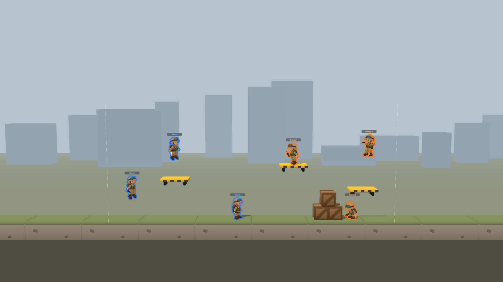
*1× zoom (36 m wide) at 1920×1080: the real on-screen size. Each soldier is about 80 px tall.*

| | |
|---|---|
| 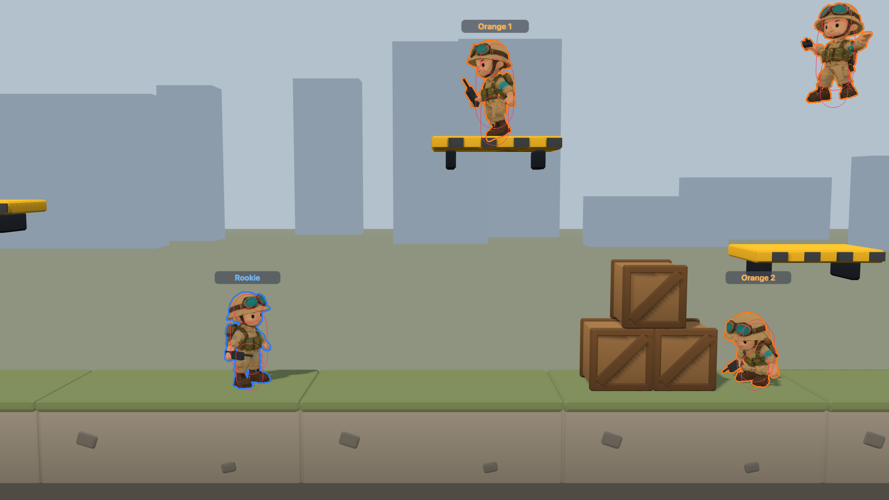 *Damage hitboxes (red) from `packages/content`* |  *Inverted-hull team outline tints the whole soldier at gameplay size; the viewer's default is a screen-space silhouette* |

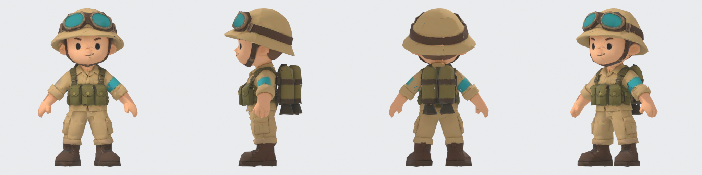

### Concepts (Higgsfield, GPT Image 2.5)

Three original directions, each a front/side/back sheet. **You picked A.**

| | Sheet | Direction |
|---|---|---|
| **A** ✅ | [concepts/A-vinyl-rookie.png](concepts/A-vinyl-rookie.png) | **Vinyl Rookie**: soft vinyl toy, bowl helmet + goggles, twin-tank jetpack, sand/olive with a teal accent |
| B | [concepts/B-doodle-grunt.png](concepts/B-doodle-grunt.png) | **Sketchbook Grunt**: painted sketchbook look, beanie under a dented half-helmet, extinguisher jetpack |
| C | [concepts/C-tin-trooper.png](concepts/C-tin-trooper.png) | **Tin Trooper**: painted tin wind-up toy, dome helmet with a glowing visor, rocket jetpack |

Settings: `gpt_image_2_5`, quality `high`, `2k`, 16:9. No reference images were used, and the prompts name no existing game, character or brand (docs/01 §12).

Each prompt is the direction paragraph below followed by this shared layout paragraph:

> Layout: the SAME character shown three times side by side at identical scale and height — front view, left side view (profile), back view — orthographic, full body, neutral A-pose with arms angled about 30 degrees down and away from the body, feet shoulder-width apart, empty hands (no weapon, holding nothing). Chibi proportions: the head including helmet is one third of the total height; short stubby limbs; chunky mitten hands with a separate thumb; big boots. Bold, simple, instantly readable silhouette. Clean flat light-grey background, soft even studio lighting, no cast shadows, no text, no labels, no logos, no watermarks, no insignia or national flags.

<details><summary>Direction paragraphs (exact text)</summary>

**A:** Character turnaround reference sheet for a 3D game model. Stylised 3D render, soft vinyl designer-toy look with a light toon-shaded ramp and subtle hand-painted texture detail. An original cheerful rookie jetpack soldier: rounded bowl helmet with a wide brim and chin strap, oversized aviator goggles pushed up on the helmet, big round face with simple dot eyes and a small confident grin, sand-khaki fatigues with rolled sleeves, olive chest webbing with three chunky pouches, a bright teal armband on the left upper arm, dark brown boots. On the back: a compact jetpack made of two short rounded fuel tanks side by side on a strap frame, each ending in a stubby flared nozzle pointing down. Palette: sand, olive, warm brown, with teal as the only saturated accent (armband and goggle lenses).

**B:** Character turnaround reference sheet for a 3D game model. Stylised 3D render that looks hand-painted, like a sketchbook doodle brought to life: visible painterly brush strokes and slightly wobbly ink-like outlines painted into the textures, light toon shading. An original stocky, scrappy jetpack grunt: a knitted beanie under a dented half-shell helmet, a bandana around the neck, square jaw with a little stubble patch, determined eyebrows, large expressive eyes, a patched olive-green jacket with a big zip and elbow pads, mustard cargo shorts over dark leggings, oversized lace-up boots, an orange armband on the left upper arm. On the back: a jetpack built from a repurposed brick-red extinguisher-style cylinder strapped vertically, with a single wide nozzle at the bottom and two small stabiliser fins. Palette: olive, mustard, brick red, off-white, with orange as the accent.

**C:** Character turnaround reference sheet for a 3D game model. Stylised 3D render of a painted tin wind-up toy soldier: smooth rounded forms, glossy enamel paint with a few tiny chips at the edges, small rivets and seam lines, light toon ramp. An original plucky jetpack trooper: a round dome helmet with a flip-up visor that has a glowing cyan visor strip, a friendly face with simple oval eyes, a rounded torso like a tin can with a brass belt, short tube-like arms and legs with ball joints at the shoulders and knees, big rounded boots, a cyan band around the left upper arm. On the back: a retro rocket-style jetpack — a single bullet-shaped tank with three small tail fins and twin nozzles at its base, plus a small decorative wind-up key on top that stays close to the body. Palette: navy blue, cream, brass, with cyan as the accent.

</details>

### 3D model (Higgsfield → Tripo H3.1 multiview)

- **Input:** sheet A split into [front / left / back](concepts/A-views/) by `art/pipeline/split_sheet.py`.
- **Model:** `tripo_h3_1_multiview_to_3d`, `face_limit: 30000`, `texture: true`, `pbr: true`.
- **Output:** [character/source/rookie_tripo_raw.glb](character/source/rookie_tripo_raw.glb): 29,860 tris, 2048² maps, A-pose, facing +X, 1 m tall. It fails the asset check, as expected for raw output.

### Map-slice kit (`kit/kit_yard.glb`)

`art/pipeline/build_kit.py` builds three toy-like bevelled pieces with baked vertex colours and one shared material: `ground_4m` (walkable top at y = 0), `platform_2m` (hazard-yellow drop-through), `crate_1m` (bottom at y = 0). [Check](kit/kit_yard.check.txt): **10/10**.

### Findings that still stand

1. **Outline:** use a screen-space silhouette, not the inverted hull (the hull tints the whole soldier at ~80 px). The viewer implements the silhouette pass.
2. **Palette contrast:** without outlines the sand/olive soldier sinks into the yard; the dye system now makes saturated defaults a one-line change.
3. **Crouch vs hitbox:** the crouch puts the head centre at 0.89 m (crouched hitbox 0.84 m); the helmet top sits 13 cm above the crouched hitbox.
4. **Helmet brim radius** ≈ 0.35 m vs the 0.24 m head hitbox.

## Viewer (`tools/art-preview/`)

```bash
python3 tools/art-preview/serve.py      # http://localhost:8123/tools/art-preview/
```

It loads the **shipped runtime files** (meshopt GLB + WebP) with three.js r186, using the docs/01 §5 camera (perspective, 35° FOV, 5° tilt, zoom by visible width per docs/03 §10). `?map=street_market` switches to map mode (kit + layout + spawns as soldiers; `cx`/`cy` centre the camera). Panel: zoom (portrait / close-up / 1×–7×), hero clip, hero weapon (rifle / pistol / dual / none), hero aim angle, action buttons, shading (toon + dye mask / toon / flat / PBR), dye colour pickers, LOD, how far the soldiers turn toward the camera, outline style, hitboxes. **Save screenshot** writes to `art/screenshots/`. URL params: `zoom, clip, family, aim, shading, lod, outline, hitboxes, focus=<roster index>, dyeP/dyeS/dyeA=<hex>, action=<reload|swap|throw|melee>, t=<seconds>, shot=<name>`. `shot` renders deterministically and saves, so it works in a hidden tab.

## Asset check (`tools/asset-check/`)

```bash
blender -b --factory-startup --python-exit-code 1 --python tools/asset-check/check.py -- art/character/rookie_body.glb,art/character/parts/headgear_brim_helmet.glb,art/character/parts/boots_combat.glb,art/character/parts/jetpack_twin_tank.glb
blender -b --factory-startup --python-exit-code 1 --python tools/asset-check/check.py -- <part.glb> --kind part --base art/character/rookie_body.glb,art/character/parts/headgear_brim_helmet.glb,art/character/parts/boots_combat.glb,art/character/parts/jetpack_twin_tank.glb
blender -b --factory-startup --python-exit-code 1 --python tools/asset-check/check.py -- art/weapons/k47.glb --kind weapon
blender -b --factory-startup --python-exit-code 1 --python tools/asset-check/check.py -- art/kit/kit_yard.glb --kind kit
blender -b --factory-startup --python-exit-code 1 --python tools/asset-check/check.py -- art/kits/street_market/kit_street_market.glb --kind kit
blender -b --factory-startup --python-exit-code 1 --python tools/asset-check/selftest.py
```

It exits 0 on PASS, 1 on any FAIL and 2 if the check itself crashed. Keep `--python-exit-code 1`, or Blender exits 0 when a script raises.

What it checks:
- Comma-separated files are checked as one assembled character, because the docs/04 §5 budgets are per character on screen.
- **Parts:**
  - They must be skinned in character space (docs/04 §9.3), with exactly the shared joints.
  - The bind pose must equal the base body's (≤ 1 mm, 0.1°), and weights must be normalised. Stray bones FAIL.
  - Each part has one mesh and one material, and textures of at most 256² (LOD0) or 128² (LOD1).
  - A missing or unknown `slot` FAILs, as do missing `bodyTypes`, `envelopeOk` or dye extras (or an explicit `dyeable: false`).
- The cosmetic envelope is **strict** (docs/04 §1.2): no cosmetic sticks out past the body.
  - The box is the body alone, ×1.10, from the floor up, for every slot including default parts. Default parts listed in `--base` are ignored.
  - Pass the LOD0 body for every LOD.
  - The `envelopeOk` extra must match the measurement.
  - Builders fit parts with [pipeline/envelope.py](pipeline/envelope.py): jetpacks scale about their backplate, while brims, visors, crowns and soles are squeezed in.
- **Locality** (docs/04 §1.2): a part must also stay inside the box of the body vertices skinned to its slot's bones, plus the slot's default part, ×1.10. A 1 m-wide hat, or eyewear hanging to the shins, fits the body box but fails here.
- **Dye round trip** on every texel the mesh's UVs cover:
  - dyed texels: `dyeAlbedo × Π lerp(1, default, mask)` vs the albedo, linear luminance, mean ≤ 0.012 and p95 ≤ 0.04;
  - undyed texels: `dyeAlbedo` = albedo, mean ≤ 5/255 and p95 ≤ 16/255 (WebP/JPEG loss);
  - textures of 128² or smaller get 1.25–2× those limits, because WebP loss is heavier there. A tone-mapped dye albedo still fails by far;
  - one texel in from every UV-island border is skipped, as is a class with fewer than 2% of the texels;
  - art/ sources compare against the lossless `<stem>_albedo.png`;
  - missing dye files FAIL.
- Dye masks named in the extras count toward the texture budget at the KTX2 mask rate (docs/11 §4: ETC1S albedo 0.5 B/px, UASTC masks 1 B/px). Images are classified by role, not by name.
- **Weapons:** `family` must be a §4.2 family (or `thrown`), and `aimPose` one of the clip sets (pistol, dual, rifle).

## Open questions

1. **Toon ramp or flat** (docs/12 decision #6)? The viewer has both; the screenshots use toon.
2. **Default dyes:** keep the sand Rookie, or ship a more saturated default for contrast (Phase 0 finding 2)?
3. **Aim pivot:** lower the sim's aim pivot toward the chibi's hold height (~0.8 m), or keep 1.08 m and accept tracers starting ~0.3 m under the sim line?
4. **KTX2:** OK to install KTX-Software (`brew install ktx-software` or the GitHub release) so the pipeline can write KTX2?

## Cost

| Step | Credits |
|---|---|
| Phase 0: 3 concept sheets + 1 multiview 3D model | 17.25 |
| Milestone A (Blender only) | **0** |
| Milestone B part 1: weapons (Blender only) | **0** |
| Milestone B part 2: cosmetics (Blender only) | **0** |
| Street Market kit + map (Blender only) | **0** |
| Hero cosmetics: 9 concept images + 5 multiview 3D models | **69.75** |
| Weapons Forge 2: 8 muzzle-flash sheets (7 used + 1 test), GPT Image 2.5 medium | **4.00** |
| Weapons Forge 3: 6 impact sheets + 1 decal sheet, GPT Image 2.5 medium | **3.50** |
| Weapons Forge 4: 2 explosion flipbooks, GPT Image 2.5 high 2k | **5.50** |
| Weapons Forge 8: concept sheet for 5 new weapons, GPT Image 2.5 medium 2k | **1.00** |
| Weapons Forge 8, batch 2: concept sheet for 6 new weapons, GPT Image 2.5 medium 2k | **1.00** |
| Weapons Forge 8c: flame puff flipbook, GPT Image 2.5 medium 2k | **1.00** |
| Environments (orchestrator stream, cap 120): Street Market backdrops batch 1, day sky + far and mid skyline layers, GPT Image 2.5 high 2k (3 × 2.75) | **8.25** |
| Environments: backdrops batch 2, second far and mid layers + dusk and night skies, GPT Image 2.5 high 2k (4 × 2.75) | **11.00** |
| Environments: billboard house art batch 3, 8 Screens (4:3) + 4 Hoardings (21:9 → 6:1), GPT Image 2.5 high 1k (12 × 1.5; 8 resubmitted after a rate limit, not charged twice) | **18.00** |
| Environments: backdrops batch 4 for Lunar Outpost (sky, ridges, moon base), Storm Front (storm sky, far port, dockside) and Flux Lab (hall wall, machinery), GPT Image 2.5 high 2k (8 × 2.75; 2 resubmitted after a rate limit, not charged twice) | **22.00** |
| Weapons Forge 10: riot shield concept, GPT Image 2.5 medium 2k | **1.00** |
| Weapons Forge 12, batch 1: the core 6 guns from generated images: 6 concept sheets (GPT Image 2.5 medium 2k, 1.0 each) + 6 Tripo H3.1 multiview models (9 each) | **60.00** |
| Weapons Forge 12, batch 2a: the other 8 originals from generated images: 8 concept sheets (1.0 each) + 8 Tripo H3.1 multiview models (9 each) | **80.00** |
| Weapons Forge 12, batch 2b: the 5 specials from generated images: 5 concept sheets (1.0 each) + 5 Tripo H3.1 multiview models (9 each) | **50.00** |
| The female soldier (22 Oct): 3 concept sheets + 1 edit (GPT Image 2.5 high 2k, 2.75 each) + 1 Tripo H3.1 multiview model (9) | **20.00** |
| Her hairstyles (22 Oct): 1 concept sheet (GPT Image 2.5 high 2k) | **2.75** |
| **Total so far** | **376.00** (the Forge's 400-credit cap: 298.25 used, counting PR 3's concepts and boots and both key arts, each in its own PR) |

Phase 0 Higgsfield job IDs: concepts A `160eb90e-41ab-4ecc-a917-1e76c0563b40`, B `b40714aa-ec2f-4d2a-a522-ff5a4ebe57cc`, C `3e234313-6c57-4cd7-9946-22e6cd62b4b3`; 3D `75fc7390-163d-4c95-869c-58e8544bd654`.

Environments job IDs, with each image's exact prompt and settings, are in `apps/web/scripts/higgsfield-prompts.json` (originals are not committed; `apps/web/scripts/backdrops.py` turns them into `apps/web/public/assets/backdrops/`): batch 1 sky_day `5ef0226c-c5c9-40d4-82d3-0f3e803b92cd`, far_a `301ce1d0-a43c-4e40-bb9c-632621e912cb`, mid_a `b9a788a9-bb7f-474a-b52c-bcdaf3421cc8`; batch 2 far_b `277e2e91-fffc-4225-bac7-02ad0130e2b3`, mid_b `83e2f8aa-2e5d-4ecd-9207-33b49c1f8839`, sky_dusk `ea0f4669-60b5-406b-a8f6-7185f4394903`, sky_night `2bfae633-9388-4803-bf61-5359124245f2`; batch 3 (house art, `apps/web/scripts/house-ads.py` → `apps/web/public/assets/ads/street_market/`) bakery `b7cfdb8d-136d-41a3-b6ca-45879ef31077`, kitchen `5ac9ead8-86dd-4f2c-afba-4343d025a8ba`, tailors `7806dbab-983d-4b59-bbe4-efee89169642`, gutters `1edd4897-dfa9-461f-b044-7eaa5a5f549b`, zebra `9eeb8fd6-b6ac-4f1a-aeea-17a7c777b93a`, water `a2d553d2-8571-4175-b2ca-71cca67ee4b7`, fish `8163076e-37ee-44fd-a9e6-89d8766a2917`, market day `6200c838-e46e-46ad-bd03-09702b7d56ed`, city market `a7b69ac3-1f19-45e5-8160-e2948245ddd5`, trees `802189d6-5d66-4946-85cd-b25b65f74b6c`, slow down `0c733c8c-fec3-4975-bb44-68fbac6b015b`, bakery banner `9f4b17df-2ed3-4bf7-8f2c-97da9a085ec8`; batch 4 (backdrops for the other maps, each its own place) lunar sky `9a37ba51-a473-455e-989a-a153c5715bff`, lunar far `f9a68902-49cf-4d48-afd5-ccc2b9f88776`, lunar mid `2353a943-e392-456f-a31a-ff10c8e0d227`, storm sky `6bf3cdee-5406-4efe-9860-e990937c17d3`, storm far `be5a3496-cc10-4be6-8a31-6bc95b6b85a4`, storm mid `fa786170-a313-49cf-a989-2d9f41a0fe33`, lab wall `d0f150ce-3eb2-4421-99a2-18f6626ef41b`, lab mid `9ce1d476-d472-4d94-8960-0d22faf0f946`. Environments stream total: 59.25 of its 120-credit cap.

## Files

```
art/
  pipeline/        build_character.py, clips.py, dye.py, build_cosmetics.py, build_weapons.py, build_vfx.py, build_casings.py, build_impacts.py, build_explosions.py, build_projectiles.py, build_specials.py, build_grenade_fx.py, build_attachments.py, build_camos.py, build_gun_scan.py, build_kit.py, build_market_kit.py, compile_map.py, render_views.py, render_weapons.py, split_sheet.py
  concepts/        A/B/C sheets + A-views/ (the 3D inputs)
  character/       rookie_body[_lod1].glb, rookie_anims.glb, rookie_preview.glb, rookie_rig.json, *.check.txt|json
    parts/         default parts: headgear_brim_helmet, boots_combat, jetpack_twin_tank [_lod1].glb
    textures/      baked albedo, dye mask and dye albedo per part and LOD
    source/        rookie_tripo_raw.glb (Higgsfield output), rookie.blend
  weapons/         <id>.glb, weapons.json, sockets.json, camos.json, checks/, scan_specs.json
    scan/          <id>_albedo.png (the baked 256² albedo); source/<id>_tripo_raw.glb (Higgsfield output, the scan inputs)
  cosmetics/       <slot>/<id>[_lod1].glb ×11 items, textures, cosmetics.json, checks/
  kit/             kit_yard.glb (+ check)
  kits/            street_market/kit_street_market.glb (+ check)
  maps/            street_market/layout.json → street_market.map.json (MapDef) + street_market.adslots.json
  screenshots/     viewer captures + Blender sheets
tools/
  asset-check/     check.py, selftest.py
  art-preview/     index.html, main.js, serve.py
apps/web/public/assets/   runtime exports (see above)
```
