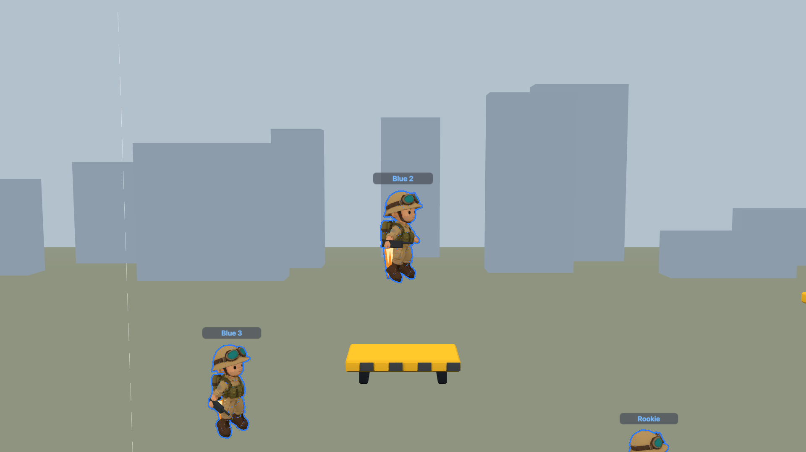
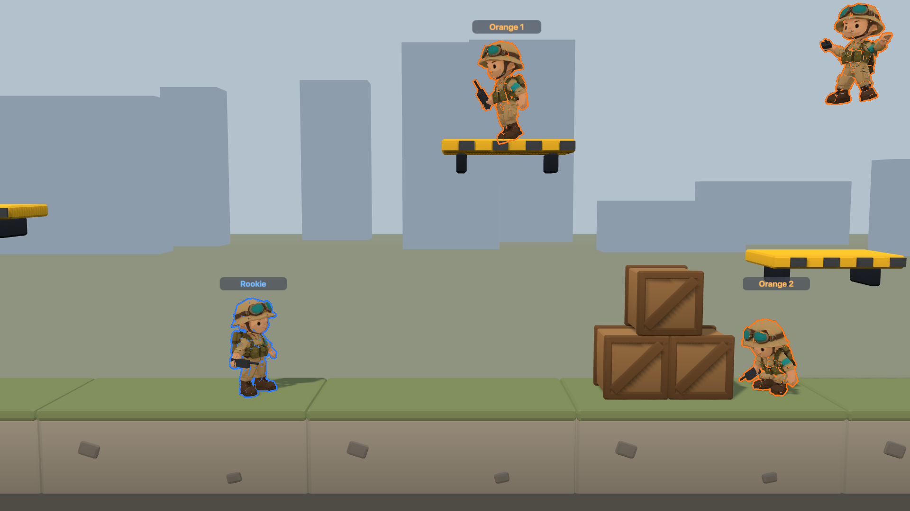
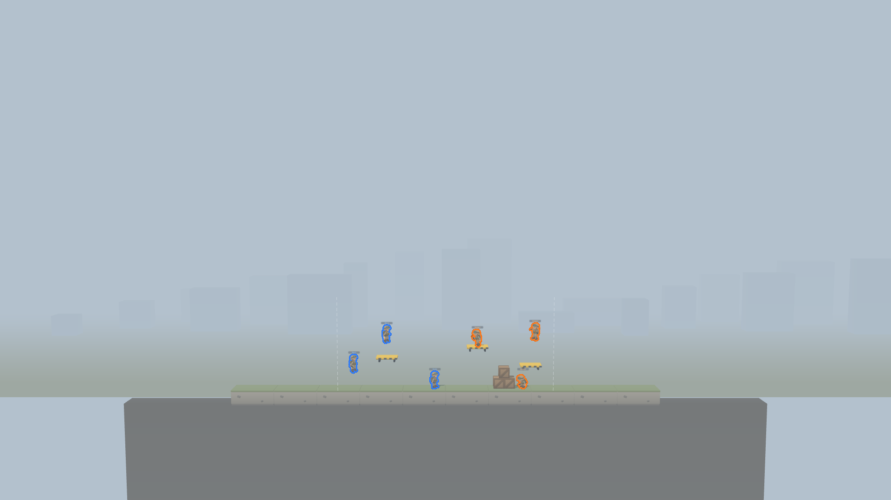

# Phase 0 art-style test: Rookie + yard kit

The art-style test from [docs/12](../docs/12-roadmap.md) §2: one rigged chibi soldier with 6 clips and a 20 m map slice, viewed in Three.js at the gameplay camera. Concepts and the base mesh come from Higgsfield. Blender (headless) does the rest.

**Result:** the pipeline works end to end. Concept → 3D → game-ready rigged glTF takes **17.25 Higgsfield credits** and a few seconds of scripted Blender time (a full rebuild runs in 2.3 s here). The soldier passes every asset check: 3,900 tris, one draw call, a 1024² albedo, the shared 25-bone skeleton plus 7 sockets, and a head centre 1 mm from the hitbox. Two findings need decisions before more art is made: **outline style** and **palette contrast**, both under [Findings](#findings).


*1× zoom (36 m wide) at 1920×1080: the real on-screen size. Toon ramp, screen-space team silhouettes. Each soldier is about 80 px tall. Dashed lines mark the 20 m slice.*


| | |
|---|---|
|  *Damage hitboxes (red) from `packages/content`; the crouching soldier uses the crouched layout* |  *Jet clips, with placeholder flames hung on `socket_jetpack` and a placeholder gun on `socket_weapon_R`* |
|  *Inverted-hull team outline: also outlines interior edges, which tints the whole soldier at gameplay size* |  *No outline: sand fatigues blend into the yard palette* |
|  *LOD1 (1,750 tris, 512² texture)* |  *7× zoom (83 m wide)* |


*Clips (profile + three-quarter each): idle, run, crouch_idle, jet_ascend, jet_hover, fall.*

---

## 1. Concepts (Higgsfield, GPT Image 2.5)

Three original directions, each a front/side/back sheet. **You picked A.**

| | Sheet | Direction |
|---|---|---|
| **A** ✅ | [concepts/A-vinyl-rookie.png](concepts/A-vinyl-rookie.png) | **Vinyl Rookie**: soft vinyl toy, bowl helmet + goggles, twin-tank jetpack, sand/olive with a teal accent |
| B | [concepts/B-doodle-grunt.png](concepts/B-doodle-grunt.png) | **Sketchbook Grunt**: painted sketchbook look, beanie under a dented half-helmet, extinguisher jetpack |
| C | [concepts/C-tin-trooper.png](concepts/C-tin-trooper.png) | **Tin Trooper**: painted tin wind-up toy, dome helmet with a glowing visor, rocket jetpack |

Settings: `gpt_image_2_5`, quality `high`, `2k`, 16:9. No reference images were used, and the prompts name no existing game, character or brand (docs/01 §12).

Each prompt is the direction paragraph below followed by this shared layout paragraph:

> Layout: the SAME character shown three times side by side at identical scale and height — front view, left side view (profile), back view — orthographic, full body, neutral A-pose with arms angled about 30 degrees down and away from the body, feet shoulder-width apart, empty hands (no weapon, holding nothing). Chibi proportions: the head including helmet is one third of the total height; short stubby limbs; chunky mitten hands with a separate thumb; big boots. Bold, simple, instantly readable silhouette. Clean flat light-grey background, soft even studio lighting, no cast shadows, no text, no labels, no logos, no watermarks, no insignia or national flags.

<details><summary>Direction paragraphs (exact text)</summary>

**A:** Character turnaround reference sheet for a 3D game model. Stylised 3D render, soft vinyl designer-toy look with a light toon-shaded ramp and subtle hand-painted texture detail. An original cheerful rookie jetpack soldier: rounded bowl helmet with a wide brim and chin strap, oversized aviator goggles pushed up on the helmet, big round face with simple dot eyes and a small confident grin, sand-khaki fatigues with rolled sleeves, olive chest webbing with three chunky pouches, a bright teal armband on the left upper arm, dark brown boots. On the back: a compact jetpack made of two short rounded fuel tanks side by side on a strap frame, each ending in a stubby flared nozzle pointing down. Palette: sand, olive, warm brown, with teal as the only saturated accent (armband and goggle lenses).

**B:** Character turnaround reference sheet for a 3D game model. Stylised 3D render that looks hand-painted, like a sketchbook doodle brought to life: visible painterly brush strokes and slightly wobbly ink-like outlines painted into the textures, light toon shading. An original stocky, scrappy jetpack grunt: a knitted beanie under a dented half-shell helmet, a bandana around the neck, square jaw with a little stubble patch, determined eyebrows, large expressive eyes, a patched olive-green jacket with a big zip and elbow pads, mustard cargo shorts over dark leggings, oversized lace-up boots, an orange armband on the left upper arm. On the back: a jetpack built from a repurposed brick-red extinguisher-style cylinder strapped vertically, with a single wide nozzle at the bottom and two small stabiliser fins. Palette: olive, mustard, brick red, off-white, with orange as the accent.

**C:** Character turnaround reference sheet for a 3D game model. Stylised 3D render of a painted tin wind-up toy soldier: smooth rounded forms, glossy enamel paint with a few tiny chips at the edges, small rivets and seam lines, light toon ramp. An original plucky jetpack trooper: a round dome helmet with a flip-up visor that has a glowing cyan visor strip, a friendly face with simple oval eyes, a rounded torso like a tin can with a brass belt, short tube-like arms and legs with ball joints at the shoulders and knees, big rounded boots, a cyan band around the left upper arm. On the back: a retro rocket-style jetpack — a single bullet-shaped tank with three small tail fins and twin nozzles at its base, plus a small decorative wind-up key on top that stays close to the body. Palette: navy blue, cream, brass, with cyan as the accent.

</details>

## 2. 3D model (Higgsfield → Tripo H3.1 multiview)

- **Input:** sheet A split into [front / left / back](concepts/A-views/) by `tools/asset-pipeline/split_sheet.py` (same scale, square, in Tripo's front-left-back order).
- **Model:** `tripo_h3_1_multiview_to_3d`, `face_limit: 30000`, `texture: true`, `pbr: true`.
- **Output:** [character/source/rookie_tripo_raw.glb](character/source/rookie_tripo_raw.glb): 29,860 tris, 2048² colour + normal + ORM maps, clean A-pose, facing +X, 1 m tall. It fails the asset check, as expected for raw output (see §4).

## 3. Blender pipeline → game-ready glTF

```bash
blender -b --factory-startup --python tools/asset-pipeline/build_character.py -- \
  art/character/source/rookie_tripo_raw.glb art/character --name rookie --facing +x
```

`blender` is `/Applications/Blender.app/Contents/MacOS/Blender` (5.2.1 here). The script:

1. **Normalises:** faces glTF +Z, is 1.50 m tall (the collision capsule height), stands with its feet on y = 0 and is centred on the legs.
2. **Measures landmarks on the full-res mesh** (neck = the narrowest slice, crotch, armpit, hand tips, feet) and places the skeleton from them. Result: [character/rookie_rig.json](character/rookie_rig.json).
3. **Builds LODs:** collapse-decimates to 3,900 tris (LOD0) and 1,750 tris (LOD1), smart-UV-unwraps, then **bakes** the original albedo onto the new UVs (1024² / 512²). Normal and ORM maps are dropped for the toon look.
4. **Rigs:** the docs/04 §4.1 skeleton: `root, pelvis, spine1, spine2, neck, head, clavicle/upperarm/forearm/hand/thigh/calf/foot/toe _L/_R, jaw, eye_L/R` (25 deform bones; the docs say "about 24") plus non-deform `socket_weapon_R/L, socket_offhand_IK, socket_jetpack, socket_hat, socket_back, socket_nameplate`. Weights come from distance-to-bone, gated by body region: the head and helmet, the jetpack and the boots are rigid; joints are smoothed; at most 4 influences per vertex.
5. **Clips:** 6 placeholder clips keyed in the script: `idle, run, crouch_idle, jet_ascend, jet_hover, fall`. They're stand-ins for an animator or for Mixamo retargets (docs/11 §4).
6. **Exports** [character/rookie.glb](character/rookie.glb) (LOD0, 713 KB) and [character/rookie_lod1.glb](character/rookie_lod1.glb) (368 KB), with the same skeleton and clips, plus [character/source/rookie.blend](character/source/rookie.blend).

**Conventions** (worth fixing in docs/04 before more assets):
- Bones: +Y runs along the bone and +Z points forward (up, for bones that already point forward: feet, toes, eyes, weapon sockets), so **+X rotation flexes any vertical bone forward**.
- Weapon sockets point forward: +Y is the muzzle direction.
- `socket_offhand_IK` hangs off `socket_weapon_R`, 16 cm forward, as a default foregrip; each weapon should override it.
- `socket_jetpack` sits where the jetpack meets the back. `socket_back` sits behind the jetpack's top, for flags and radios.
- `socket_hat` is 8 cm below the top of the helmet. `socket_nameplate` is under `root`, at 1.75 m.
- Node extras: `slot: body`, `bodyTypes: [standard]`, `envelopeOk: true` (docs/04 §8).

### Budgets

| Budget (docs/04 §5, docs/11 §3) | Target | Rookie |
|---|---|---|
| Triangles LOD0 / LOD1 | ≤ 4,000 / ≤ 1,800 | **3,900 / 1,750** |
| Draw calls per character | 1–3 | **1** (+ weapon + flame) |
| GPU texture memory (KTX2 estimate) | ≤ 1.5 MB | **1.33 MB** (one 1024² albedo; LOD1 0.33 MB) |
| Skeleton | shared ~24 bones + 7 sockets | **25 + 7**, names exact |
| Influences per vertex | ≤ 4 (three.js) | **≤ 4** |
| Head centre vs hitbox | 1.24 m | **1.239 m** standing; **0.89 m** crouched (hitbox 0.84) |
| Height | hitbox top 1.48 m (+10%) | **1.50 m** |
| Silhouette vs hitboxes (profile) | not smaller, ≤ 10% envelope | **68%** of the hitbox area drawn; **6%** outside the ×1.1 envelope |
| Kit pieces | n/a | ground 432, platform 228, crate 484 tris; one shared material, no textures |

## 4. Asset check (`tools/asset-check/`)

```bash
blender -b --factory-startup --python tools/asset-check/check.py -- art/character/rookie.glb            # character, LOD0
blender -b --factory-startup --python tools/asset-check/check.py -- art/character/rookie_lod1.glb --lod 1
blender -b --factory-startup --python tools/asset-check/check.py -- art/kit/kit_yard.glb --kind kit
blender -b --factory-startup --python tools/asset-check/check.py -- hat.glb --kind part --base art/character/rookie.glb
blender -b --factory-startup --python tools/asset-check/selftest.py                                      # 7/7
```

It prints PASS/WARN/FAIL lines, exits 1 on any FAIL, and `--json` writes a report. It checks:
- triangle budget, draw calls and texture size, power-of-two sizes and estimated KTX2 memory;
- the skeleton: all bone and socket names, no unexpected bones, sockets unweighted;
- skin weights: every vertex weighted, ≤ 4 influences, normalised;
- placement: feet on the ground, facing glTF +Z, height and head centre against the hitboxes, which it **reads from `packages/content/src/hitboxes.ts`** so it can't drift from the sim;
- **profile silhouette coverage** of the hitboxes (no tiny skins) and the share drawn outside the ×1.1 envelope;
- the **cosmetic envelope** for parts (`--kind part --base body.glb`);
- kit pieces: pivot on the top or bottom surface, and the 0.25 m grid.

Reports: [character/rookie.check.txt](character/rookie.check.txt) (**PASS 23/23**), [character/rookie_lod1.check.txt](character/rookie_lod1.check.txt) (**PASS 23/23**), [kit/kit_yard.check.txt](kit/kit_yard.check.txt) (**PASS 10/10**). The raw Tripo GLB **fails** on 6 counts (29,860 tris, three 2048² maps, 16 MB of textures, no skeleton). That's the expected negative control.

## 5. Map-slice kit (`kit/kit_yard.glb`)

`tools/asset-pipeline/build_kit.py` builds three toy-like bevelled pieces with baked vertex colours (a bottom-dark "AO" gradient plus per-face jitter) and one shared material:

| Piece | Size | Pivot |
|---|---|---|
| `ground_4m` | 4 × 1.5 m, 2 m deep (the gameplay band), turf cap | walkable top at y = 0 |
| `platform_2m` | 2 m, hazard-yellow drop-through (matches the debug client's yellow one-way platforms) | walkable top at y = 0 |
| `crate_1m` | 1 m cover crate | bottom at y = 0 |

The kit stays mid or low saturation; only the hazard yellow, a gameplay cue, is loud (docs/11 §4). The skyline boxes, the earth fill under the ground and the slice markers in the viewer are preview dressing, not kit pieces.

## 6. Viewer (`tools/art-preview/`)

```bash
python3 tools/art-preview/serve.py      # http://localhost:8123/tools/art-preview/
```

It runs three.js r186 from the CDN with the docs/01 §5 camera: perspective, 35° FOV, a 5° downward tilt, and zoom set by visible width per docs/03 §10. Six soldiers (two teams) cover the six clips, standing on the kit. The panel has zoom, hero clip, shading (toon ramp / flat / PBR), LOD, how far the soldiers turn toward the camera, outline style, and a hitbox overlay. **Save screenshot** writes to `art/screenshots/`. URL params: `?zoom=1&clip=run&shading=toon&lod=1&outline=hull&hitboxes=1&focus=<roster index>&shot=<name>`. `shot` renders deterministically and saves, so it works in a hidden tab too.

The debug panel counts 6 soldiers + kit at **77 draw calls, 56k tris** with no outline (shadow pass included; kit and skyline not instanced), and about 96 calls with the silhouette pass. The real client would instance the kit (docs/11 §2).

## Findings

1. **Higgsfield → Blender is viable for base meshes.** One 9-credit multiview generation gave a clean A-pose mesh that matched concept A closely. The landmark-driven rig placed the head centre 1 mm from the hitbox with no hand fixes.
2. **Decimation wrecks the generators' UVs.** Collapse decimation produced white streaks of empty atlas. The pipeline re-unwraps and bakes, which fixed it. Tripo's ORM map marks the goggle lenses metallic, which bakes to black, so the bake zeroes metallic first.
3. **Outline: use a screen-space silhouette, not the inverted hull.** At gameplay size (about 80 px tall) the hull also outlines the pouches, arms and brim, and tints the whole soldier in team colour (see the hull screenshot). A silhouette pass (team mask + dilate) keeps the detail readable. docs/04 §5.5 allows either; this test says silhouette.
4. **Palette contrast.** Without outlines the sand/olive soldier sinks into the warm-grey/turf yard. The design depends on the team outline, so either the default palette gets more saturated or the dye defaults do.
5. **Crouch vs hitbox.** Short chibi legs limit the squat. The crouch clip brings the head centre to 0.89 m (crouched hitbox 0.84 m), and the helmet top sits at 1.19 m, 13 cm above the crouched hitbox top (1.06 m). Visually the head peeks above what is hittable.
6. **The helmet brim is wider than the head hitbox.** The brim radius is about 0.35 m against a head hitbox radius of 0.24 m, so shots that clip the brim's edge won't register as headshots.
7. **The jetpack is part of the body mesh**, rigid to `spine2`, not yet its own cosmetic slot. `socket_jetpack` marks where a separate jetpack part should mount.

## Not done in this test

- **meshopt + KTX2** (the gltf-transform step in docs/11 §4): the GLBs carry JPEG albedo.
- **Dye mask** texture (R/G/B/A channels, docs/04 §5.4): the teal armband is painted into the albedo.
- **Real clips**: the six clips are hand-keyed placeholders, and the aim-offset layer isn't built.
- **Weapons**: the gun in the viewer is a placeholder box on the socket.
- One change outside `art/` and `tools/`: an additive `art-preview` entry in `.claude/launch.json`. No changes to `apps/` or `packages/`.

## Open questions for you

1. **Style:** keep A (Vinyl Rookie) as the base "Rookie"? B's painted texture treatment could still be layered onto A's shapes.
2. **Shading:** toon ramp or flat? The viewer has both (docs/12 decision #6). The screenshots use the toon ramp.
3. **Outline:** adopt the screen-space silhouette as the team outline (finding 3)?
4. **Palette:** saturate the default uniform, or rely on team outlines and dyes for contrast (finding 4)?
5. **Hitbox/art fit:** shrink the brim and tuck the crouch deeper, or adjust the hitbox data (findings 5–6)? The hitboxes live in `packages/content`, which this test didn't touch.
6. **Jetpack as a separate part:** generate jetpacks as their own Higgsfield models (about 9 credits each with the same multiview route) so the jetpack slot is real?
7. **What to change on the Rookie** before it becomes the base for body types and cosmetics: face, goggles, armband colour, boots?

## Cost

| Step | Model | Credits |
|---|---|---|
| 3 concept sheets | `gpt_image_2_5`, high, 2K (2.75 each) | 8.25 |
| 1 multiview 3D model | `tripo_h3_1_multiview_to_3d` | 9.00 |
| **Total** | | **17.25** (balance 803.53 → 786.28) |

Higgsfield job IDs: concepts A `160eb90e-41ab-4ecc-a917-1e76c0563b40`, B `b40714aa-ec2f-4d2a-a522-ff5a4ebe57cc`, C `3e234313-6c57-4cd7-9946-22e6cd62b4b3`; 3D `75fc7390-163d-4c95-869c-58e8544bd654`.

## Files

```
art/
  concepts/        A/B/C sheets + A-views/ (the 3D inputs)
  character/       rookie.glb (LOD0), rookie_lod1.glb, rookie_rig.json, *.check.txt|json
    source/        rookie_tripo_raw.glb (Higgsfield output), rookie.blend
  kit/             kit_yard.glb, kit_yard.check.txt|json
  screenshots/     viewer captures + Blender turnaround and clip sheets
tools/
  asset-pipeline/  split_sheet.py, build_character.py, build_kit.py, render_views.py
  asset-check/     check.py, selftest.py
  art-preview/     index.html, main.js, serve.py
```
