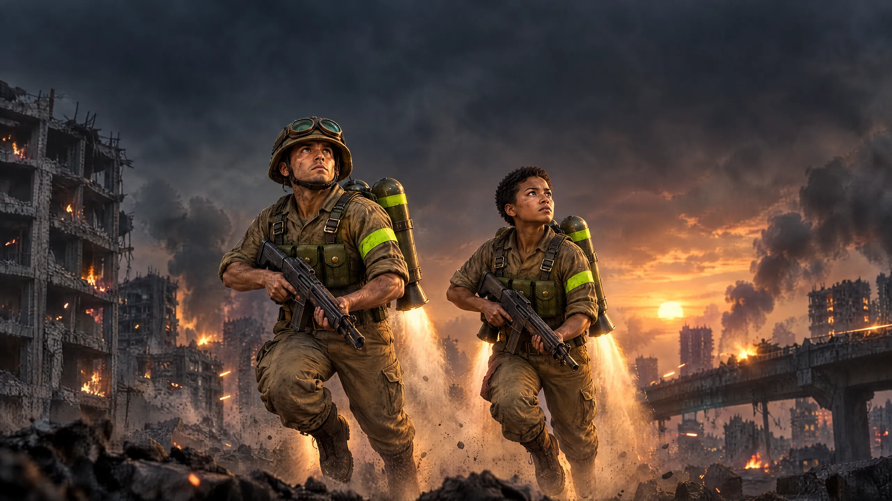

# Key art v2: our soldiers on the title screen



The owner, 23 Oct, on #185:
- the poster "should use our 3D characters instead, like our fighters' faces instead of the near-real one";
- the background "could be something 3D-ish … a nice image of a map we might build later";
- and "I just don't want it to look like we're promoting war". So it is a sunny rooftop arena, with the rifles held low.
- **The soldiers:** the game's own Rookie and female soldier (`characters/rookie`, `characters/rookie_female`) in their default kit, with their real faces, skeleton, clips and weapons, rendered in Cycles:
  - **Rookie:** the K-47, held low across him, pointing down.
  - **Her:** the Longbow, held low the same way. Nothing is aimed.
  - Both are on jet hover with their exhaust, turned toward the camera like a team photo.
- **The world:** a concept of a map we could build later. It is a sunny rooftop arena in a colourful city, laid out like a jetpack course, in the game's own low-poly 3D look (generated, with the Street Market map render as the style reference):
  - rooftops at different heights with ledges and railings, and a catwalk;
  - water tanks, rooftop gardens and parasols;
  - bunting and blank billboard frames;
  - no damage, fire or smoke.
- **Layout (as #185):** the soldiers in the middle; the upper third is calm sky for the logo, and the bottom strip is dark rubble for "TAP ANYWHERE".
- **The title screen is unchanged:** the same file names as #185 (`virtual:title-info` picks them up).

## Files (`apps/web/public/art/key-art/`)

| File | Size | What |
|---|---|---|
| `key-art-desktop.{webp,avif}` | 2560×1440 | 16:9 |
| `key-art-phone.{webp,avif}` | 2340×1080 | 19.5:9: its own camera, a little wider, over the map's middle rows |
| `poster-portrait.{webp,avif}`, `poster-portrait-phone.{webp,avif}` | 1600×2400, 1080×1620 | 2:3 poster: its own camera over the map's 2:3 crop |
| `key-art-desktop-fg.{webp,avif}`, `key-art-phone-fg.{webp,avif}` | as their frames | the soldiers alone (alpha), pixel-aligned with their frame, for the parallax layer |
| `key-art-desktop-loop.{mp4,webm}` | 1280×720, 5 s, 24 fps, silent; 198 / 398 KB | the ambient loop: the hover's bob and the flames' flicker over the still plate. Its first frame is the desktop frame's pose, and it loops seamlessly (its last frame is one step from its first). Use `key-art-desktop.webp` as its poster. |

Every phone file is under 400 KB: the phone frame is 111–153 KB, the poster 55–77 KB and the phone foreground 43–78 KB (AVIF / WebP). Serve AVIF with WebP as the fallback.

## How it is made
1. **Map plate** (Higgsfield GPT Image 2.5, high, 4k, 16:9; 2 variants, the second picked): jobs `f3d3ed33…`, `eb4bbd06…`.
   - **References:** the Street Market overview (the game's map style) and a test render of our two soldiers (their look).
   - **Source:** [plate-map-4k.jpg](plate-map-4k.jpg).
2. **The soldiers** ([render_key_art.py](../pipeline/render_key_art.py), Blender 5.2 Cycles, Metal):
   - **Rig and meshes:** the Rookie's armature and clips from `rookie.blend`; her skeleton is his. Every mesh comes from the art GLBs (body, the default helmet, boots and Twin Tank, each body's own fit) and is bound to it by vertex-group name.
   - **Pose:** the game's layering. `jet_hover` on every bone, then the aim pose on the upper body, then the off hand IK'd onto the weapon's `offhand` node (the clips' arm solver).
   - **Weapons:** on `socket_weapon_R` in the game's frame (+Y muzzle, +Z top).
   - **Light (a bright afternoon, the plate's):**
     - a warm sun high on the right and in front;
     - a soft blue sky fill all round;
     - a gentle key from the front left and a white rim from behind;
     - small lights in each flame, kept weak (stronger, one soldier's lit the other's front).
   - **Exhaust:** soft emission cones from each nozzle (`nozzles` in the Twin Tank's manifest and her `bodies.female` fit), flickering.
   - **Look:** AgX, Punchy (daylight flattens the vinyl; the plate is saturated).
   - **Shots:** desktop 3840×2160 and phone 3840×1772 at 96 samples, poster 1600×2400 at 128, all denoised; the loop at 1280×720, 32 samples a frame.
3. **Compose** ([compose_key_art.py](../pipeline/compose_key_art.py)):
   - each render over its crop of the plate;
   - a glow on the flames only (bright and saturated);
   - WebP q80 / AVIF q55, stepped down until each phone file is under 400 KB;
   - the loop's frames over the still plate, then H.264 (crf 26, faststart) and VP9 (crf 38).

**Seamless loop:**
- the hover clip plays a whole number of cycles;
- the flames flicker on the loop's period;
- its first frame is the desktop frame's pose.

Sources (`art/key-art/`): the frames at full size (JPEG q93), the plate, and the soldiers' layers (lossless WebP), for a later re-grade. The render script reads the female soldier from `characters/rookie_female` (#203).

```bash
blender -b --factory-startup --python art/pipeline/render_key_art.py -- desktop desktop.png --size 3840x2160 --samples 96
blender -b --factory-startup --python art/pipeline/render_key_art.py -- phone phone.png --size 3840x1772 --samples 96
blender -b --factory-startup --python art/pipeline/render_key_art.py -- poster poster.png --size 1600x2400 --samples 128
blender -b --factory-startup --python art/pipeline/render_key_art.py -- desktop x.png --size 1280x720 --samples 32 --frames 0-119 --loop-out loop/
python3 art/pipeline/compose_key_art.py art/key-art/plate-map-4k.jpg desktop.png phone.png poster.png --poster-x 1700 --loop loop/
```

<details><summary>Map plate prompt (exact text)</summary>

"A stylised 3D game environment render: a concept for a new map in the same game as the first reference image (the game's own low-poly street map), drawn in exactly that 3D look but richer and more polished, so it matches the chunky vinyl-toy characters in the second reference image. It is a sunny rooftop arena in a colourful, friendly city on a bright afternoon, laid out like a jetpack sport course for a side-scrolling 2.5D game: rooftops at different heights with ledges and railings, a catwalk bridging two roofs, round water tanks on stilts, rooftop gardens with potted plants and striped parasols, strings of colourful bunting and fabric banners with no writing, empty billboard frames, satellite dishes. Behind: a layered skyline of pastel apartment towers and soft round clouds. Chunky low-poly shapes with clean bevelled edges, flat-shaded painted surfaces in warm cream, terracotta, teal and soft yellow, gentle ambient occlusion, like a polished 3D diorama, NOT photographic. Clear blue sky with a warm sun high on the right, soft shadows, cheerful and calm. Absolutely no damage, no ruins, no fire, no smoke, no weapons, no military vehicles, no war. Composition for a title screen: keep the upper third a calm blue sky for a game logo, keep the centre of the frame open at mid height (two characters will be placed there later), and keep the bottom strip a calm rooftop parapet in soft shade for a line of text. No people, no characters, no text, no letters, no logos, no flags, nothing from any other game."

</details>

## Spend: 25.25 credits
| Step | Credits |
|---|---|
| a photoreal plate: #185's city with its soldiers removed, then 21:9 and 2:3 outpaints (superseded: a 3D map instead) | 8.25 |
| 2 war-torn map plates at dusk, GPT Image 2.5 high 4k (superseded: "not promoting war") | 8.50 |
| 2 sunny-arena plates, GPT Image 2.5 high 4k (4.25 each) | 8.50 |

The Forge stands at **306.75 of its 400**.
