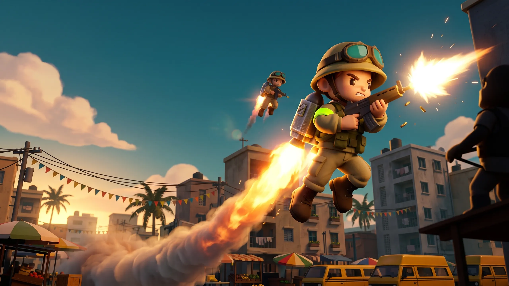

# Key art v3: one hero, mid-boost, over the Lagos street

The opening's research (1 Nov) found v2's art too passive: two soldiers standing with rifles low, khaki on beige,
a flat eye-level camera, and the lockup sitting on their helmets. v3 is one action frame:

- **Hero:** one soldier in our toy-soldier look (round khaki helmet with teal goggles, khaki fatigues, olive vest,
  rounded proportions), from a low three-quarter angle, mid-boost on a bright jetpack flame, rifle raised and
  firing. The muzzle flash is the brightest point. A volt armband carries the kit's action colour.
- **Depth:** a teammate higher and smaller behind him, and an enemy silhouette cut off at the right edge.
- **Setting:** our Lagos street market at golden hour: umbrellas, yellow minibuses, power lines and bunting,
  apartment blocks with water tanks, palms. A teal-blue sky against the orange flame.
- **Composition:** a bottom-left to top-right diagonal (the smoke trail into the climb); the upper left is open
  sky, so the lockup and the title's left column never cross the hero.

> The owner's 23 Oct note on v2 asked for nothing that looks like promoting war (rifles low, no fire). v3
> follows the 1 Nov opening brief instead (a raised rifle, firing), with no blood, wreckage or casualties. If the
> owner wants v2's calm back, v2's sources are still here (below) and `compose_key_art.py` still makes them.

## Files (`apps/web/public/art/key-art/`)

| File | Size | What |
|---|---|---|
| `key-art-desktop.{webp,avif}` | 2560×1440, 143 / 92 KB | 16:9, the title and the landing |
| `key-art-desktop-fg.{webp,avif}` | 2560×1440, 114 / 43 KB | the hero alone (alpha), pixel-aligned: the desktop parallax layer |
| `key-art-phone.{webp,avif}` | 2340×1080, 110 / 70 KB | 19.5:9, a band of the same frame (a phone shows no parallax layer) |

v2's ambient loop (`key-art-desktop-loop.*`), its phone foreground and its 2:3 posters are gone: they showed the
old frame. `virtual:title-info` (vite.config.ts) lists only the files that are here, so the title simply plays
no loop. The About sheet's thumbnails (`apps/web/public/art/landing/keyart.*`, `poster.*`) come from v3 too, and
the share image and the poster set are `apps/web/scripts/og-image.mjs` (see `art/posters/README.md`).

## How it is made

1. **Generate** (Higgsfield; references: v2's desktop frame for the characters' look, the Street Market map's
   in-game shot for the street):
   - 16:9 at 2k: two Nano Banana 2.1 and one GPT Image 2.5 high (jobs `4693c541…`, `39fa9fd7…`, `1f88acff…`).
     Picked: `39fa9fd7-eaaf-43cc-9353-f621dc90f949` (golden hour, the clearest diagonal, faces with intent).
   - 9:16 and 4:5 from the pick (Nano Banana 2.1, 2k, the pick and v2 as references; two of each, the second of
     each picked): 9:16 `84d9ddb8-ea18-4877-96c2-02b9635a2d27`, 4:5 `c2498969-73c8-4a9a-a58b-4ee7e034c056`.
   - The hero cut out of the pick (Higgsfield background remover, `e115822c-2e78-4998-9de8-02a450adaff0`).
2. **Sources** (`art/key-art/`): `v3-desktop.jpg` (2752×1536), `v3-hero.webp` (lossless, alpha),
   `v3-tall-9x16.jpg` (1536×2752), `v3-tall-4x5.jpg` (1856×2304).
3. **Web files:** `bash art/pipeline/key_art_v3.sh` (ImageMagick, cwebp, avifenc): the 16:9 middle at 2560×1440,
   the phone band from y 120, WebP q80 and AVIF q55, phone files under 400 KB.

The 16:9 prompt (the pick's, exact text)

"Action key art for a stylised 3D jetpack shooter game, cinematic low-angle shot. Keep the character design from
the first reference exactly: chunky toy-soldier proportions, oversized round head, round khaki helmet with teal
goggles, khaki uniform, olive vest, brown boots, smooth soft 3D render. A single hero soldier mid-boost, rocketing
diagonally up toward the top right on a jetpack spewing a bright orange flame, body leaning into the climb, rifle
shouldered and firing, a big white-hot muzzle flash at the barrel tip that is the brightest spot in the frame.
Intense, determined expression. Neon yellow-green armband. Behind and above, smaller, a teammate soldier on a
jetpack. An enemy soldier silhouette partly cut off at the right frame edge, in shadow. Background: a Lagos street
market at golden hour like the second reference, seen from street level looking up: striped market umbrellas,
yellow minibuses parked below, power lines and colourful bunting across the street, apartment blocks, palm trees,
warm sunset glow against a deep teal-blue sky, a few sparks and spent shell casings in the air. Composition: hero
placed right of centre, smoke trail from the bottom-left corner, the entire upper-left area is empty clear sky
reserved for a title logo. Vivid colours, strong contrast between orange flame and blue sky. No text, no letters,
no writing, no logos, no watermark."

## Spend: 15.75 credits (of the 40 allowed)

| Step | Credits |
|---|---|
| 16:9 at 2k: 2 × Nano Banana 2.1 (2.00) and 1 × GPT Image 2.5 high (2.75) | 6.75 |
| 9:16 and 4:5 at 2k: 4 × Nano Banana 2.1 (2.00) | 8.00 |
| the hero's cutout (background remover) | 1.00 |

The Higgsfield balance went from 101.75 to 86.00.

---

# Key art v2 (superseded 1 Nov): the sources kept here

`key-art-desktop-4k.jpg`, `key-art-phone-4k.jpg`, `plate-map-4k.jpg`, `poster-portrait.jpg` and `soldiers-*.webp`
are v2's: the game's own Rookie and female soldier rendered in Blender (`render_key_art.py`) over a generated
rooftop plate, composed by `compose_key_art.py`. Their story and prompts are in this file's history.
