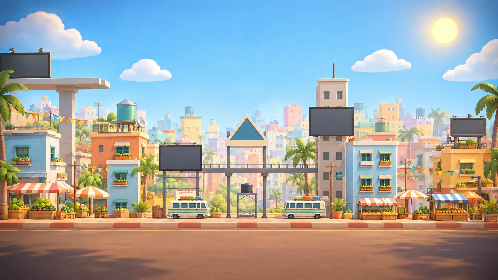

# VS poster backdrops: one plate per map

The match-presentation PR (#218) asked the art side for "a per-map backdrop plate" behind the pre-match VS poster (docs/design/character-feel-research.md §8.3). There is one per map, in the game's own low-poly 3D look, matching the title key art (#211). On the owner's word they are friendly and adventurous: no damage, fire, smoke or weapons.

## Files (`apps/web/public/art/vs/`)

| Map (content `id`) | File | What |
|---|---|---|
| `street-market` | `street-market.{avif,webp}` | the market street on a golden afternoon: colourful blocks, palms, awnings, minibuses, the billboard catwalk |
| `flux-lab` | `flux-lab.{avif,webp}` | the lab hall: glowing cyan tanks, ring coils, catwalks, a pad on the floor |
| `lunar-outpost` | `lunar-outpost.{avif,webp}` | the moon base: the dome, modules, solar panels, a radar dish, Earth rising |
| `storm-front` | `storm-front.{avif,webp}` | the harbour: warehouses, container stacks, the dock crane and the watch tower, a storm breaking into light |
| `movement-test` | `movement-test.{avif,webp}` | a jetpack training yard: ramps, hoops, target boards, control towers |

- **Size:** 1920×1080, 76–154 KB. Serve AVIF with WebP as the fallback.
- **Composition:** the middle is kept calm, since the cards cover it. The detail sits at the left and right edges and in the distance, under a soft darker vignette.
- **Wiring:** draw the plate under `.vs`'s olive vignette, halftone and team slashes (`background-image` beneath today's radial gradient, at reduced opacity if the cards need more contrast), with `object-fit: cover` for the phone's 812×375.
- **Sources:** the full 2688×1520 renders are in `art/vs/<id>.jpg` (JPEG q90).

## How they are made
Higgsfield GPT Image 2.5, high, 2k, 16:9, one each:
- **Style reference:** the key art's sunny-arena plate (job `eb4bbd06…`).
- **Content reference:** each map's own in-game backdrop layer (`assets/backdrops/<map>/…`). Street Market used the market overview render instead, and the training yard has none.
- **Jobs:** `f64c77b9…` (Street Market), `38fe80a8…` (Flux Lab), `70eb2bd0…` (Lunar Outpost), `c11fea1f…` (Storm Front), `21256b55…` (training yard).

The shared part of every prompt (exact text)

"A stylised 3D game environment render in exactly the look of the first reference image: chunky low-poly shapes with clean bevelled edges, flat-shaded painted surfaces, soft ambient occlusion, a polished 3D diorama, NOT photographic. [the map, below] It is the wide backdrop of a pre-match versus screen: player cards will cover the whole middle, so keep the centre calm, soft and uncluttered, with the detail at the left and right edges and in the distance, and a gentle darker vignette at the edges. Friendly, adventurous game mood. No damage, no fire, no smoke, no weapons, no war, no people, no text, no letters, no signs with writing, no logos, no flags."

The maps:
- **Street Market:** "The map STREET MARKET from the second reference image, at a warm golden afternoon: colourful apartment blocks with balconies and palm trees, a market street with striped stall awnings and parasols, a parked minibus, an elevated catwalk with empty billboard frames, strings of bunting, a warm sun and a blue sky with soft clouds."
- **Flux Lab:** "The map FLUX LAB from the second reference image: a clean high-tech laboratory hall with glowing cyan liquid tanks, big ring-shaped energy coils, tidy machinery, catwalks and landing pads, cool white and teal light with a few warm amber accents."
- **Lunar Outpost:** "The map LUNAR OUTPOST from the second reference image: a friendly moon base on grey lunar ground under a starry sky with the blue Earth rising, a geodesic dome, white modules and tanks, rows of solar panels, a radar dish, a small landing pad; cool moonlight with warm lit windows."
- **Storm Front:** "The map STORM FRONT from the second reference image: a harbour with brick warehouses, stacks of colourful shipping containers, a big dock crane and a watch tower, under a dramatic stormy sky with distant rain curtains and a bright break of light in the clouds, wet reflective ground; adventurous, not gloomy."
- **Training yard:** "A TRAINING YARD map: a bright jetpack training course on a sunny day, with ramps, platforms and ledges at different heights, big hoops to fly through, round target boards painted in bright team colours, traffic cones, a small control tower with a windsock, and a clear blue sky with soft clouds." (Its mood line reads "Friendly, sporty game mood".)

## Spend
**13.75 credits:** 5 images at 2.75 each. The Forge stands at **320.50 of its 400**.
